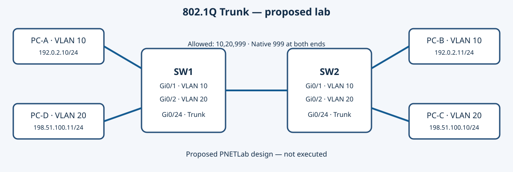

# CCNA NA-02 — Trunk، 802.1Q و Native VLAN

**سطح:** CCNA. **پیش‌نیاز:** NA-01 و NF-15. **اهداف مرتبط:** `2.2.a–c` و بخشی از `2.1.a–b`؛ Inter-VLAN و Voice Port اهداف تکمیلی جداگانه‌اند. **وضعیت:** سناریو، فرمان‌ها و خروجی‌ها طراحی‌شده و اجرا‌نشده؛ مدل و نسخهٔ Switch و Client انتخاب نشده‌اند.

## ۱. هدف‌های یادگیری

توضیح دهید Trunk چرا چند VLAN را از یک لینک عبور می‌دهد، 802.1Q و Native VLAN چه نقشی دارند، VLAN مجاز و فعال را بررسی کنید و خطای عدم تطابق دو سمت یا لیست VLAN را تحلیل کنید.

## ۲. Access در برابر Trunk

Access Port دادهٔ یک VLAN انتهایی را حمل می‌کند؛ Trunk در پلتفرم پشتیبان می‌تواند چند VLAN را روی یک لینک فیزیکی حمل کند. 802.1Q با افزودن Tag مربوط به VLAN به Frameهای مربوط، تفکیک منطقی را روی لینک ممکن می‌کند. Native VLAN در رفتار معمول IOS برای Frameهای بدون Tag روی Trunk استفاده می‌شود؛ جزئیات Tagging، تنظیمات و پلتفرم را بررسی کنید.

تشبیه: Trunk مانند یک راهروی مشترک با بسته‌های برچسب‌دار است؛ این تشبیه به معنی ارسال همهٔ VLANها یا حذف نیاز به کنترل امنیتی نیست.

Default VLAN و Native VLAN دو مفهوم متفاوت‌اند؛ ممکن است هر دو در تنظیم پیش‌فرض شمارهٔ ۱ داشته باشند، اما می‌توان Native VLAN را با طراحی و پشتیبانی محصول تغییر داد. عدم تطابق Native VLAN دو سمت می‌تواند پیامد ناخواسته ایجاد کند؛ باید هر دو سمت با طرح سازگار باشند.



## ۳. توپولوژی و جدول — کاربرگ مستقل PNETLab

**PNETLab مستقل، طراحی‌شده و اجرا‌نشده:** دو Switch لایهٔ ۲ سازگار با 802.1Q، چهار Client، لینک SW1 Gi0/24 به SW2 Gi0/24 و کنسول. ایمیج‌ها و نسخه‌ها تعیین نشده‌اند. Client پیشنهادی VPCS است؛ نسخه و سینتکس باید در محیط هدف بررسی شوند. فرمان‌های پیشنهادی، اجرا‌نشده:

```text
PC-A> ip 192.0.2.10/24
PC-B> ip 192.0.2.11/24
PC-C> ip 198.51.100.10/24
PC-D> ip 198.51.100.11/24
```

```text
PC-A VLAN10 ─ Gi0/1 [SW1] Gi0/24 ══ Trunk 802.1Q ══ Gi0/24 [SW2] Gi0/1 ─ PC-B VLAN10
PC-D VLAN20 ─ Gi0/2         VLAN 10,20,999          Gi0/2 ─ PC-C VLAN20
                             Native 999 / 999
```

| مؤلفه | VLAN | آدرس فرضی | نقش |
|---|---:|---|---|
| PC-A در SW1 Gi0/1 | 10 | `192.0.2.10/24` | Client داده |
| PC-B در SW2 Gi0/1 | 10 | `192.0.2.11/24` | Client داده |
| PC-C در SW2 Gi0/2 | 20 | `198.51.100.10/24` | Client شبکهٔ 20 سمت SW2 |
| PC-D در SW1 Gi0/2 | 20 | `198.51.100.11/24` | Client شبکهٔ 20 سمت SW1 |
| Native Trunk دو سمت | 999 | ندارد | VLAN بدون Client در سناریو |

VLANهای مجاز Trunk شامل `10,20,999` هستند. هیچ روتر یا Gateway بین VLANها تنظیم نشده است.

## ۴. پیکربندی پیشنهادی

**همهٔ فرمان‌ها اجرا‌نشده و وابسته به مدل/نسخه‌اند.** در برخی پلتفرم‌ها نحو انتخاب Encapsulation یا نام رابط متفاوت است. VLANها را روی هر دو Switch بسازید.

SW1:

```text
configure terminal
vlan 10
 name USERS
vlan 20
 name OTHER
vlan 999
 name NATIVE
interface GigabitEthernet0/1
 switchport mode access
 switchport access vlan 10
 no shutdown
interface GigabitEthernet0/2
 switchport mode access
 switchport access vlan 20
 no shutdown
interface GigabitEthernet0/24
 switchport mode trunk
 switchport trunk native vlan 999
 switchport trunk allowed vlan 10,20,999
 no shutdown
end
```

SW2:

```text
configure terminal
vlan 10
 name USERS
vlan 20
 name OTHER
vlan 999
 name NATIVE
interface GigabitEthernet0/1
 switchport mode access
 switchport access vlan 10
 no shutdown
interface GigabitEthernet0/2
 switchport mode access
 switchport access vlan 20
 no shutdown
interface GigabitEthernet0/24
 switchport mode trunk
 switchport trunk native vlan 999
 switchport trunk allowed vlan 10,20,999
 no shutdown
end
```

`vlan` و `name` VLAN و نام آن را مشخص می‌کنند؛ `switchport mode access` و `switchport access vlan` پورت Client را تنظیم می‌کنند. `switchport mode trunk` نقش Trunk، `native vlan` VLAN بدون Tag طبق رفتار پلتفرم و `allowed vlan` مجموعهٔ مجاز لینک را تعیین می‌کنند. فرمان `allowed vlan` در این شکل **فهرست قبلی را جایگزین می‌کند**؛ این نمونه فقط در آزمایشگاه مستقل است، نه تغییر مستقیم لینک عملیاتی. `no shutdown` رابط را از Shutdown اداری خارج می‌کند.

## ۵. Verification و نتیجهٔ مورد انتظار

**فرمان‌ها و خروجی نمونهٔ آموزشی، اجرا‌نشده:**

```text
SW1# show interfaces trunk
Port      Mode  Encapsulation  Status    Native vlan
Gi0/24    on    802.1q         trunking  999

Port      Vlans allowed on trunk
Gi0/24    10,20,999

SW1# show vlan brief
VLAN Name                             Status    Ports
10   USERS                            active    Gi0/1
20   OTHER                            active    Gi0/2
999  NATIVE                           active
```

`Status trunking` وضعیت عملیاتی نمونه، `Native vlan` VLAN بومی و فهرست Allowed، VLANهای مجاز را نشان می‌دهد. مجاز بودن، به‌تنهایی فعال بودن VLAN و Forwarding آن را اثبات نمی‌کند؛ فهرست VLANهای active و وضعیت STP نیز بررسی شوند. Trunk الزاماً در ستون Access Ports خروجی `show vlan brief` دیده نمی‌شود.

**انتظار طراحی:** پس از آدرس‌دهی، PC-A↔PC-B باید در VLAN/Subnet 10 و PC-D↔PC-C در VLAN/Subnet 20 ارتباط محلی داشته باشند، مشروط به VLAN فعال، Trunk، STP، لینک و پاسخ ICMP Client. دو جفت Gateway ندارند؛ بین VLANها Routing وجود ندارد. فایروال Client و وضعیت رابط می‌توانند Ping را تحت تأثیر قرار دهند.

### نقص‌های کنترل‌شده، بازگشت و معیار موفقیت

**فقط در لاب ایزوله و پس از Snapshot:**

1. روی SW1، رابط `Gi0/24` را انتخاب و موقتاً `switchport trunk allowed vlan 10,999` را تنظیم کنید. انتظار: PC-D و PC-C در VLAN 20 دیگر از طریق Trunk به هم نمی‌رسند؛ PC-A/PC-B در VLAN 10 باید تحت شرط‌های بالا ارتباط داشته باشند. `show interfaces trunk` را در هر دو سمت بگیرید.
2. Allowed list SW1 را دقیقاً به `10,20,999` برگردانید و آزمون VLAN 20 را دوباره انجام دهید.
3. برای آزمایش Native mismatch، VLAN 998 بدون Client را روی هر دو Switch بسازید و در رابط `Gi0/24` هر دو طرف `switchport trunk allowed vlan add 998` بزنید تا Native mismatch با حذف VLAN از Allowed List اشتباه نشود. سپس فقط در SW2 روی `Gi0/24` مقدار `switchport trunk native vlan 998` را تنظیم کنید؛ روی SW1 مقدار 999 بماند. با `show interfaces trunk` هر دو سمت و، در صورت فعال‌بودن CDP، پیام mismatch را بررسی کنید؛ قالب پیام نسخه‌محور است. هیچ Endpointی روی Native VLANها نیست، پس از این آزمون Ping سرویس نتیجه نگیرید. بازیابی: روی SW2 `switchport trunk native vlan 999` بزنید و Allowed list هر دو سمت را به `10,20,999` برگردانید.
4. از Snapshot/پیکربندی اولیه بازگردید، دوباره خروجی Trunk، VLAN و چهار PC را ثبت کنید. تغییر Allowed یا Native روی شبکهٔ عملیاتی بدون Change Plan و مجوز ممنوع است.
**معیار تحویل:** Image/Version و نام پورت‌ها ثبت؛ VLAN/Access membership دو سمت درست؛ Trunk هر دو سمت Operational با 802.1Q و Native 999؛ VLANهای 10/20/999 مجاز و فعال؛ هر دو جفت هم‌VLAN آزمایش؛ دو نقص با شاهد تشخیص و بازیابی؛ خروجی واقعی timestamped و پاک‌سازی‌شده ضمیمه شود. **در این سند فقط طرح و خروجی آموزشی وجود دارد؛ آزمایش اجرا نشده است.**

## ۶. عیب‌یابی

| نشانه | مسیر بررسی | نکته |
|---|---|---|
| A و B ارتباط ندارند | VLAN و Access Port، Trunk عملیاتی، VLAN مجاز/فعال، STP و IP | تنها وجود Trunk موفقیت سرویس را تضمین نمی‌کند |
| Native VLAN دو سمت متفاوت است | `show interfaces trunk` در هر دو سمت و طرح مصوب | تغییر روی شبکهٔ عملیاتی نیازمند مجوز و برنامه است |
| VLAN 10 در Allowed نیست | فهرست دو سمت و تنظیمات | جایگزینی فهرست ممکن است VLANهای دیگر را قطع کند |
| یک VLAN فعال نیست | وجود VLAN محلی و وضعیت پورت/تصویر | نام VLAN به‌تنهایی وضعیت Forwarding را ثابت نمی‌کند |

## ۷. سؤال‌های سناریویی و پاسخ

1. **Trunk چه مزیتی دارد؟** حمل چند VLAN روی لینک مشترک، مطابق تنظیم و قابلیت پلتفرم.
2. **802.1Q چه می‌کند؟** برچسب VLAN را برای تفکیک Frameهای مربوط اضافه می‌کند.
3. **Native VLAN در مثال چیست؟** VLAN 999 روی هر دو سمت، با رفتار بدون Tag وابسته به پیکربندی.
4. **Default VLAN و Native VLAN یک مفهوم‌اند؟** خیر، ممکن است شمارهٔ یکسان داشته باشند ولی نقش متفاوت است.
5. **VLAN در Allowed است؛ آیا Forwarding قطعی است؟** خیر، فعال بودن VLAN، STP و رابط هم مهم‌اند.
6. **چرا دو سمت Trunk باید بررسی شوند؟** نقش، Allowed و Native ممکن است متفاوت باشند.
7. **چرا `allowed vlan` ریسک عملیاتی دارد؟** می‌تواند فهرست موجود را جایگزین و VLANهای دیگر را قطع کند.
8. **A و B حتماً Ping موفق دارند؟** خیر؛ Client، فایروال و IP نیز باید درست باشند.
9. **A بدون Router به VLAN 20 می‌رسد؟** در سناریوی حاضر مسیر لایهٔ ۳ تعریف نشده است.
10. **Trunk حتماً در پورت‌های Access خروجی VLAN فهرست است؟** خیر، باید `show interfaces trunk` و خروجی پلتفرم بررسی شود.
11. **آیا نام Gi0/24 در هر ایمیج وجود دارد؟** خیر؛ نام رابط و نسخه هنوز مشخص نیست.
12. **آیا این سناریو روی PNETLab اجرا شده است؟** خیر، طراحی آموزشی است.

## واژه‌نامه و چک‌لیست

Trunk: لینک حامل VLANهای متعدد؛ 802.1Q: استاندارد Tagging؛ Native VLAN: VLAN مربوط به فریم بدون Tag طبق تنظیم؛ Allowed VLAN: VLAN مجاز روی Trunk.

- [ ] Native و Default را تفکیک می‌کنم.
- [ ] هر دو سر Trunk و وضعیت فعال/STP را بررسی می‌کنم.
- [ ] ریسک جایگزینی فهرست VLAN را قبل از تغییر می‌شناسم.
