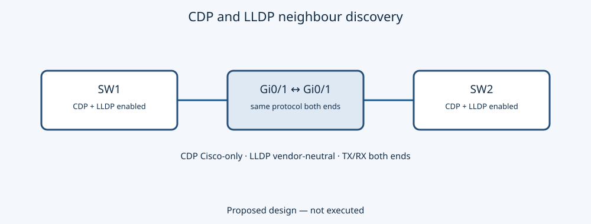

# CCNA NA-05 — کشف همسایهٔ مستقیم با CDP و LLDP

**سطح:** CCNA. **پیش‌نیاز:** NF-01، NF-06 و آشنایی CLI. **هدف مرتبط:** `2.3` Configure and verify Layer 2 discovery protocols (CDP and LLDP). **وضعیت:** پیش‌نویس؛ فرمان‌ها، خروجی و سناریو طراحی‌شده و اجرا‌نشده‌اند. تصویر و نسخهٔ IOS انتخاب نشده‌اند.

## اهداف

CDP و LLDP را در نقش کشف همسایهٔ مستقیم مقایسه کنید، تنظیم سراسری و رابط را در سناریوی آزمایشی بشناسید، خروجی Neighbor را تفسیر و نبود همسایه را با بررسی دو سمت تشخیص دهید.

## ۱. چرا Discovery؟

مدیر شبکه برای مستندسازی و عیب‌یابی می‌خواهد بداند کدام پورت به کدام تجهیز متصل است. CDP یک پروتکل Cisco و LLDP یک استاندارد باز برای اعلام اطلاعات همسایهٔ مستقیم‌اند. اطلاعاتی مانند شناسه، پورت و قابلیت‌ها بسته به پروتکل، پلتفرم و تنظیمات ارائه می‌شوند.

دیدن همسایه به معنی سلامت IP، صحت Routing یا دسترسی به سرویس نیست. این پیام‌ها اطلاعات زیرساخت را آشکار می‌کنند؛ در طراحی امن، محل فعال‌سازی و غیرفعال‌سازی باید مطابق سیاست سازمان تعیین شود. CDP/LLDP معمولاً همسایهٔ مستقیم لایهٔ ۲ را نشان می‌دهند، نه نقشهٔ کامل شبکه.

## ۲. سناریوی دو Switch

**PNETLab مستقل، طراحی‌شده و اجرا‌نشده:** دو Switch IOS دارای CDP و LLDP، یک لینک و دو کنسول. نام تصویر، نسخه و پورت‌ها هنوز تأیید نشده‌اند. از Gi0/1 برای لینک SW1 به SW2 استفاده می‌کنیم؛ آدرس IP یا VLAN خاصی برای مفهوم Discovery لازم نیست.

```text
[SW1 Gi0/1] ───── Ethernet ───── [Gi0/1 SW2]
```



## ۳. پیکربندی پیشنهادی

**فرمان‌ها اجرا‌نشده و وابسته به IOS هدف‌اند.** روی هر دو Switch:

```text
configure terminal
cdp run
lldp run
interface GigabitEthernet0/1
 cdp enable
 lldp transmit
 lldp receive
 no shutdown
end
```

`cdp run` و `lldp run` سرویس مربوط را در سطح سراسری فعال می‌کنند. `cdp enable` CDP و `lldp transmit/receive` ارسال و دریافت LLDP را روی رابط پشتیبان فعال می‌کنند. فعال‌بودن سراسری و رابط و وضعیت طرف مقابل همه مهم‌اند. نحو و پیش‌فرض‌ها بر اساس نسخه متفاوت‌اند. این تنظیمات فقط برای محیط آزمایشی مستقل‌اند، نه پیشنهاد فعال‌سازی سراسری در شبکهٔ واقعی.

## ۴. Verification

**فرمان و خروجی نمونه، اجرا‌نشده:**

```text
SW1# show cdp neighbors
Device ID  Local Intrfce  Holdtme  Capability  Platform  Port ID
SW2        Gig 0/1        145      S I         Switch    Gig 0/1

SW1# show lldp neighbors
Device ID  Local Intf  Hold-time  Capability  Port ID
SW2        Gi0/1       120        B           Gi0/1
```

Device ID شناسهٔ اعلام‌شدهٔ طرف مقابل، Local Interface رابط محلی، Port ID رابط اعلام‌شدهٔ همسایه و Hold-time زمان نگهداری گزارش‌شده‌اند. Capability و Platform وابسته به پلتفرم‌اند. یک Device ID نمونه، هویت امنیتی تأییدشده نیست؛ LLDP و CDP کشف همسایه را با احراز هویت دستگاه یکسان نمی‌کنند.

فرمان‌های `show cdp interface GigabitEthernet0/1` و `show lldp interface GigabitEthernet0/1` در پلتفرم‌های پشتیبان برای وضعیت هر رابط مفیدند. نحو و خروجی واقعی باید با ایمیج انتخاب‌شده بررسی شوند.

## ۵. کاربرگ مستقل PNETLab — کشف همسایه و آزمون یک‌طرفه

**هدف رسمی `2.3`:** CDP و LLDP را پیکربندی و وضعیت همسایه را Verification کنید. **این کاربرگ طراحی‌شده و اجرا‌نشده است.** یک IOSv/IOL با قابلیت‌های لایهٔ ۲، نسخهٔ IOS، پورت‌های واقعی و License را پیش از اجرا ثبت کنید. برای این تمرین به IP و Router نیاز نیست؛ فقط یک لینک مستقیم لایهٔ ۲ میان دو Switch لازم است.

```text
SW1 Gi0/1 ───────── Gi0/1 SW2
```

**پیش‌نیاز/جدول گره‌ها:** SW1 و SW2 روشن، Console در دسترس، کابل مجازی به پورت‌های Gi0/1، بدون اتصال به LAN بیرونی. آزمون فقط در پروژهٔ ایزوله و با مجوز انجام شود؛ اطلاعات Discovery می‌تواند نام/مدل/پورت را افشا کند.

### مراحل اجرا و شواهد

1. ثبت کنسول، `show version`، `show interfaces status` و `show cdp neighbors`/`show lldp neighbors` را بگیرید؛ خروجی پیش از تغییر، رابط‌ها و سرویس‌های پیش‌فرض را نشان دهد.
2. روی هر دو Switch، اگر دستورات در نسخهٔ هدف پشتیبانی می‌شوند، سرویس سراسری CDP/LLDP را فعال و روی Gi0/1 ارسال/دریافت را روشن کنید. الگوی §۳ نمونه است؛ با `?` نحو را تأیید کنید.
3. هر دو سمت را بررسی کنید: `show cdp neighbors detail` و `show lldp neighbors detail` (یا فرمان معادل مستندشده). Device ID، Local Interface، Port ID، Capability، عمر گزارش و سیستم‌عامل/Platform را ثبت کنید؛ MAC/مدل را به هویت رمزنگاری‌شده تعبیر نکنید.
4. **نقص کنترل‌شده:** فقط روی SW2، LLDP Receive را روی Gi0/1 غیرفعال کنید. انتظار منطقی این است که SW2 دیگر تبلیغات SW1 را نبیند، اما SW1 ممکن است همچنان تبلیغ SW2 را دریافت کند؛ وضعیت CDP باید مستقل بماند. خروجی واقعی به Image/نسخه وابسته است.
5. LLDP Receive را در SW2 برگردانید؛ دو سمت را دوباره مشاهده کنید و بازگشت اطلاعات همسایه را ثبت کنید. سپس در صورت نیاز تنظیمات موقت را طبق Snapshot پاک کنید.

### Troubleshooting و معیار موفقیت

| شاهد/نشانه | بررسی |
|---|---|
| هیچ Neighbor دیده نمی‌شود | پورت و کابل مجازی، Link/err-disable، فعال‌بودن پروتکل سراسری و رابطی در هر دو سمت، Hold-time و پشتیبانی Image |
| فقط یک سمت LLDP می‌بیند | TX هر سمت و RX همان سمت را جدا بررسی کنید؛ `show lldp interface` در صورت پشتیبانی |
| CDP هست ولی LLDP نیست | این دو پروتکل تنظیم/پشتیبانی مستقل دارند؛ هم‌زمان‌بودنشان را فرض نکنید |
| Port ID با Label لاب فرق دارد | کابل واقعی و رابط محلی را تطبیق دهید؛ Device ID/Port ID متنی می‌تواند تغییر کند |

**تحویل:** Image/نسخه و توپولوژی ثبت شده، دو پروتکل را از هم جدا توضیح داده‌اید، خروجی دو سمت قبل/بعد از نقص را دارید، و پس از بازگردانی، همسایهٔ مجاز دوباره دیده می‌شود. Ping یا Neighbor به‌تنهایی سلامت IP/سرویس را ثابت نمی‌کند. هیچ نتیجهٔ واقعی در این نسخه ثبت نشده است.

## ۶. سؤال‌ها و پاسخ

1. **CDP و LLDP چه نقش مشترکی دارند؟** اعلام اطلاعات همسایهٔ مستقیم در لایهٔ ۲.
2. **LLDP استاندارد باز است؟** بله؛ CDP وابسته به Cisco است.
3. **دیدن Neighbor یعنی Routing سالم است؟** خیر، Discovery اتصال سرویس یا مسیر IP را تأیید نمی‌کند.
4. **Port ID چه می‌گوید؟** شناسهٔ رابط اعلام‌شدهٔ همسایه، در قالب وابسته به پلتفرم.
5. **Local Interface چیست؟** پورت محلی که پیام Neighbor روی آن دیده شده است.
6. **چرا LLDP ممکن است یک‌طرفه باشد؟** تفاوت transmit/receive، وضعیت لینک یا پشتیبانی دو سمت ممکن است نقش داشته باشد.
7. **Device ID، احراز هویت امن دستگاه است؟** خیر، باید با کنترل‌ها و مستندات دیگر تأیید شود.
8. **سرویس سراسری فعال است؛ رابط الزاماً فعال است؟** خیر، هر دو سطح باید بررسی شوند.
9. **قبل از فعال‌سازی عملیاتی چه می‌کنیم؟** سیاست افشای اطلاعات، مجوز و پیامدها را بررسی می‌کنیم.
10. **Hold-time به چه اشاره دارد؟** زمان نگهداری اطلاعات همسایه طبق خروجی پلتفرم.
11. **چرا دو سمت را مشاهده می‌کنیم؟** ارسال، دریافت و کابل‌کشی ممکن است نامتقارن باشند.
12. **این خروجی آزمایش واقعی است؟** خیر، نمونهٔ آموزشی است.

## واژه‌نامه و چک‌لیست

CDP: کشف همسایه Cisco؛ LLDP: کشف استاندارد باز؛ Hold-time: زمان نگهداری اطلاعات؛ Neighbor: همسایهٔ مستقیم در این درس.

- [ ] Local Interface و Port ID را جدا می‌خوانم.
- [ ] Discovery را با احراز هویت یا Routing یکی نمی‌دانم.
- [ ] مجوز و افشای اطلاعات را پیش از تغییر بررسی می‌کنم.
