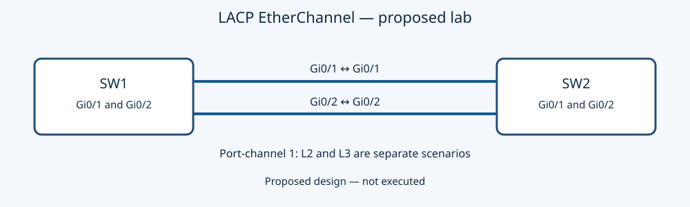

# CCNA NA-06 — EtherChannel لایهٔ ۲ و ۳ با LACP

**سطح:** CCNA. **پیش‌نیاز:** NA-01، NA-02 و IPv4. **هدف رسمی مرتبط:** `2.4` Configure and verify Layer 2/Layer 3 EtherChannel (LACP). **وضعیت:** هر دو کاربرگ، فرمان‌ها و خروجی‌ها طراحی‌شده و اجرا‌نشده‌اند؛ مدل، ایمیج، نام رابط‌ها و نسخهٔ IOS انتخاب نشده است.

## ۱. هدف و مفهوم

دانشجو نقش Port-channel و LACP را توضیح دهد، سناریوهای لایهٔ ۲ و لایهٔ ۳ را جدا پیکربندی و وضعیت عضوها را تفسیر کند. EtherChannel چند لینک فیزیکی سازگار را به یک رابط منطقی گروه می‌کند؛ STP در سناریوی لایهٔ ۲ Port-channel را به‌عنوان لینک منطقی در نظر می‌گیرد. Load balancing بر اساس الگوریتم پلتفرم است؛ یک جریان واحد لزوماً مجموع پهنای باند همهٔ لینک‌ها را دریافت نمی‌کند.

**LACP** سازوکار مذاکره برای تشکیل گروه است؛ حالت `active` به‌طور فعال مذاکره می‌کند، `passive` به درخواست پاسخ می‌دهد. دو سمت passive بدون شروع LACP از طرف دیگر به‌طور معمول گروه تشکیل نمی‌دهند. شمارهٔ Channel-group در دو دستگاه لزوماً یکسان نیست، اما در این سناریو برای خوانایی 1 است.

پیش از تشکیل گروه، ویژگی‌های لازم پورت‌ها مانند سرعت، Duplex، نوع لایهٔ ۲/۳ و در حالت L2 پارامترهای Trunk/VLAN باید با الزام پلتفرم سازگار باشند. PAgP و Static `on` جایگزین LACP در این کاربرگ نیستند.



## ۲. کاربرگ A — EtherChannel لایهٔ ۲

**PNETLab مستقل، اجرا‌نشده:** دو Switch سازگار با LACP و Trunk، دو لینک `Gi0/1` و `Gi0/2`، دو کنسول. Clientها اختیاری‌اند؛ برای تمرین عبور VLAN، از آدرس‌دهی و پورت Access کاربرگ NA-02 استفاده کنید. نام تصویر و نسخه هنوز تأیید نشده‌اند.

```text
SW1 Gi0/1 ───── Gi0/1 SW2
SW1 Gi0/2 ───── Gi0/2 SW2
       دو لینک، یک Port-channel 1، VLAN 10 و 20
```

روی **هر دو Switch**، فرمان‌های زیر پیشنهادی و اجرا‌نشده‌اند:

```text
configure terminal
vlan 10
vlan 20
interface range GigabitEthernet0/1 - 2
 switchport mode trunk
 switchport trunk allowed vlan 10,20
 channel-group 1 mode active
 no shutdown
interface Port-channel1
 switchport mode trunk
 switchport trunk allowed vlan 10,20
 no shutdown
end
```

`interface range` اعضا را انتخاب می‌کند؛ حالت و VLANهای مجاز با Port-channel سازگار تنظیم می‌شوند؛ `channel-group 1 mode active` LACP را درخواست می‌کند؛ `interface Port-channel1` تنظیمات رابط منطقی را تعیین می‌کند. `allowed vlan 10,20` فهرست موجود را جایگزین می‌کند و بدون بررسی روی شبکهٔ عملیاتی مجاز نیست. دستور و ترتیب دقیق وابسته به پلتفرم است.

### Verification A

**فرمان و خروجی آموزشی، اجرا‌نشده:**

```text
SW1# show etherchannel summary
Group  Port-channel  Protocol    Ports
1      Po1(SU)       LACP        Gi0/1(P) Gi0/2(P)
```

در قالب متداول IOS، `S` نشان L2، `U` استفاده‌شدن Port-channel و `P` بسته‌بندی عضو در گروه است. علائم و قالب را برای نسخهٔ هدف بررسی کنید؛ وضعیت خلاصه اثبات عبور هر VLAN یا سلامت ارتباط انتهابه‌انتها نیست.

```text
show interfaces Port-channel1 trunk
show spanning-tree vlan 10
show interfaces GigabitEthernet0/1
```

وضعیت VLAN مجاز و فعال، نقش STP و خطاهای عضوها را روی هر دو Switch بررسی کنید؛ خروجی واقعی هنوز وجود ندارد.

### نقص کنترل‌شده و بازیابی A

فقط در Lab و پس از ثبت حالت اولیه: روی **هر دو** Switch، LACP اعضا را موقتاً از `active` به `passive` تغییر دهید. چون دو طرف منتظر شروع مذاکره می‌مانند، انتظار می‌رود عضوهای `P` بسته‌بندی نشوند و Port-channel عملیاتی نباشد؛ شکل دقیق State نسخه‌محور است. سپس یک سمت (مثلاً SW1) را به `active` و سمت دیگر را به `passive` بازگردانید؛ انتظار می‌رود LACP دوباره تشکیل شود. قبل/بعد را با `show etherchannel summary` و neighbor/status پشتیبانی‌شده ثبت کنید. اگر همان IOS تغییر Mode را درجا نپذیرفت، گروه را طبق رویهٔ لاب بازسازی کنید؛ دستور حذف گروه را روی شبکهٔ واقعی اجرا نکنید.

سپس یک عضو را موقتاً `shutdown` کنید: اگر `min-links`/پلتفرم اجازه دهد، لینک منطقی باید با عضو باقی‌مانده کار کند؛ وضعیت عضو را ثبت و `no shutdown` کنید. این آزمون، افزونگی کامل یا ظرفیت دوبرابر را ثابت نمی‌کند. **معیار موفقیت A:** دو عضو در حالت عادی با LACP در Po1 بسته‌بندی شوند؛ آزمایش passive/passive تشکیل گروه را متوقف کند؛ active/passive دوباره گروه را بسازد؛ عضو خاموش‌شده پس از بازیابی برگردد؛ خروجی زمان‌دار و Image/Version ثبت شود. هیچ آزمایشی اجرا نشده است.

## ۳. کاربرگ B — EtherChannel لایهٔ ۳

**سناریوی مستقل، نه ادامهٔ پیکربندی L2:** دو Switch لایهٔ ۳ سازگار با Routed Port و LACP، دو لینک `Gi0/1` و `Gi0/2` و شبکهٔ مستقیم `192.0.2.0/30`؛ تصویر و نسخه باید پیش از اجرا تعیین شوند. آدرس‌ها مستنداتی‌اند. سناریو را از تنظیمات خالی و در محیط ایزوله بسازید؛ تبدیل Port-channel موجود در محیط واقعی بدون برنامه خطرناک است.

| Switch | رابط منطقی | آدرس |
|---|---|---|
| SW1 | Port-channel1 | `192.0.2.1/30` |
| SW2 | Port-channel1 | `192.0.2.2/30` |

**پیکربندی پیشنهادی SW1، اجرا‌نشده:**

```text
configure terminal
interface range GigabitEthernet0/1 - 2
 no switchport
 channel-group 1 mode active
 no shutdown
interface Port-channel1
 no switchport
 ip address 192.0.2.1 255.255.255.252
 no shutdown
end
```

**SW2، پیشنهادی و اجرا‌نشده:**

```text
configure terminal
interface range GigabitEthernet0/1 - 2
 no switchport
 channel-group 1 mode active
 no shutdown
interface Port-channel1
 no switchport
 ip address 192.0.2.2 255.255.255.252
 no shutdown
end
```

`no switchport` رابط پشتیبان را Routed می‌کند؛ IP روی رابط منطقی Port-channel است، نه هر عضو. ترتیب ایجاد و قابلیت L3 EtherChannel باید روی مدل/نسخه بررسی شود.

### Verification B

**فرمان‌های پیشنهادی، اجرا‌نشده:**

```text
show etherchannel summary
show ip interface brief
show ip route connected
ping 192.0.2.2
```

انتظار طراحی، Port-channel لایهٔ ۳ با اعضای مناسب، آدرس و مسیر Connected و پاسخ Ping از SW1 است. هیچ نمونهٔ خروجی یا نتیجهٔ واقعی برای این حالت ثبت نشده است.

### نقص کنترل‌شده و بازیابی B

در محیط ایزوله، یک عضو SW1 را موقتاً با `shutdown` متوقف کنید. `show etherchannel summary` و `show ip interface brief` را بگیرید و دوباره از SW1 به `192.0.2.2` Ping کنید؛ با باقی‌ماندن عضو سالم و نبود محدودیت `min-links`، طراحی انتظار دارد Port-channel و ارتباط روی عضو باقی‌مانده برقرار بمانند. این نتیجه را از پیش تضمین نکنید؛ شرط، نسخه و تنظیم min-links را ثبت کنید. سپس `no shutdown` و همهٔ وضعیت‌ها/پینگ را دوباره بررسی کنید. اگر ارتباط از دست رفت، Port-channel را حذف نکنید؛ اول وضعیت هر دو سمت، LACP و مسیر را ثبت و طبق Snapshot بازگردانی کنید.

**معیار موفقیت B:** حالت عادی هر دو عضو را در گروه نشان دهد؛ آدرس روی رابط منطقی و Route متصل مشاهده شود؛ آزمون Ping پایه ثبت شود؛ نقص یک عضو و اثر آن، بازیابی عضو و بازگشت به وضعیت اصلی ثبت شوند. Image/Version و پشتیبانی L3 EtherChannel باید در تحویل درج شود. این آزمون طراحی شده و اجرا‌نشده است.

## ۴. عیب‌یابی

| نشانه | بررسی |
|---|---|
| عضو در گروه نیست | حالت LACP دو طرف، سازگاری اعضا، خطا و وضعیت فیزیکی را با `show etherchannel summary` و رابط‌ها بررسی کنید |
| Port-channel L2 بالا ولی VLAN عبور نمی‌کند | تنظیم Trunk، Allowed/Active و STP دو سمت را بررسی کنید |
| حالت L3 Ping ندارد | آدرس، ماسک، وضعیت Port-channel، اعضا و فیلتر را بررسی کنید |
| یک جریان به سرعت مجموع نمی‌رسد | الگوریتم Load balancing پلتفرم را بشناسید؛ مجموع ظرفیت الزاماً برای یک جریان نیست |

تغییر اعضا، حذف گروه یا تنظیم سرعت روی شبکهٔ عملیاتی نیازمند مجوز و برنامهٔ بازگشت است.

## ۵. سؤال‌های سناریویی با پاسخ

1. **EtherChannel چیست؟** گروه‌بندی چند لینک فیزیکی در رابط منطقی Port-channel.
2. **LACP active و passive چه تفاوتی دارند؟** Active مذاکره را آغاز می‌کند؛ Passive پاسخ می‌دهد.
3. **دو سمت Passive معمولاً گروه می‌سازند؟** خیر، طرفی باید مذاکره را آغاز کند.
4. **`P` در خروجی نمونه چیست؟** عضو بسته‌بندی‌شده در گروه در قالب متداول IOS؛ نسخه بررسی شود.
5. **`SU` چه مفهومی دارد؟** در نمونهٔ IOS، L2 و Port-channel در حال استفاده است؛ معنی علائم نسخه‌محور است.
6. **یک جریان حتماً دو برابر سرعت می‌گیرد؟** خیر، الگوریتم Load balancing و جریان تعیین‌کننده‌اند.
7. **آیا IP را روی تک‌تک اعضای L3 می‌گذاریم؟** در سناریوی پیشنهادی IP روی Port-channel منطقی است.
8. **Port-channel بالا است؛ همهٔ VLANها عبور می‌کنند؟** لزوماً خیر، Allowed/Active و STP بررسی شوند.
9. **تنظیم L2 را مستقیماً به L3 در شبکهٔ واقعی تغییر می‌دهیم؟** خیر؛ طرح، مجوز و اثر و بازگشت لازم است.
10. **آیا شمارندهٔ عضوها می‌تواند متفاوت باشد؟** بله، توزیع جریان‌ها به الگوریتم بستگی دارد.
11. **آیا شمارهٔ گروه دو سمت الزاماً یکسان است؟** خیر؛ در مثال فقط برای خوانایی یکسان است.
12. **آیا این دو کاربرگ اجرا شده‌اند؟** خیر؛ تصویر و نتیجهٔ واقعی مشخص نیستند.

## واژه‌نامه و چک‌لیست

LACP: مذاکرهٔ تجمیع لینک؛ Port-channel: رابط منطقی گروه؛ عضو: رابط فیزیکی گروه؛ Load balancing: توزیع جریان‌ها بر اساس الگوریتم پلتفرم.

- [ ] L2 و L3 Port-channel را جدا می‌سازم و تفسیر می‌کنم.
- [ ] مذاکره و سازگاری دو سمت را بررسی می‌کنم.
- [ ] وضعیت گروه را با اثبات عبور VLAN یا Ping یکی نمی‌گیرم.
