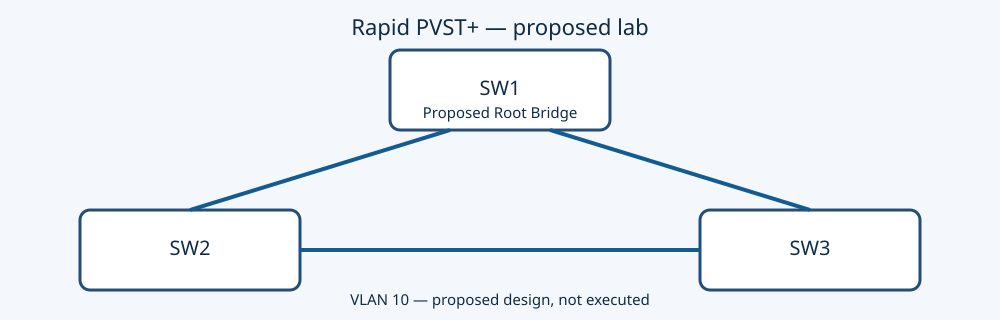

# CCNA NA-07 — Rapid PVST+، نقش پورت‌ها و محافظت‌های STP

**سطح:** CCNA. **پیش‌نیاز:** NA-01، NA-02 و NF-15. **اهداف رسمی:** `2.5.a` تفسیر Root Port، Root Bridge (Primary/Secondary) و نام‌های دیگر پورت؛ `2.5.b` تفسیر حالت‌ها و نقش‌های پورت؛ `2.5.c` تفسیر PortFast؛ `2.5.d` تفسیر Root Guard، Loop Guard، BPDU Filter و BPDU Guard. **وضعیت:** پیش‌نویس محتوایی؛ طراحی عملی انجام شده و **اجرا نشده** است. مدل Switch، نام ایمیج و نسخهٔ IOS انتخاب نشده‌اند. همهٔ خروجی‌ها نمونهٔ طراحی‌شده‌اند، نه خروجی ثبت‌شده.

## اهداف

1. توضیح دهید چرا حلقهٔ لایهٔ ۲ خطرناک است و STP چگونه آن را به درخت تبدیل می‌کند.
2. Root Bridge را از Bridge ID پیش‌بینی کنید و نقش هر پورت را تعیین کنید.
3. خروجی `show spanning-tree` را خط‌به‌خط بخوانید و بگویید هر عدد از کجا می‌آید.
4. PortFast و چهار محافظت STP را در جای درست خود به‌کار ببرید و اثر اشتباه‌شان را تشخیص دهید.

## ۱. چرا STP لازم است؟

سه Switch را در نظر بگیرید که مثلثی به هم وصل شده‌اند. یک فریم Broadcast از PC1 وارد می‌شود. Switch آن را از هر دو پورت دیگر خارج می‌کند. Switch بعدی هم همین کار را می‌کند و فریم دوباره به Switch اول برمی‌گردد. چون Broadcast در Ethernet TTL ندارد، این چرخه تا اشباع لینک‌ها ادامه می‌یابد (**Broadcast Storm**). هم‌زمان، MAC یک دستگاه از دو پورت مختلف دیده می‌شود و جدول MAC ناپایدار می‌شود (**MAC Flapping**).

STP این مسئله را با **مسدود کردن منطقی** بعضی پورت‌ها حل می‌کند، نه با حذف کابل. لینک فیزیکی باقی می‌ماند و اگر لینک فعال قطع شود، STP پورت مسدود را جایگزین می‌کند.

**Rapid PVST+** دو ویژگی دارد که نامش را توضیح می‌دهد:

- **Rapid** (بر پایهٔ RSTP): سازوکار همگرایی سریع‌تری از STP کلاسیک دارد؛ زمان واقعی به توپولوژی، سازگاری همسایه‌ها، وضعیت لینک و پلتفرم وابسته است و تضمین زمانی ثابتی نیست.
- **PVST+** (Per-VLAN): برای هر VLAN یک نمونهٔ جداگانهٔ Spanning Tree با Root و توپولوژی مستقل.

Per-VLAN بودن یعنی می‌توانید با Priority متفاوت، ترافیک یک VLAN را از یک لینک و VLAN دیگر را از لینک دیگر بفرستید (**Load Balancing**). این کار با STP تک‌نمونه‌ای ممکن نیست چون فقط یک درخت وجود دارد.

## ۲. Bridge ID و انتخاب Root

Root Bridge سوئیچی است که **کمترین Bridge ID** را دارد. Bridge ID در PVST+ شامل اولویت ۴‌بیتی، System ID Extension دوازده‌بیتی (معمولاً شناسهٔ VLAN) و MAC Address شش‌بایتی است:

```text
Bridge ID = (Bridge Priority + System ID Extension) + MAC Address
```

نکته‌ای که در آزمون و در کار واقعی مهم است: در PVST+ مقدار دو بایتی Priority از **Priority پیکربندی‌شده + System ID Extension (شمارهٔ VLAN)** ساخته می‌شود.

```text
Priority در خروجی = Priority پیکربندی‌شده + VLAN ID
```

پس اگر روی VLAN 10 مقدار `4096` بگذارید، در خروجی `4106` می‌بینید. اگر چیزی تنظیم نکنید، پیش‌فرض `32768` است و برای VLAN 10 به‌صورت `32778` نمایش داده می‌شود.

مقدار Priority فقط در مضارب 4096 پذیرفته می‌شود: 0، 4096، 8192، …، 61440. اگر عددی مثل 4000 بدهید، Switch آن را نمی‌پذیرد.

در یک VLAN، اگر بخش اولویت و System ID Extension دو Bridge برابر باشد، MAC پایین‌تر Bridge ID پایین‌تری می‌سازد و برنده است. مقایسهٔ کامل Bridge ID ترتیب انتخاب را یکتا می‌کند؛ صرفاً دو مقدار تنظیم‌شدهٔ Priority را مقایسه نکنید.

**Primary و Secondary Root** اصطلاح‌های طراحی‌اند، نه نقش‌های اختصاصی پروتکل: برای نمونه اولویت VLAN را روی سوییچ اصلی 4096 و روی پشتیبان 8192 می‌گذاریم. پشتیبان فقط در صورتی مطابق انتظار انتخاب می‌شود که Bridge IDهای دیگر بدتر باشند؛ پس از خرابی Root، همگرایی و مسیر منتخب باید بررسی شود. Root جایگزین به‌خودی‌خود مسیر بهینهٔ ترافیک را تضمین نمی‌کند.

## ۳. نقش پورت‌ها

| نقش | تعریف کوتاه | حالت در RSTP |
|---|---|---|
| **Root Port** | پورت با کمترین هزینهٔ مسیر به Root | Forwarding |
| **Designated Port** | پورت مسئول ارسال BPDU در یک سگمنت | Forwarding |
| **Alternate Port** | مسیر پشتیبان به Root (از سوئیچ دیگر) | Discarding |
| **Backup Port** | پشتیبان محلیِ Designated برای همان سگمنت اشتراکی؛ معمولاً در توپولوژی‌های Hub/shared media | Discarding |

قاعده‌ای که خیلی از اشتباهات را رفع می‌کند: **Root Bridge هیچ‌گاه Root Port ندارد**. پورت‌های فعالِ مشارکت‌کننده در STP روی Root Bridge نقش Designated دارند. اگر در یک VLAN، همان Bridge هم‌زمان `This bridge is the root` و `Root Port` داشته باشد، خروجی ناسازگار است؛ VLAN، زمان ثبت و تفسیر نقش را دوباره بررسی کنید.

انتخاب Root Port بر اساس بهترین BPDU و به‌ترتیب زیر انجام می‌شود:

1. کمترین **Root Path Cost** تا Root.
2. در تساوی: کمترین **Bridge ID** فرستنده/همسایهٔ بالادست.
3. در تساوی بعدی: کمترین **Port ID** فرستندهٔ BPDU.
4. اگر هنوز برابر بود (مثلاً چند لینک هم‌هزینه به همان همسایه): کمترین **Port ID محلی**.

برای انتخاب Designated روی هر سگمنت، Root Path Cost کمتر برنده است؛ سپس Bridge ID کمتر، و در صورت تساوی Port ID فرستنده تعیین‌کننده است. هزینهٔ هر لینک به روش محاسبه (**Path Cost Method**) و سرعت/تنظیمات پلتفرم وابسته است. در روش **Short** (۱۶ بیتی) لینک 1 Gbps هزینهٔ `4` و در روش **Long** (۳۲ بیتی) هزینهٔ `20000` دارد. مقدار واقعی را از خروجی `show spanning-tree` بخوانید، به‌جای فرض کردن.



## ۴. حالت‌های پورت

در RSTP فقط سه حالت وجود دارد:

| حالت | یادگیری MAC | ارسال/دریافت داده | توضیح |
|---|---|---|---|
| **Discarding** | خیر | خیر | معادل Disabled/Blocking/Listening در STP کلاسیک |
| **Learning** | بله | خیر | جدول MAC ساخته می‌شود، داده عبور نمی‌کند |
| **Forwarding** | بله | بله | پورت فعال کامل |

تفاوت مهم با STP کلاسیک: حالت‌های `Blocking` و `Listening` در RSTP حذف شده‌اند. اگر در خروجی RSTP کلمهٔ `Listening` دیدید، آن خروجی از RSTP نیست.

RSTP روی لینک‌های **point-to-point** از دست‌دهی **Proposal/Agreement** استفاده می‌کند: پیش از گذار سریع، پورت‌های دیگر همگام می‌شوند تا حلقه ساخته نشود. Edge Port نیز می‌تواند سریع وارد Forwarding شود؛ روی لینک مشترک یا در تعامل با STP قدیمی ممکن است همچنان Timerها دخیل باشند. بنابراین سرعت واقعی به نوع لینک و همسایه وابسته است.

## ۵. توپولوژی کاربرگ

**PNETLab مستقل — طراحی‌شده و اجرا‌نشده.** سه Switch با مثلث لینک و VLAN 10 روی همهٔ آن‌ها.

```text
              SW1  (Root Bridge هدف)
             /   \
        Gi0/1     Gi0/2
           /         \
      SW2 ──Gi0/2──Gi0/1── SW3
      Gi0/1            Gi0/2
```

| لینک | انتهای A | انتهای B | نقش مورد انتظار |
|---|---|---|---|
| L1 | SW1 Gi0/1 | SW2 Gi0/1 | Designated در SW1، Root در SW2 |
| L2 | SW1 Gi0/2 | SW3 Gi0/1 | Designated در SW1، Root در SW3 |
| L3 | SW2 Gi0/2 | SW3 Gi0/2 | SW2 Designated و SW3 Alternate؛ Cost برابر و Bridge IDِ SW2 پایین‌تر است |

در این طرح، هر سه لینک مستقیم 1-Gbps و نقطه‌به‌نقطه فرض می‌شوند. هر دو مسیر SW2 و SW3 به Root هزینهٔ 4 دارند (روش Short). کدام سمت L3 Alternate می‌شود؟ چون Cost برابر است، Bridge ID پایین‌تر SW2 (اولویت 8192 در برابر پیش‌فرض 32768 روی SW3) سمت Designated را تعیین می‌کند؛ سمت SW3 Alternate/Discarding می‌شود. در حالت Cost نابرابر، ابتدا Cost و سپس Bridge ID و Port ID معیارند.

## ۶. پیکربندی به ترتیب اجرا

**فرمان‌ها اجرا‌نشده‌اند.** فقط روی **SW1** Priority را تنظیم می‌کنیم. اعمال همان Priority روی هر سه Switch باعث می‌شود انتخاب Root به MAC واگذار شود؛ یعنی نتیجه قطعی و قابل‌طراحی نیست.

روی هر سه Switch، فعال کردن حالت Rapid PVST+ و ساخت VLAN:

```text
enable
configure terminal
spanning-tree mode rapid-pvst
vlan 10
 name LAB-USER
 exit
end
```

روی **SW1**، فقط همین یکی:

```text
configure terminal
spanning-tree vlan 10 priority 4096
end
```

روی **SW2** به‌عنوان Root دوم:

```text
configure terminal
spanning-tree vlan 10 priority 8192
end
```

روی **SW3** چیزی تنظیم نمی‌کنیم و پیش‌فرض 32768 باقی می‌ماند.

توضیح فرمان‌ها:

- `spanning-tree mode rapid-pvst` — حالت STP را به Rapid PVST+ تغییر می‌دهد. بدون آن، Switch با STP کلاسیک یا MST کار می‌کند و Role و Stateها متفاوت می‌شوند.
- `spanning-tree vlan 10 priority 4096` — Priority مخصوص VLAN 10 را تنظیم می‌کند. عدد نهایی در Bridge ID برابر 4096 + 10 = 4106 می‌شود.

## ۷. Verification و تفسیر خروجی

**نمونهٔ طراحی‌شده، اجرا‌نشده.** خروجی روی SW1 (که Root است):

```text
SW1# show spanning-tree vlan 10

VLAN0010
  Spanning tree enabled protocol rstp
  Root ID    Priority    4106
             Address     0011.2233.4401
             This bridge is the root
             Hello Time   2 sec  Max Age 20 sec  Forward Delay 15 sec

  Bridge ID  Priority    4106
             Address     0011.2233.4401
             Hello Time   2 sec  Max Age 20 sec  Forward Delay 15 sec
             Aging Time  300 sec

Interface           Role Sts Cost      Prio.Nbr Type
------------------- ---- --- --------- -------- -------
Gi0/1               Desig FWD 4         128.1    P2p
Gi0/2               Desig FWD 4         128.2    P2p
```

خط‌به‌خط:

- `enabled protocol rstp` — تایید می‌کند حالت Rapid PVST+ فعال است.
- `Priority 4106` — همان 4096 + VLAN 10 است. این عدد ثابت می‌کند Priority درست اعمال شده.
- `Address 0011.2233.4401` — MAC فرضی Bridge ID ریشه است؛ MAC واقعی متفاوت خواهد بود.
- `This bridge is the root` — تنها سوئیچی که این خط را دارد Root است.
- `Root ID` و `Bridge ID` در Root یکسان‌اند. این یکی از نشانه‌های قطعی Root بودن است.
- `Role Desig` روی هر دو پورت فعال در این نمونه — Root Bridge برای سگمنت‌های متصل، پورت Root ندارد و پورت‌های مشارکت‌کنندهٔ آن Designated هستند.
- `Cost 4` — با روش Short محاسبه شده است؛ در روش Long عدد 20000 دیده می‌شود.
- `Prio.Nbr 128.1` — Port ID: اولویت پورت (128) و شمارهٔ پورت (1).

خروجی روی SW3 (که Root نیست):

```text
SW3# show spanning-tree vlan 10

VLAN0010
  Spanning tree enabled protocol rstp
  Root ID    Priority    4106
             Address     0011.2233.4401
             Cost        4
             Port        1 (GigabitEthernet0/1)
             Hello Time   2 sec  Max Age 20 sec  Forward Delay 15 sec

  Bridge ID  Priority    32778
             Address     0055.6677.8803
...
Interface           Role Sts Cost      Prio.Nbr Type
------------------- ---- --- --------- -------- -------
Gi0/1               Root FWD 4         128.1    P2p
Gi0/2               Altn BLK 4         128.2    P2p
```

خط‌به‌خط:

- `Root ID Priority 4106` — همان Root است، ولی `This bridge is the root` **ندارد**.
- `Bridge ID Priority 32778` — سوئیچ خودش Priority پیش‌فرض 32768 + VLAN 10 دارد. تفاوت این دو عدد با Root، دلیل Root نشدن است.
- `Cost 4` — Root Path Cost گزارش‌شده از این سوئیچ تا Root؛ این مقدار در مثال فرضی است.
- `Role Root` روی Gi0/1 — پورت به سمت Root.
- `Role Altn` و `Sts BLK` روی Gi0/2 — مسیر پشتیبان؛ در حالت Discarding است و ترافیک کاربر از آن عبور نمی‌کند.

فرمان‌های تکمیلی:

- `show spanning-tree summary` — شمارش پورت‌ها در هر حالت و بررسی فعال بودن PortFast و Guardها.
- `show spanning-tree interface Gi0/2 detail` — جزئیات تصمیم STP برای یک پورت، شامل هزینه و همسایه.
- `show spanning-tree root` — فقط خلاصهٔ Root برای همهٔ VLANها؛ برای مقایسهٔ سریع مفید است.

## ۸. PortFast و چهار محافظت

### PortFast

پورت Edge متصل به Endpoint، بدون PortFast ممکن است در گذارهای STP منتظر بماند؛ در این فاصله بعضی فرایندهای Client مانند DHCP ممکن است با تأخیر یا Timeout روبه‌رو شوند. PortFast گذار Edge را سریع می‌کند، اما STP را حذف نمی‌کند؛ دریافت BPDU و Guardهای فعال همچنان مهم‌اند.

```text
interface GigabitEthernet0/3
 switchport mode access
 spanning-tree portfast
end
```

تنها روی پورتی فعالش کنید که **به دستگاه نهایی** وصل است. اگر اشتباهی روی لینک بین دو Switch فعال شود، حلقهٔ موقت ساخته می‌شود.

در برخی IOSها می‌توان PortFast را به‌صورت پیش‌فرض برای پورت‌های غیر-Trunk فعال کرد؛ دامنه و رفتار را در نسخهٔ هدف بررسی کنید و BPDU Guard را مطابق سیاست در نظر بگیرید:

```text
spanning-tree portfast default
```

### BPDU Guard

اگر روی پورتی که BPDU Guard دارد BPDU دریافت شود، حفاظت پورت را به حالت **Err-Disable** می‌برد؛ این می‌تواند اتصال سوئیچ/حلقهٔ ناخواسته را مهار کند، اما BPDU به‌تنهایی هویت یا قصد همسایه را ثابت نمی‌کند:

```text
interface GigabitEthernet0/3
 spanning-tree bpduguard enable
end
```

روش سراسری به‌همراه PortFast:

```text
spanning-tree portfast default
spanning-tree portfast bpduguard default
```

فقط پس از شناسایی و رفع علت و با مجوز پورت را بازیابی کنید؛ اگر BPDU ناخواسته همچنان برسد، پورت ممکن است دوباره Err-Disable شود:


```text
interface GigabitEthernet0/3
 shutdown
 no shutdown
end
```

یا فعال‌سازی بازیابی خودکار با `errdisable recovery cause bpduguard` و `errdisable recovery interval 300`. بدون یکی از این دو، پورت تا ری‌استارت یا `shutdown/no shutdown` بسته می‌ماند؛ این یکی از رایج‌ترین دلایل «کابل سالم است ولی پورت بالا نمی‌آید» است.

### Root Guard

روی پورتی استفاده می‌شود که انتظار دارید همیشه **Designated** بماند و هرگز Root از آن سمت نیاید. اگر BPDU برتر (**Superior BPDU** بر پایهٔ مقایسهٔ اطلاعات Root ID، هزینهٔ مسیر و شناسه‌های Bridge/Port) از آن سمت برسد، پورت در حالت **Root-Inconsistent** قرار می‌گیرد و ترافیک را متوقف می‌کند:

```text
interface GigabitEthernet0/1
 spanning-tree guard root
end
```

وقتی BPDU برتر دیگر دریافت نشود، حالت Root-Inconsistent معمولاً پاک می‌شود و STP نقش را دوباره محاسبه می‌کند. Root Guard را روی پورتی بگذارید که باید سمت Designated بماند و نباید Root برتر از آن سمت دیده شود؛ محل را با توپولوژی واقعی تطبیق دهید.

### Loop Guard

اگر پورتی که باید BPDU دریافت کند (معمولاً Root/Alternate) دیگر BPDU نگیرد، مثلاً به‌دلیل خرابی یک‌طرفهٔ لینک، تشخیص عادی STP ممکن است توپولوژی را نادرست تغییر دهد و حلقه بسازد. **Loop Guard** در نبود BPDU، پورت را در حالت **Loop-Inconsistent** نگه می‌دارد:

```text
spanning-tree loopguard default
```

Loop Guard و Root Guard را روی یک پورت جمع نکنید؛ نقش و محل کاربردشان متفاوت است و محدودیت ترکیب را در راهنمای IOS هدف بررسی کنید.

### BPDU Filter

ارسال و دریافت BPDU را روی پورت متوقف می‌کند. دو رفتار متفاوت دارد:

- روی یک پورت مشخص (`spanning-tree bpdufilter enable`) — BPDUها واقعاً دور ریخته می‌شوند و Guardهای دیگر بی‌اثر می‌شوند.
- به‌صورت پیش‌فرض برای پورت‌های PortFast (`spanning-tree portfast bpdufilter default`) — در رفتار متداول IOS، با دریافت BPDU فیلتر آن پورت برداشته و پردازش عادی STP آغاز می‌شود؛ جزئیات نسخه را بررسی کنید.

BPDU Filter می‌تواند تشخیص حلقه را کور کند و استفادهٔ نادرست آن، دقیقاً همان فاجعه‌ای را می‌سازد که STP می‌خواست جلوگیری کند. اگر فقط می‌خواهید پورت تجاهل‌شده توسط STP نباشد، PortFast کافی است و Filter لازم نیست.

## ۹. عیب‌یابی

| نشانه | علت محتمل | بررسی |
|---|---|---|
| Root ما نیست | Priority روی چند Switch تنظیم شده | `show spanning-tree root` روی همه |
| پورت بالا نمی‌آید ولی کابل سالم است | Err-Disable از BPDU Guard | `show interfaces status err-disabled` |
| طوفان Broadcast | PortFast روی لینک Switch-to-Switch | `show spanning-tree interface ...` |
| Root به‌طور ناگهانی عوض شد | BPDU برتر از سمت لبه | Root Guard را فعال کنید |
| پورت Alternate وارد Forwarding شد | Unidirectional Link | Loop Guard را فعال کنید |
| PVST+ به‌جای Rapid | `mode` تنظیم نشده | `show spanning-tree summary` |

**سناریوی نقص طراحی‌شده (اجرا نشده):** یک Switch جدید به پورت کاربر وصل می‌شود. اگر BPDU Guard فعال باشد، با دریافت BPDU پورت Err-Disable می‌شود. اگر Guard نباشد، لینک در STP شرکت می‌کند؛ Switch تازه فقط وقتی می‌تواند Root را تغییر دهد که BPDU برتر بفرستد (مثلاً اولویت بهتری از Root فعلی داشته باشد)—Priority پیش‌فرض به‌تنهایی برتری را تضمین نمی‌کند.

## ۱۰. کاربرگ مستقل PNETLab

1. سه Switch را با مثلث لینک وصل کنید و VLAN 10 را روی همه بسازید.
2. `spanning-tree mode rapid-pvst` را روی هر سه اجرا کنید و Priority را فقط روی SW1 و SW2 تنظیم کنید.
3. `show spanning-tree vlan 10` را روی هر سه ثبت کنید. Root را با MAC و Priority تایید کنید.
4. نقش هر پورت در مثلث را با جدول بخش ۵ مقایسه کنید و توضیح دهید چرا یک پورت Alternate شد.
5. روی SW3 اولویت VLAN 10 را به `0` (کمترین مقدار معتبر، پایین‌تر از 4096 روی SW1) تنظیم کنید و پس از همگرایی Root جدید را ثبت کنید؛ در این طرح SW3 باید Root شود.
6. تنظیم موقت SW3 را با روش بازنشانی مستندشده برای IOS هدف حذف کنید (در نسخه‌های پشتیبان، معمولاً `no spanning-tree vlan 10 priority`) یا مقدار پیش‌فرض معتبر همان پلتفرم را برگردانید؛ تأیید کنید SW1 دوباره Root شده، سپس فقط در لاب مجاز لینک SW1–SW2 را قطع و زمان همگرایی مشاهده‌شده را ثبت کنید.
7. PortFast و BPDU Guard را روی پورت کاربر فعال کنید، سپس یک Switch با کابل به آن پورت وصل کنید و حالت Err-Disable را در `show interface status` ببینید.
8. پورت را با `shutdown`/`no shutdown` بازیابی کنید.

### معیار موفقیت و شواهد تحویلی

در Image/نسخهٔ ثبت‌شده، SW1 باید ابتدا Root VLAN 10 باشد؛ SW2 و SW3 باید Root Port متناظر داشته باشند و L3 طبق Bridge ID/Cost طرح یک Alternate در حالت Discarding نشان دهد. با Priority موقت 0 روی SW3، Root باید به SW3 تغییر کند؛ پس از بازگردانی SW3، Root باید دوباره SW1 شود. قطع کنترل‌شدهٔ لینک افزونه باید نقش/State مسیر جایگزین را پس از همگرایی به‌روز کند؛ زمان واقعی فقط اگر اندازه‌گیری شد ثبت شود. روی پورت Edge، آزمون BPDU Guard باید حالت حفاظتی مورد انتظار Image را ایجاد کند و پورت پس از حذف نقص و بازیابی، دوباره بالا بیاید. شاهد تحویلی: مدل/Image/Release و پورت‌ها؛ خروجی `show spanning-tree vlan 10` روی هر سه Switch در حالت پایه و پس از تغییر Root/لینک؛ `show spanning-tree summary`; وضعیت پورت قبل/بعد BPDU Guard؛ و ثبت Snapshot/بازگشت. اگر قابلیت یا خروجی با این طرح فرق دارد، تفاوت را بنویسید و آن را نتیجهٔ موفقِ پیش‌فرض فرض نکنید. هیچ‌یک از این شواهد واقعی در سند فعلی ثبت نشده‌اند.

هیچ‌کدام از این مراحل در این محتوا اجرا نشده و زمان همگرایی واقعی ثبت نشده است.

## ۱۱. سؤال‌های سناریویی با پاسخ

1. **چرا Root Bridge نمی‌تواند Root Port داشته باشد؟** Root Port یعنی «بهترین مسیر به سمت Root». سوئیچی که خودش Root است مسیر به سمت خود ندارد، پس پورت‌های فعالش که در STP شرکت می‌کنند برای سگمنت‌های متصل Designated می‌شوند.

2. **روی VLAN 10 مقدار `priority 4096` گذاشته‌اید. در خروجی چه عددی می‌بینید؟** `4106`؛ چون System ID Extension (شمارهٔ VLAN) به Priority اضافه می‌شود.

3. **در یک VLAN دو Switch با Bridge Priority و System ID Extension برابرند. کدام Root می‌شود؟** Bridge ID کامل مقایسه می‌شود؛ MAC پایین‌تر برنده است.

4. **یک پورت Alternate چه تفاوتی با Root Port دارد؟** Root Port مسیر فعال به Root است؛ Alternate مسیر پشتیبان است و در Discarding می‌ماند تا مسیر اصلی قطع شود.

5. **`spanning-tree portfast` روی لینک بین دو Switch اجرا شده است. چه خطری وجود دارد؟** پیش از همگرایی کامل، پورت زودتر Forwarding می‌شود و حلقهٔ موقت و طوفان Broadcast رخ می‌دهد.

6. **BPDU Guard پورتی را Err-Disable کرده است. دو روش بازگردانی چیست؟** `shutdown` و `no shutdown` روی همان پورت، یا فعال‌سازی `errdisable recovery`.

7. **Root Guard با BPDU Guard چه تفاوتی دارد؟** Root Guard اجازه نمی‌دهد Root از سمت آن پورت بیاید ولی پورت را Err-Disable نمی‌کند (Root-Inconsistent). BPDU Guard روی پورت PortFast، با دیدن هر BPDU پورت را Err-Disable می‌کند.

8. **Loop Guard چه مشکلی را حل می‌کند که RSTP خودش حل نمی‌کند؟** لینک یک‌طرفه: پورت BPDU نمی‌گیرد ولی لینک داده فعال است و RSTP ممکن است آن را Forwarding کند.

9. **چرا BPDU Filter خطرناک است؟** چون پیام‌های STP را حذف می‌کند و Switch بدون اطلاع از توپولوژی، حلقه می‌سازد.

10. **`Cost 4` در خروجی چه معنایی دارد؟** هزینهٔ مسیر آن پورت تا Root با روش Short. در روش Long عدد متفاوتی (مثلاً 20000 برای 1 Gbps) دیده می‌شود.

11. **تفاوت Rapid PVST+ با MST چیست؟** Rapid PVST+ برای هر VLAN یک نمونهٔ جدا دارد (پرهزینه در تعداد زیاد VLAN)؛ MST چند VLAN را در یک نمونه گروه‌بندی می‌کند.

12. **`This bridge is the root` را روی دو سوئیچ دیدید. چه نتیجه‌ای می‌گیرید؟** غیرممکن است در یک VLAN؛ یعنی در دو VLAN مختلف نگاه می‌کنید یا خروجی کهنه است.

## واژه‌نامه و چک‌لیست

Bridge ID: شناسهٔ سوئیچ در STP (Priority + System ID Extension + MAC)؛ Root Bridge: ریشهٔ درخت؛ Root Port: بهترین مسیر به Root؛ Designated Port: پورت ارسال‌کنندهٔ BPDU در سگمنت؛ Alternate: مسیر پشتیبان؛ BPDU: پیام STP؛ PortFast: ورود سریع پورت Edge؛ Err-Disable: خاموشی محافظتی پورت.

- [ ] تفاوت Priority پیکربندی‌شده و Priority نمایش‌داده‌شده (به‌علاوهٔ VLAN) را می‌دانم.
- [ ] می‌دانم Root Bridge هیچ‌گاه Root Port ندارد.
- [ ] می‌توانم از خروجی `show spanning-tree` نقش و حالت هر پورت را بخوانم.
- [ ] PortFast را فقط روی پورت دستگاه نهایی فعال می‌کنم.
- [ ] تفاوت Root Guard، Loop Guard، BPDU Guard و BPDU Filter را می‌شناسم.
- [ ] می‌دانم پورت Err-Disable بدون بازیابی، خودش بالا نمی‌آید.
