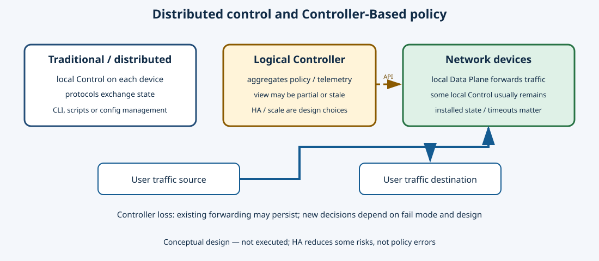

# CCNA AUT-02 — شبکهٔ سنتی در برابر Controller-Based Networking

**سطح:** CCNA. **پیش‌نیاز:** AUT-01. **هدف رسمی:** `6.2` مقایسهٔ شبکهٔ سنتی با Controller-Based Networking، شامل اثر برنامه‌پذیری و سطوح Abstraction. **وضعیت:** پیش‌نویس محتوایی؛ طراحی عملی انجام شده و **اجرا نشده**؛ هیچ کنترلر واقعی در دسترس نبوده است. مدل و نسخهٔ کنترلر انتخاب نشده.

## اهداف

1. مدل **سنتی (Distributed)** و **Controller-Based (Centralized)** را از نظر محل تصمیم مقایسه کنید.
2. سه Plane را با مثال تشخیص دهید و بگویید کدام به کنترلر منتقل می‌شود.
3. **Effect of Programming / Abstraction** را توضیح دهید — یعنی چرا API شبکه را «برنامه‌پذیر» می‌کند.
4. ریسک تمرکز را بفهمید و بدانید در قطع کنترلر چه اتفاقی می‌افتد.

## ۱. شبکهٔ سنتی — تصمیم توزیع‌شده

در شبکهٔ سنتی، Control Plane به‌صورت **توزیع‌شده** روی دستگاه‌ها اجرا می‌شود: هر دستگاه اطلاعات محلی‌اش را نگه می‌دارد و پروتکل‌ها برای ساخت دید مشترک با همسایه‌ها تبادل می‌کنند؛ این به معنی تصمیم‌گیریِ کاملاً جدا یا ناآگاهی از بقیه نیست.

```text
SW1/SW2: هر دو STP را اجرا و BPDU ردوبدل می‌کنند
R1/R2: هر دو OSPF را اجرا و LSDB/Route را همگام می‌کنند
```

پیکربندی ممکن است با CLI روی هر دستگاه انجام شود، اما Template/Script هم می‌تواند تکرار را خودکار کند؛ «سنتی» الزاماً «کاملاً دستی» نیست. مسئلهٔ اصلی نبودِ منبع Policy متمرکزِ مشترک در خود مدل توزیع‌شده است؛ هر Automation جداگانه باید تغییرات و Drift را کنترل کند.

| توانایی/مزیت | محدودیت/ریسک |
|---|---|
| Control Plane محلی و توزیع‌شده؛ در صورت طراحی درست یک خرابی دستگاه الزاماً کل شبکه را متوقف نمی‌کند | Configuration می‌تواند بین دستگاه‌ها Drift کند، به‌ویژه اگر Automation و بازبینی ضعیف باشد |
| بسیاری از تغییرها با CLI/API و پروتکل‌های شناخته‌شده قابل عیب‌یابی‌اند | مشاهده و عیب‌یابی ممکن است چند دستگاه و چند Log را درگیر کند |
| می‌توان با Template، Script و Configuration Management مقیاس را بهتر کرد | Automation مستقل، به‌تنهایی دید و Policy سراسری را تضمین نمی‌کند |
| وابستگی روزمره به یک Controller مرکزی کمتر است | یکنواخت‌کردن Policy و Lifecycle بین سازندگان/دستگاه‌ها نیازمند طراحی است |

مدل سنتی می‌تواند پایدار و خودکار باشد؛ تفاوت اصلی در محل تجمیع Policy/Abstraction و چرخهٔ کنترل است، نه اینکه یکی «کار می‌کند» و دیگری نه.

## ۲. Controller-Based — تصمیم متمرکز

کنترلر یا سامانهٔ Controller-Based معمولاً اطلاعات دریافتی از دستگاه‌ها را تجمیع می‌کند و یک **نقطهٔ مدیریت/Policy منطقی** فراهم می‌آورد؛ دیدش فقط به telemetry، مدل، مجوز و اتصال واقعی دستگاه‌هایی محدود است که گزارش می‌دهند. کنترلر لزوماً یک سرور منفرد نیست و می‌تواند Cluster/HA یا معماری سلسله‌مراتبی داشته باشد.

```text
        ┌─────────────┐
        │  Controller │ ← سیاست یک‌جا تعریف می‌شود
        └──────┬──────┘
      ┌────────┼────────┐
      ↓        ↓        ↓
    SW1      SW2      SW3   ← پیکربندی اعمال می‌شود
```

| ویژگی | سنتی/توزیع‌شده | Controller-Based |
|---|---|---|
| محل Control | پروتکل‌ها و State روی هر دستگاه؛ تبادل اطلاعات میان همتاها | Policy/Orchestration در یک سامانهٔ منطقی متمرکزتر؛ مقداری Control محلی معمولاً باقی می‌ماند |
| مدیریت | CLI/API و نیز امکان Script/Configuration Management | Controller API/GUI/Workflow، وابسته به محصول |
| مشاهده | دادهٔ هر دستگاه و Telemetry موجود | تجمیع‌شده، اما ممکن است ناقص/با تأخیر باشد |
| مقیاس | نیازمند استانداردسازی و Automation مناسب | می‌تواند تغییر Policy را ساده‌تر کند؛ ظرفیت، HA و حدود پلتفرم باید طراحی شوند |
| تغییر | به Workflow و ابزار تیم بستگی دارد | به Workflow و Controller بستگی دارد؛ سرعت را بدون اندازه‌گیری نمی‌توان ادعا کرد |
| وابستگی | کمتر به Controller مرکزی؛ به پروتکل‌ها و Management همچنان نیاز دارد | به Controller/API/شبکهٔ مدیریت و پشتیبانی دستگاه وابسته است |
| ریسک برجسته | Drift و پیکربندی ناهماهنگ | خطای Policy متمرکز با دامنهٔ اثر وسیع یا اختلال Controller؛ HA ریسک را کاهش می‌دهد، حذف نمی‌کند |

**نکتهٔ کلیدی:** در معماری Controller-Based رایج، کنترلر Policy/State را محاسبه یا توزیع می‌کند، اما هر Packet معمولاً همچنان توسط Data Plane سوییچ/روتر Forward می‌شود؛ ترافیک کاربر لزوماً از سرور Controller عبور نمی‌کند. بعضی محصولات یا معماری‌ها اجزای متفاوتی دارند، پس نقش دقیق و مسیر Data را از مستند طراحی همان سامانه بررسی کنید.

## ۳. سه Plane — کدام به کنترلر می‌رود؟

| Plane | چه‌کار می‌کند | مثال | در SDN |
|---|---|---|---|
| **Control** | تصمیم مسیر و توپولوژی؛ در پیاده‌سازی توزیع‌شده با همسایه‌ها تبادل می‌شود | OSPF، STP، ARP/Neighbor Resolution | بخشی از Control/Policy ممکن است منطقی متمرکز یا به Controller منتقل شود؛ همهٔ Control محلی حذف نمی‌شود |
| **Data** | اجرای Lookup و Forwarding بسته | جدول Forwarding، ACL، Queue، NAT | معمولاً روی تجهیزات Forwarding؛ Packetها را دستگاه‌ها پردازش می‌کنند |
| **Management** | پیکربندی و پایش | SSH، SNMP، NETCONF، Syslog | ممکن است متمرکز شود، ولی الزامی نیست |

**مثال محسوس:** وقتی یک بسته از SW1 به SW2 می‌رود:

1. **Control Plane** (قبلاً): STP تصمیم گرفت پورت `Gi0/1` Root Port است و Forwarding باشد.
2. **Data Plane** (اکنون): سوییچ در جدول MAC جستجو می‌کند و بسته را می‌فرستد.
3. **Management Plane** (روز قبل): مدیر با SSH روی SW1 این پیکربندی را زده بود.

**نکتهٔ ظریف و پرتکرار:** ACL از نظر چارچوب conceptual بخشی از **Data Plane** است، چون روی بسته در حال عبور اعمال می‌شود، نه روی محاسبهٔ مسیر. اما اگر کنترلر پیکربندی ACL را **توزیع** می‌کند، توزیع در Control/Management و اجرا در Data است. این تفکیک را در آزمون‌ها گاهی با هم اشتباه می‌گیرند.

## ۴. Effect of Programming و Abstraction — چرا مهم است؟

این بخش را در درس‌های سطحی جا می‌افتد ولی هدف رسمی `6.2` صریحاً به آن اشاره دارد.

### Abstraction یعنی چه؟

**Abstraction** یعنی مدیر با مفهوم/هدف سطح بالاتر (مثلاً «این گروه از Portها به شبکهٔ Users تعلق دارد») کار کند، نه اینکه همهٔ جزئیات CLI هر Vendor را خودش تکرار کند. Controller ممکن است این Policy را به فرمان‌های دستگاه نگاشت کند، اما این نگاشت به پشتیبانی مدل و نسخه وابسته است و همهٔ تفاوت‌های Vendor را پنهان نمی‌کند.

```text
بدون Abstraction:
  برای هر سوییچ:  vlan 10 / name USERS / interface ... / switchport access vlan 10

با Abstraction:
  در مدل/Controller:  "VLAN 10 = USERS" و "این Deviceها عضو گروه Access هستند"
  سامانه آن را به تغییرهای پشتیبانی‌شده نگاشت می‌کند؛ پیش‌نمایش و Verification لازم است
```

### Effect of Programming یعنی چه؟

شبکه از طریق API و دادهٔ ساخت‌یافته قابل مدیریت/خواندن می‌شود؛ مثلاً:

1. یک Workflow می‌تواند همان Policy را روی گروهی از دستگاه‌های پشتیبانی‌شده اعمال کند؛ اندازهٔ گروه، Rate Limit، مجوز و مرحله‌بندی را کنترل کنید.
2. Automation می‌تواند با Monitoring هماهنگ شود؛ برگشت خودکار فقط با شرط، سنجش سلامت و روش Rollback آزموده‌شده طراحی شود، نه با هر هشدار.
3. Policy/Configuration را می‌توان به‌صورت Code نسخه‌بندی، بازبینی و تست کرد؛ Git و IaC خطا را حذف نمی‌کنند و Secret نباید در Repository قرار گیرد.

```text
# نمونهٔ طراحی‌شده، اجرانشده — مفهوم، نه فرمان واقعی
for switch in access_switches:
    controller.add_vlan(switch, vlan_id=10, name="USERS")
```

**محدودیت مهم:** Abstraction می‌تواند مرحلهٔ عیب‌یابی دیگری اضافه کند؛ یک Policy ممکن است در Controller، مدل/Template، API، مسیر مدیریت یا پیکربندی/حالت عملیاتی Device شکست بخورد. فقط به `show running-config` بسنده نکنید: Desired State و خطای Controller، وضعیت تحویل به دستگاه، Config/Operational State و مسیر ترافیک را با هم مقایسه کنید. در بعضی سامانه‌ها تغییر محلی را Controller بعداً بازنویسی می‌کند.

## ۵. ریسک تمرکز و Fail Mode

### وابستگی و رفتار هنگام قطع Controller

قطع یک Controller متمرکز **ممکن است** نقطهٔ اختلال مدیریتی/کنترلی شود، اما لزوماً به معنی قطع همهٔ Data Plane نیست؛ رفتار به معماری HA، Cache/State نصب‌شده، Timeout، وابستگی Control و Fail Mode دستگاه بستگی دارد.

| سناریو | پرسش درست برای طراحی/تحلیل |
|---|---|
| ترافیک موجود | آیا Switch/Router Flow و Policy لازم را دارد و چه مدت نگه می‌دارد؟ ادامهٔ Forwarding را فرض نکنید؛ در Lab/مدرک محصول تأیید کنید. |
| تغییر جدید | آیا تصمیم/Update به Controller نیاز دارد یا پروتکل محلی ادامه می‌دهد؟ تغییر ممکن است متوقف، به تأخیر افتاده یا محدود شود. |
| کلاینت/Session جدید | احراز هویت و Policy از کجا می‌آیند؟ Cache، AP Mode و سرویس وابسته را بررسی کنید. |
| Policy تازه | تا بازگشت Controller/Failover، دستگاه ممکن است Policy قبلی یا حالت جایگزین را نگه دارد؛ دامنهٔ تغییر ثبت شود. |

### سه راهکار کاهش ریسک

1. **High Availability (HA)** — کنترلر دوم به‌صورت Active/Standby یا Active/Active. اگر اولی قطع شود، دومی نقش می‌گیرد.
2. **مسیر مدیریت با تفکیک مناسب** — شبکه/VRF مدیریت و وابستگی‌های آن را از مسیر کاربران طراحی کنید؛ این کار بعضی خرابی‌های مشترک را کاهش می‌دهد، اما خرابی زیرساخت فیزیکی/مسیر مشترک یا Gateway همچنان می‌تواند هر دو را قطع کند.
3. **Fail Mode مشخص** — برای هر مورد تصمیم صریح بگیرید: «دستگاه در نبود کنترلر چه کند؟» اگر این تصمیم صریح نباشد، رفتار دستگاه در قطع شبکه غافلگیرکننده می‌شود.

**مثال معماری WLAN:** در WLAN کنترلری، قطع WLC می‌تواند بر مدیریت AP، احراز هویت، Client جدید و مسیر Data اثر متفاوت بگذارد. Local/Central Switching و FlexConnect Local Switching مسیرها/قابلیت‌های متفاوت دارند؛ نتیجهٔ دقیق هنگام قطع کنترلر به AP Mode، نسخه، پیکربندی، Cache و روش احراز بستگی دارد. واژهٔ **FlexConnect** به‌تنهایی تضمین نمی‌کند هر Session یا Policy بدون WLC ادامه یابد؛ مستند همان نسخه و Failover را بررسی کنید.

## ۶. نمونه‌های واقعی

| نمونه | دامنه | نقش |
|---|---|---|
| **Cisco DNA Center / Catalyst Center** | Campus و SD-Access | کنترل و اتوماسیون سیاست |
| **Cisco SD-WAN (vManage)** | WAN | کنترل مسیر و سیاست SD-WAN |
| **Cisco Meraki Dashboard** | Cloud Managed | پیکربندی از ابر |
| **Aruba Central** | Cloud Managed | پیکربندی از ابر |
| **OpenDaylight / ONOS** | کنترلر باز | آموزشی و پژوهشی |

**نکته:** Meraki و Aruba Central «Cloud Managed» هستند و نامشان کنترلر محلی نیست، ولی همان مفهوم متمرکز را با مدل ابری پیاده می‌کنند.

## ۷. سناریوی طراحی‌شده

**PNETLab مستقل، طراحی‌شده و اجرا‌نشده:** چهار سوییچ و یک کنترلر فرضی. هیچ کنترلر واقعی نصب نشده است.

```text
           [Controller 10.10.0.10]
                    | (VLAN مدیریت 99)
     ┌──────────────┼──────────────┐
     ↓              ↓              ↓
   [SW1]          [SW2]          [SW3]
     |              |              |
   PC-A           PC-B           PC-C
```

| مؤلفه | آدرس | نقش |
|---|---|---|
| Controller | `10.10.0.10` (VLAN 99) | کنترل مرکزی |
| SW1–SW3 | `10.10.0.11-13` (VLAN 99) | Data Plane |
| PC-A..C | DHCP در VLAN 10 | کاربران |



**سناریوی طراحی‌شده (اجرا نشده):** در مدل سنتی، `vlan 10` روی SW1 و SW2 ساخته شده ولی روی SW3 فراموش شده. باید با `show vlan brief` روی هر سه سوییچ پیدا شود — کاری که در ۲۰۰ سوییچ عملی نیست. در مدل Controller-Based، سیاست یک‌جا تعریف می‌شود و خطای «فراموش شد» ساختاری حذف می‌شود. **این تفاوت است، نه این‌که کنترلر جادو می‌کند.**

## ۸. کاربرگ تحلیلی مستقل

**این Objective از فعل Compare است؛ برای حل زیر PNETLab یا Controller واقعی لازم نیست.** دادهٔ زیر سناریوی ساخته‌شده برای تحلیل است، نه Capture یا اجرای CLI:

| دستگاه/سامانه | وضعیت مطلوب فرضی | وضعیت مشاهده‌شدهٔ فرضی |
|---|---|---|
| SW1 | VLAN 10 با نام USERS | VLAN 10 موجود |
| SW2 | VLAN 10 با نام USERS | VLAN 10 موجود |
| SW3 | VLAN 10 با نام USERS | VLAN 10 غایب |
| Controller-Based | Policy شامل SW1–SW3 است | گزارش فرضی می‌گوید SW3 خارج از Desired State است |

1. در مدل توزیع‌شدهٔ سنتی، چه راه‌هایی برای پیدا کردن اختلاف دارید؟ پاسخ می‌تواند CLI دستگاه‌به‌دستگاه، Script، Syslog/Telemetry یا Configuration Management باشد؛ «سنتی» به معنی نبود Automation نیست.
2. در مدل Controller-Based چه چیزی تجمیع می‌شود؟ نام ببرید که Controller فقط روی Deviceهای Onboard/Reachable و داده‌ای که جمع‌آوری می‌کند دید دارد.
3. اختلاف VLAN به کدام Plane مربوط می‌شود هنگام **تعریف Policy**، **توزیع Config** و **Forwarding Frame**؟ بین Management/Control/Data تمایز بگذارید.
4. اگر Controller قطع شود، چه چیزهایی را می‌توان با اطلاعات موجود نتیجه گرفت؟ پاسخ درست: نه تداوم و نه توقف کامل Data اثبات نشده؛ Fail Mode، مسیر و Config نصب‌شده را باید دانست.
5. یک مزیت، یک هزینه و یک کنترل کاهش ریسک برای هر مدل بنویسید؛ برای Controller-Based، اثر اشتباه Policy روی گروه وسیع را هم در نظر بگیرید.
6. آیا ثبت «۱۰ فرمان در برابر یک API» اثبات می‌کند Controller سریع‌تر است؟ خیر؛ تعداد/زمان باید در یک سنجش کنترل‌شده، با مدل/نسخه/آزمایش یکسان اندازه‌گیری شود.

**راهنمای پاسخ:** در مدل سنتی وضعیت روی هر Node یا از طریق Automation گردآوری و مقایسه می‌شود؛ در Controller-Based دید و Policy تجمیع‌شده ساده‌تر می‌شود ولی به Onboarding، دسترسی، کیفیت Telemetry و رفتار Controller وابسته است. هیچ‌یک به‌تنهایی صحت VLAN، مسیر Data یا Failover را تضمین نمی‌کند.

**اختیاری:** می‌توان فقط بخش مشاهدهٔ SWها را در Emulator اجرا کرد و خروجی `show vlan brief` واقعی گرفت. این کار Controller-Based Networking را پیاده‌سازی/تأیید نمی‌کند و هیچ خروجی یا زمان واقعی در این درس ثبت نشده است.

## ۹. سؤال‌ها و پاسخ

1. **تفاوت اصلی سنتی و Controller-Based چیست؟** سازمان‌دهی Control/Management و تجمیع Policy؛ مدل سنتی Control Plane توزیع‌شده دارد، در حالی که Controller-Based یک سطح مدیریت/Policy منطقی متمرکزتر فراهم می‌کند و بخشی از Control محلی همچنان می‌ماند.

2. **کنترلر معمولاً هر Packet را Forward می‌کند؟** خیر؛ معمولاً Packetها را Data Plane روی Switch/Router می‌فرستد و Controller Policy/State را محاسبه یا توزیع می‌کند. معماری محصول را بررسی کنید.

3. **سه Plane را با مثال بگویید.** Control: OSPF/STP؛ Data: جدول Forwarding/ACL؛ Management: SSH/SNMP.

4. **Abstraction چه مزیتی دارد؟** مدیر می‌تواند با مفهوم/Policy کار کند نه با فرمان‌های تکراری؛ اعمال یک Policy روی گروهی از دستگاه‌های سازگار به دامنه، پشتیبانی، Workflow و Verification همان سامانه بستگی دارد.

5. **Abstraction چه عیبی دارد؟** لایهٔ اضافه، عیب‌یابی را سخت می‌کند. باید بدانید کنترلر چه فرمانی روی دستگاه زده است.

6. **Effect of Programming چیست؟** شبکه از طریق API قابل مدیریت می‌شود؛ اسکریپت، اتوماسیون و Infrastructure as Code ممکن می‌شود.

7. **یک ریسک Controller-Based چیست؟** Policy/تغییر اشتباه می‌تواند دامنهٔ وسیع داشته باشد و مدیریت به Controller/API/مسیر وابسته شود؛ HA و کنترل Change ریسک را کم می‌کنند، اما خطای Policy را حذف نمی‌کنند.

8. **اگر Controller قطع شود چه می‌شود؟** پاسخ واحدی ندارد: Data موجود ممکن است با State نصب‌شده ادامه یابد یا بخشی از Service متأثر شود؛ تغییر و Client جدید به Fail Mode و Product وابسته‌اند.

9. **HA کنترلر چه کمکی می‌کند؟** زمان توقف ناشی از خرابی یک نمونه را کاهش می‌دهد؛ Failover، سازگاری State و رفتار در قطع API باید آزمایش و مستند شوند.

10. **SD-WAN و SD-Access چه هستند؟** نمونه‌های تجاری Controller-Based به‌ترتیب برای WAN و Access.

11. **Configuration Drift یعنی چه؟** تفاوت پیکربندی بین دستگاه‌ها که در مدل دستی و در مقیاس اتفاق می‌افتد.

12. **آیا در این درس کنترلری اجرا شده است؟** خیر. همهٔ مقایسه‌ها طراحی‌شده‌اند و هیچ عدد یا زمان واقعی ثبت نشده است.

## واژه‌نامه و چک‌لیست

**Controller**: کنترل مرکزی؛ **Distributed**: تصمیم توزیع‌شده؛ **Control Plane**: لایهٔ تصمیم؛ **Data Plane**: لایهٔ عبور؛ **Management Plane**: لایهٔ پیکربندی؛ **Abstraction**: پنهان‌کردن جزئیات؛ **API**: رابط برنامه‌نویسی؛ **HA**: دسترس‌پذیری بالا؛ **Fail Mode**: رفتار در قطع کنترلر؛ **Configuration Drift**: واگرایی پیکربندی.

- [ ] سه Plane را با مثال واقعی تفکیک می‌کنم.
- [ ] می‌دانم در معماری رایج، Deviceها Packet را Forward می‌کنند و Controller معمولاً مسیر هر Packet نیست.
- [ ] Abstraction را با مزیت **و** عیبش می‌دانم.
- [ ] وابستگی به Controller و ارزش/محدودیت HA را ارزیابی می‌کنم.
- [ ] Fail Mode را برای هر دستگاه صریح تعیین می‌کنم.
- [ ] هیچ کنترلر واقعی را آزمایش‌شده اعلام نمی‌کنم.
