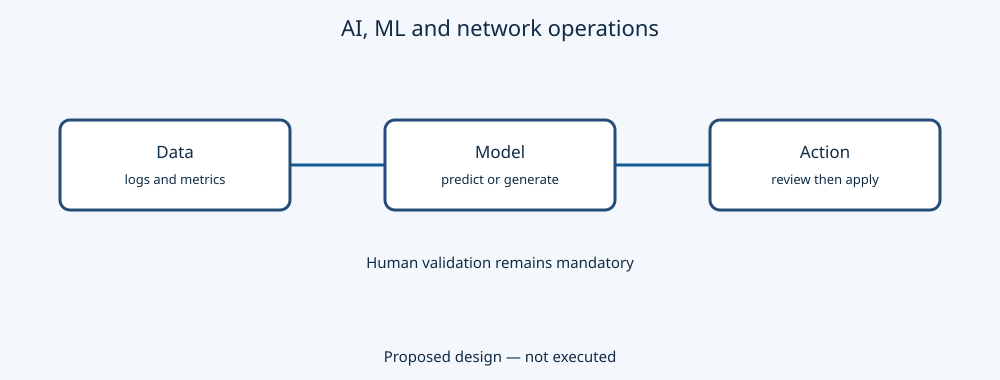

# CCNA AUT-06 — AI و Machine Learning در عملیات شبکه

**سطح:** CCNA. **پیش‌نیاز:** AUT-01. **هدف رسمی:** `6.4` توضیح AI (Generative و Predictive) و Machine Learning در عملیات شبکه. **وضعیت:** پیش‌نویس محتوایی؛ طراحی مفهومی انجام شده و **اجرا نشده**؛ هیچ مدلی آموزش، ارزیابی یا مقایسه نشده است. هیچ دادهٔ واقعی شبکه جمع‌آوری نشده.

## اهداف

1. **AI، ML و Generative AI** را از هم تفکیک کنید — این سه هم‌معنی نیستند و در آزمون هم اشتباه گرفته می‌شوند.
2. تفاوت **Predictive** و **Generative** را با مثال عملیاتی بیان کنید.
3. بدانید چرا **کیفیت داده** سقف کیفیت مدل را تعیین می‌کند.
4. **Five-nines** و **Explainability** را توضیح دهید.
5. برای یک سناریوی شبکه‌ای، کاربرد درست و کاربرد نادرست را تشخیص دهید.

## ۱. AI، ML و Generative — مفهوم‌ها را از هم جدا کنید

این اصطلاح‌ها یک نردبانِ کاملاً هم‌پوشان یا سه نوع هم‌سطح نیستند. **AI** نام حوزهٔ وسیعی از سامانه‌هایی است که وظایف هوشمندانه انجام می‌دهند؛ **ML** رویکردی است که در آن مدل از داده الگو می‌آموزد؛ **Deep Learning** زیرمجموعه‌ای از ML بر پایهٔ شبکه‌های عصبی چندلایه است. **Generative** بیشتر به نوع وظیفه/خروجی (ساخت متن، تصویر، کد یا دادهٔ تازه) اشاره می‌کند، نه تضمین یک معماری واحد.

```text
Artificial Intelligence (حوزهٔ کلیِ سامانه‌های هوشمند)
├── سامانهٔ قاعده‌محور: if/then؛ الزاماً از داده یاد نمی‌گیرد
└── روش‌های داده‌محور، از جمله Machine Learning
    ├── وظیفهٔ Predictive / Classification: برآورد یا دسته‌بندی
    └── وظیفهٔ Generative: تولید محتوای جدید

Deep Learning ⊂ ML؛ می‌تواند Predictive یا Generative باشد.
Generative نامِ نوع وظیفه/خروجی است، نه مرز معماریِ هم‌سطح و انحصاری با ML.
```

در کاربرد امروزی، بسیاری از محصولات Generative AI از ML/Deep Learning استفاده می‌کنند؛ اما «تولیدگر بودن» به‌تنهایی ثابت نمی‌کند سامانه دقیقاً با کدام الگوریتم ساخته شده است. برای CCNA، تفاوت عملی را به خاطر بسپارید: **Predictive** دربارهٔ برچسب/مقدار/رخداد احتمالی تخمین می‌زند؛ **Generative** محتوای جدید پیشنهاد یا تولید می‌کند. یک Expert System با قاعدهٔ دستی می‌تواند AI نامیده شود، ولی چون از نمونه‌های داده مدل نمی‌آموزد ML نیست.

| مفهوم | پرسش ساده | مثال شبکه‌ای | مرز مهم |
|---|---|---|---|
| **AI** | سامانه چه وظیفهٔ هوشمندانه‌ای انجام می‌دهد؟ | پشتیبان تصمیم عیب‌یابی | واژهٔ کلی است، نه تضمین کیفیت |
| **ML** | آیا مدل از داده الگو می‌آموزد؟ | پیش‌بینی مصرف از آمار تاریخی | دادهٔ آموزشی/ارزیابی لازم دارد |
| **Deep Learning** | آیا مدل شبکهٔ عصبی چندلایه است؟ | تحلیل سری زمانی یا متن | زیرمجموعهٔ ML؛ تفسیر ممکن است دشوار باشد |
| **Generative AI** | آیا خروجی تازه می‌سازد؟ | خلاصهٔ Log یا پیش‌نویس Config | خروجی را باید بررسی کرد؛ معماری دقیق وابسته به محصول است |

## ۲. Predictive و Generative — دو کار متفاوت

### Predictive AI — «چه اتفاقی می‌افتد؟»

مدل روی دادهٔ **تاریخی** آموزش می‌بیند و آینده را تخمین می‌زند.

**مثال عملیاتی محسوس:**

```text
دادهٔ ورودی (۶ ماه گذشته):
  - Interface Gi0/3: نرخ CRC Error رو به افزایش
  - دما: ۴۲°C (بالاتر از میانگین)
  - Traffic: افت تدریجی ظرفیت هر هفته

خروجی مدل:
  احتمال خرابی Gi0/3 در ۷۲ ساعت آینده: 78%
```

**چه کاری با این خروجی می‌شود کرد؟** یک تیکت پیشگیرانه بسازید و کابل/SFP را **قبل** از قطعی عوض کنید. این همان تفاوت **Proactive** با **Reactive** است.

### Generative AI — «چه چیزی بنویسم یا پیشنهاد بدهم؟»

مدل محتوای **جدید** تولید می‌کند: متن، کد، خلاصه.

**نمونهٔ محسوس شمارهٔ ۱ — خلاصهٔ رخداد:**

```text
ورودی:  ۴۲۰ خط Log از سه دستگاه در بازهٔ ۱۴:۰۰–۱۴:۱۵

خروجی Generative (طراحی‌شده):
  «در ساعت ۱۴:۰۳، Gi0/24 روی SW2 به دلیل BPDU Guard خطای
   Err-Disable خورد. پس از آن، VLAN 10 از دسترس خارج شد.
   دو دستگاه دیگر خطای مستقلی نداشتند.»
```

**نمونهٔ محسوس شمارهٔ ۲ — پیشنهاد پیکربندی:**

```text
ورودی:  «یک Access Port برای تلفن IP با VLAN داده ۱۰ و Voice VLAN ۲۰ بساز»

خروجی Generative (طراحی‌شده):
  interface GigabitEthernet0/12
   switchport mode access
   switchport access vlan 10
   switchport voice vlan 20
   spanning-tree portfast
   spanning-tree bpduguard enable
```

**هشدار اساسی:** خروجی Generative **یک پیشنهاد است، نه یک واقعیت**. مدل ممکن است فرمانی بسازد که در نسخهٔ IOS شما وجود ندارد، یا PortFast را روی Uplink پیشنهاد دهد. اینجاست که **Validate** اجباری می‌شود.

## ۳. سه نوع یادگیری ML — چرا برای شبکه مهم است

| نوع | دادهٔ آموزشی | کار در شبکه | مثال |
|---|---|---|---|
| **Supervised** | دادهٔ **برچسب‌دار** («این ترافیک حمله بود، این نبود») | دسته‌بندی و پیش‌بینی | تشخیص ترافیک مخرب با نمونه‌های برچسب‌خورده |
| **Unsupervised** | دادهٔ **بدون برچسب** | کشف الگوی پنهان | کشف ناهنجاری: «این ترافیک شبیه هیچ چیز معمول نیست» |
| **Reinforcement** | پاداش/تنبیه از محیط | بهینه‌سازی تصمیم | مسیریابی تطبیقی در SD-WAN |

**محدودیت تعمیم:** دادهٔ برچسب‌خورده ممکن است کم‌هزینه نباشد، اما از این واقعیت نمی‌توان نتیجه گرفت «بیشتر کاربردهای شبکه Unsupervised هستند». روش مناسب به مسئله، برچسب‌ها، حریم خصوصی و دادهٔ موجود بستگی دارد؛ یک سامانهٔ عملی می‌تواند دادهٔ برچسب‌دار، بدون برچسب یا ترکیبی به‌کار ببرد. Anomaly Detection نیز الزاماً «حمله» را نمی‌شناسد؛ ممکن است فقط رفتار نادر را علامت بزند، پس False Positive و تحلیل انسانی مهم‌اند.

### نرخ پایه، Precision و Recall — مثال محاسبه‌شده

**فرض آموزشی (نه نتیجهٔ مدل واقعی):** از ۱٬۰۰۰٬۰۰۰ جریان، ۰٫۰۱٪ حمله است؛ یعنی ۱۰۰ جریان مثبت و ۹۹۹٬۹۰۰ جریان عادی. فرض کنید مدل **Recall/TPR=99٪** و **False Positive Rate=1٪** دارد؛ این دو فرض به معنی Accuracy=99٪ نیستند.

```text
حملهٔ واقعی:       100 × 99٪ = 99 هشدار درست (TP)، 1 مورد از دست‌رفته (FN)
جریان عادی: 999,900 × 1٪ = 9,999 هشدار کاذب (FP)
مجموع هشدارها:                 99 + 9,999 = 10,098
Precision: 99 / 10,098 ≈ 0.98٪
FP به‌ازای هر TP: 9,999 / 99 ≈ 101
```

با وجود TPR بالا، بیشتر هشدارها کاذب‌اند چون حمله کم‌رخداد است. **Accuracy** سهم همهٔ تصمیم‌های درست از کل نمونه‌هاست؛ **Precision** سهم هشدارهای درست از همهٔ هشدارها؛ **Recall** سهم حمله‌های کشف‌شده از همهٔ حمله‌های واقعی. برای رخدادهای نادر، نرخ پایه و ماتریس خطا را کنار هم بررسی کنید؛ Accuracy تنها معیار مناسبی نیست. Alert Fatigue می‌تواند باعث شود اپراتور هشدار واقعی را هم نادیده بگیرد.

## ۴. کیفیت داده — سقف واقعی مدل

قاعدهٔ سخت: **مدل نمی‌تواند از دادهٔ بد، نتیجهٔ خوب بسازد.** سه مسئلهٔ رایج:

| مسئله | معنا | نمونهٔ شبکه‌ای | پیامد |
|---|---|---|---|
| **کمبود داده** | نمونه کافی نیست | تنها ۲ نمونه از یک نوع حمله | مدل آن حمله را نمی‌شناسد |
| **Bias** | داده نمایندهٔ واقعیت نیست | آموزش روی شبکهٔ یک سایت کوچک | در سایت بزرگ شکست می‌خورد |
| **Drift** | توزیع داده با زمان عوض می‌شود | ترافیک پس از مهاجرت به Cloud | دقت مدل قدیمی افت می‌کند |
| **برچسب غلط** | دادهٔ آموزشی نادرست | رخداد عادی به‌عنوان حمله برچسب خورده | مدل رفتار عادی را حمله می‌بیند |

**Data Drift** می‌تواند پس از تغییر معماری، برنامه‌ها یا رفتار کاربران رخ دهد و کارایی مدل را تغییر دهد؛ افتِ ۹۸٪ به ۶۰٪ در مثال بالا صرفاً سناریوی فرضی است، نه نتیجهٔ اندازه‌گیری. پایش کیفیت، ارزیابی روی دادهٔ تازه و تصمیم مستند برای بازآموزی لازم‌اند؛ بازآموزی خودکار بدون کنترل می‌تواند Bias یا خطای جدید وارد کند.

## ۵. Explainability و Availability — اعتماد مشروط، نه تضمین

**Explainability** یعنی توانایی ارائهٔ دلیل/شواهد قابل بررسی برای خروجی مدل؛ مقدار و کیفیت آن به مدل، ابزار و روش تحلیل بستگی دارد. توضیحِ تولیدشدهٔ یک LLM لزوماً توضیح وفادارانهٔ فرایند درونی مدل نیست و خودش باید راستی‌آزمایی شود.

چرا در شبکه حیاتی است؟ چون تصمیم مدل ممکن است **تغییر پیکربندی** یا **قطع سرویس** باشد. اگر مدل بگوید «Gi0/3 را ببند» و نتواند بگوید چرا، مدیر نمی‌تواند تصمیم را تأیید کند.

| مدل/روش | برداشت دربارهٔ Explainability | محدودیت |
|---|---|---|
| درخت تصمیم ساده | مسیر Ruleها را می‌توان خواند | درخت عمیق/بزرگ هم دشوار است و همبستگی با علت را ثابت نمی‌کند |
| Linear Regression | وزن‌ها/ضرایب در مدل مشخص‌اند | مقیاس‌بندی، متغیرهای هم‌بسته و فرضیات روی تفسیر اثر می‌گذارند |
| Random Forest | Feature Importance سراسری می‌تواند سرنخ بدهد | اهمیت ویژگی به‌تنهایی دلیل یک پیش‌بینی خاص یا رابطهٔ علّی نیست |
| Deep Neural Network | محاسبهٔ درونی معمولاً مستقیماً خوانا نیست | روش توضیح پسینی ممکن است تقریبی باشد |
| LLM (Generative) | می‌تواند متنِ توضیحی بسازد | متنِ قانع‌کننده تضمین نمی‌کند شرحِ وفادارانه‌ای از محاسبهٔ مدل باشد |

Explainability ویژگی مطلق «خوب/بد» نیست؛ پیچیدگی، روش توضیح و مخاطب اهمیت دارند. برای تصمیم حساس، ورودی/نسخهٔ مدل، شواهد مستقل، محدودیت و امکان بازبینی انسانی را ثبت کنید. توضیح علّی را از هم‌زمانی/همبستگی و Feature Importance جدا نگه دارید.

### Availability یا Five Nines

«پنج نه» یعنی دسترس‌پذیری قراردادی `99.999٪` در یک پنجرهٔ تعریف‌شده. اگر پنجره 365 روز پیوسته باشد و تمام زمان ازکارافتادگی شمرده شود، کل سال `525,600` دقیقه است و `0.001٪` آن حدود **5.256 دقیقه در سال** می‌شود. SLO/SLI واقعی باید پنجره، روش اندازه‌گیری، دامنهٔ سرویس و شمول/عدم‌شمول نگهداری را تعریف کند؛ بنابراین این تبدیل، تضمین شبکه نیست. Predictive AI می‌تواند یک سیگنال عملیاتی باشد، اما درصدِ پیش‌بینی یا هشدار، Availability تضمین‌شده را برابر نمی‌کند.

**هشدار مهم دربارهٔ LLM:** مدل زبانی می‌تواند با اطمینان کامل، توضیحی بدهد که **درست نیست** (**Hallucination**). در شبکه این یعنی: «این فرمان را بزنید چون…» با یک دلیل ساختگی. برای همین خروجی LLM باید **همیشه** با مستندات رسمی یا محیط آزمایشگاهی تأیید شود.



## ۶. AIOps — ترکیب AI با عملیات

**AIOps** به‌کارگیری AI/ML برای خودکارسازی و بهبود عملیات IT است. سه لایهٔ معمول:

| لایه | کار | مثال |
|---|---|---|
| **جمع‌آوری** | Telemetry، Log، Flow، SNMP | میلیون‌ها نقطه داده در روز |
| **تحلیل** | Correlation، Anomaly، Prediction | «این ۴۰ هشدار یک ریشه دارند» |
| **اقدام** | Ticket، Notification، خودکارسازی | ساخت خودکار تیکت با Context |

یکی از کاربردهای AIOps، Correlation هشدارهای هم‌زمان و کاهش Noise است؛ مثلاً چند Alarm می‌توانند با یک علت احتمالی مانند قطع لینک مرتبط باشند. سامانه ممکن است این ارتباط را اشتباه کند یا فقط هم‌بستگی زمانی ببیند، نه علت. ارزش Correlation، پیش‌بینی یا خودکارسازی به محیط، داده و معیار موفقیت بستگی دارد؛ هیچ‌کدام را برترِ همیشگی اعلام نکنید.

## ۷. کاربردهای واقعی — با محدودیت هر کدام

| کاربرد | چه می‌کند | محدودیت واقعی |
|---|---|---|
| **Anomaly Detection** | ترافیک غیرعادی را پیدا می‌کند | False Positive زیاد؛ نیاز به Baseline |
| **Capacity Planning** | رشد مصرف را پیش‌بینی می‌کند | به دادهٔ تاریخی کافی نیاز دارد |
| **Root Cause Analysis** | ریشهٔ مجموعهٔ هشدارها را می‌یابد | به کیفیت Correlation وابسته است |
| **Alert Classification** | هشدارها را دسته‌بندی و اولویت‌بندی می‌کند | مدل باید با تیم عملیات هم‌آموزش شود |
| **Config Generation** | پیکربندی پیشنهاد می‌دهد | **باید اعتبارسنجی شود؛ هرگز مستقیماً اعمال نشود** |
| **Log Summarization** | حجم Log را خلاصه می‌کند | ممکن است جزئیات حیاتی را حذف کند |

### مطالعهٔ موردی: دو مدل، دو سؤال متفاوت

**فرضی و اجرا‌نشده:** در ۳۰ روز، شمارنده‌های Interface نشان می‌دهند CRC در Gi0/3 به‌تدریج زیاد شده و هم‌زمان maintenance انجام شده است. یک مدل Predictive می‌تواند احتمال نیاز به بررسی پورت را برآورد کند، اما علت (کابل، SFP، پورت یا تغییر نگهداری) را به‌تنهایی اثبات نمی‌کند. یک مدل Generative می‌تواند Logها را خلاصه یا یک چک‌لیست عیب‌یابی پیشنهاد کند؛ چک‌لیست باید با نسخهٔ IOS و مستند رسمی تطبیق داده شود.

اقدام ایمن: (۱) دادهٔ مجاز و زمان‌ها را بررسی کنید؛ (۲) خروجی مدل را به‌عنوان فرضیه نگه دارید؛ (۳) آزمون کم‌خطر و معیار توقف را تعریف کنید؛ (۴) اپراتور نتیجه را تأیید کند؛ (۵) پس از اقدام، شمارنده/سرویس و اثر جانبی را بازبینی کنید. **مدل پیش‌بینی‌کنندهٔ خرابی نیست و متن تولیدشده فرمان تأییدشده نیست.**

## ۸. کاربرگ مستقل (تحلیلی، نه اجرایی)

Objective `6.4` توضیحی است؛ آموزش/آزمونِ ساخت مدل AI یا اجرای حملهٔ شبکه در این درس هدف نیست، پس تمرین تحلیلی زیر برای تفکیک مفاهیم کافی است. هیچ مدل یا دادهٔ واقعی لازم/به‌کاررفته نیست:

1. سه شاخص در شبکهٔ خود نام ببرید که **قابل پیش‌بینی** هستند و برای هر کدام دادهٔ لازم را مشخص کنید (چه چیزی، چند وقت، با چه نرخ).
2. برای هر شاخص بگویید خروجی پیش‌بینی چه **اقدامی** را ممکن می‌کند. اگر اقدام ممکن نیست، پیش‌بینی بی‌فایده است.
3. یک سناریوی «هشدار کاذب» بنویسید: مدل چه چیزی را اشتباه می‌بیند و اپراتور چه کاری می‌کند.
4. یک ریسک استفادهٔ Generative AI برای تولید پیکربندی بنویسید و **دو** کنترل متناظر پیشنهاد کنید.
5. برای یک تصمیم حساس شبکه، مدل با Explainability بالا و پایین را مقایسه کنید.

هیچ مدلی آموزش، ارزیابی یا مقایسه نشده است. اعداد بخش ۳ (نرخ پایه، TPR و FPR فرضی) **مثال محاسباتی طراحی‌شده** هستند، نه نتیجهٔ اندازه‌گیری یا ادعای Accuracy یک مدل.

## ۹. سؤال‌ها و پاسخ

1. **AI و ML چه تفاوتی دارند؟** AI حوزهٔ کلی است؛ ML زیرمجموعهٔ آن است که از داده یاد می‌گیرد. یک Expert System با قاعدهٔ دستی AI است ولی ML نیست.

2. **آیا هر ML، Generative است؟** نه. بیشتر مدل‌های ML پیش‌بینی یا دسته‌بندی می‌کنند، نه تولید محتوا.

3. **Predictive AI چه می‌کند؟** کمیت آینده را تخمین می‌زند: احتمال خرابی، روند مصرف.

4. **Generative AI چه می‌کند؟** محتوای جدید تولید می‌کند: متن، کد، خلاصه، پیشنهاد.

5. **Supervised و Unsupervised چه تفاوتی دارند؟** Supervised دادهٔ برچسب‌دار می‌خواهد؛ Unsupervised الگو را بدون برچسب می‌یابد.

6. **آیا می‌توان گفت بیشتر کاربردهای شبکه Unsupervised هستند؟** بدون تعریف دامنه و داده، خیر؛ روش به مسئله و دسترس‌پذیری برچسب‌ها بستگی دارد.

7. **Anomaly Detection چیست؟** کشف رفتاری که با الگوی معمول نمی‌خواند.

8. **چرا Accuracy=99٪ به‌تنهایی کافی نیست؟** رخداد نادر می‌تواند Precision را پایین بیاورد؛ مثال عددی به‌طور جداگانه TPR=99٪ و FPR=1٪ فرض می‌کند. باید ماتریس خطا، Precision، Recall و نرخ پایه را بررسی کرد.

9. **Alert Fatigue چیست؟** خستگی اپراتور از حجم هشدار، که به نادیده‌گرفتن هشدار واقعی می‌انجامد.

10. **Data Drift چیست؟** تغییر توزیع داده با زمان، که دقت مدل قدیمی را کم می‌کند.

11. **Explainability چیست و چرا مهم است؟** توانایی توضیح «چرا». در شبکه، تصمیم مدل ممکن است سرویس را قطع کند و مدیر باید بتواند تأیید کند.

12. **چرا LLM برای تصمیم خودکار مناسب نیست؟** ممکن است توضیح ساختگی و مطمئن بدهد (Hallucination) و Explainability قابل اتکا ندارد.

13. **آیا Correlation همیشه علت ریشه‌ای را پیدا می‌کند؟** خیر؛ می‌تواند هشدارهای هم‌زمان را گروه‌بندی و فرضیه بسازد، اما علت باید با شواهد مستقل تأیید شود.

14. **پیکربندی تولیدشده توسط AI چه نیاز دارد؟** Validate در برابر مستندات و آزمایش در محیط ایزوله. هرگز مستقیماً روی تولیدی اعمال نشود.

15. **آیا AI جایگزین درک اصول شبکه است؟** نه. مدل بدون درک اصول، نمی‌تواند خروجی را ارزیابی کند.

16. **آیا در این درس مدلی آموزش دیده است؟** خیر.

## واژه‌نامه و چک‌لیست

**AI**: هوش مصنوعی؛ **ML**: یادگیری ماشین؛ **Deep Learning**: شبکهٔ عصبی چندلایه؛ **Predictive**: پیش‌بین؛ **Generative**: تولیدکننده؛ **AIOps**: عملیات هوشمند؛ **Supervised/Unsupervised**: با/بدون برچسب؛ **Precision/Recall**: معیارهای دقت؛ **Alert Fatigue**: خستگی هشدار؛ **Data Drift**: تغییر توزیع؛ **Explainability**: توضیح‌پذیری؛ **Hallucination**: تولید محتوای نادرست با اطمینان.

- [ ] AI، ML، Deep Learning و Generative را بر اساس حوزه/روش/نوع خروجی تفکیک می‌کنم؛ آن‌ها را سلسله‌مراتب مطلق فرض نمی‌کنم.
- [ ] Predictive را از Generative با مثال تفکیک می‌کنم.
- [ ] Accuracy، Precision، Recall و False Positive Rate را از هم جدا می‌کنم و نرخ پایه را حساب می‌کنم.
- [ ] پنج نه را به SLO بازه‌دار ربط می‌دهم، نه پیش‌بینی AI را تضمین دسترس‌پذیری می‌گیرم.
- [ ] Data Drift و نیاز به بازآموزی را می‌شناسم.
- [ ] می‌دانم LLM می‌تواند توضیح ساختگی بدهد.
- [ ] خروجی AI را بدون Validate اعمال نمی‌کنم.
- [ ] هیچ مدلی را آموزش‌دیده یا ارزیابی‌شده اعلام نمی‌کنم.
