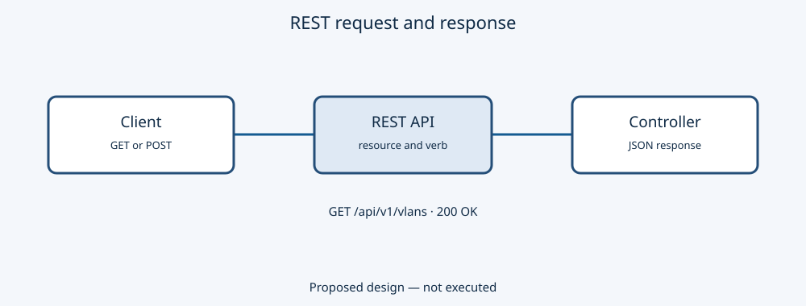

# CCNA AUT-07 — REST API: احراز، CRUD، افعال HTTP و Encoding

**سطح:** CCNA. **پیش‌نیاز:** AUT-05 و IS-08. **هدف رسمی:** `6.5` توصیف ویژگی‌های REST API شامل انواع احراز هویت، CRUD، افعال HTTP و Encoding داده. **وضعیت:** پیش‌نویس محتوایی؛ درخواست‌ها طراحی‌شده و **اجرا‌نشده**؛ هیچ API واقعی در دسترس نبوده و هیچ درخواستی ارسال نشده است.

## اهداف

1. افعال HTTP را به CRUD نگاشت کنید و بفهمید **Idempotency** چرا در Automation حیاتی است.
2. کدهای وضعیت را تفسیر کنید و **بدانید 200 OK همیشه موفقیت نیست**.
3. روش‌های احراز هویت را با ریسک عملی‌شان مقایسه کنید — Base64 رمزنگاری نیست.
4. یک پاسخ JSON واقعی را بخوانید و بدانید هر بخش چه نوع داده‌ای است.

## ۱. REST — سبک معماری

**REST** (Representational State Transfer) یک سبک معماری است، نه پروتکل یا قالب داده. در APIهای وب، معمولاً HTTP به‌کار می‌رود. محدودیت‌های REST شامل جداسازی Client/Server، Stateless، Cacheable، رابط یکنواخت و معماری لایه‌ای است؛ اجرای کد در Client (Code-on-Demand) محدودیت اختیاری است. URI منبع، نمایش داده و افعال استاندارد از نشانه‌های رایج رابط یکنواخت‌اند، اما نام URL یا استفاده از JSON به‌تنهایی REST بودن را ثابت نمی‌کند.

| مفهوم | توضیح دقیق |
|---|---|
| **Client/Server** | رابط کاربر از ذخیره‌سازی/اجرای سرویس جدا می‌شود |
| **Stateless** | هر درخواست برای فهم و پردازش خود اطلاعات لازم را دارد و به زمینهٔ مکالمه‌ای ذخیره‌شده از درخواست قبلی وابسته نیست |
| **Cacheable** | پاسخ می‌تواند طبق فرادادهٔ HTTP قابل ذخیره/استفادهٔ مجدد باشد |
| **رابط یکنواخت** | منبع با URI شناخته می‌شود و از نمایش‌ها و معنای استاندارد روش‌ها استفاده می‌شود |
| **لایه‌ای** | واسطه‌ها می‌توانند میان Client و Server باشند؛ هر لایه نباید جزئیات لایهٔ بعد را لازم بداند |

**Stateless به معنی «سرور هیچ داده‌ای نگه نمی‌دارد» نیست.** سرور وضعیت منابع، حساب‌ها، سوابق و سیاست اعتبارنامه را نگه می‌دارد؛ اما نباید برای تفسیر یک درخواست به زمینهٔ گفت‌وگوییِ پنهان از درخواست قبلی تکیه کند. اگر منبع حفاظت‌شده احراز هویت بخواهد، درخواست باید اطلاعات لازم برای آن را همراه داشته باشد؛ Endpoint عمومی الزاماً توکن نمی‌خواهد. Cookie به‌خودی‌خود REST را نقض نمی‌کند؛ وابستگی به نشستِ سمت سرور که زمینهٔ مکالمه را از درخواست‌های قبلی نگه می‌دارد با محدودیت Stateless سازگار نیست.

## ۲. CRUD و افعال HTTP

CRUD (Create, Read, Update, Delete) یک الگوی رایج طراحی API است؛ نگاشت دقیق هر فعل و منبع را قرارداد همان API تعیین می‌کند.

| فعل | CRUD رایج | معنای HTTP در این درس | Idempotent | Safe |
|---|---|---|---|---|
| **GET** | Read | دریافت نمایش منبع | ✅ | ✅ |
| **POST** | Create/عملیات | پردازش محتوا بر اساس معنای منبع مقصد | معمولاً خیر؛ مگر API سازوکار مشخص داشته باشد | ❌ |
| **PUT** | Create/Update | ایجاد یا جایگزینی وضعیت منبع در URI مقصد با نمایش ارسالی | ✅ طبق معنای HTTP | ❌ |
| **PATCH** | Update | اعمال تغییرات جزئیِ تعریف‌شده در Patch Document | تضمین نمی‌شود؛ به Patch Document و API بستگی دارد | ❌ |
| **DELETE** | Delete | درخواست حذف منبع مقصد | ✅ از نظر اثر موردنظر | ❌ |

**Idempotent** یعنی تکرار درخواست‌های یکسان، اثر موردنظر روی منبع را مانند یک بار اجرا می‌کند؛ پاسخ‌ها، Logها یا عوارض جانبی دیگر الزاماً یکسان نیستند.

### چرا این در Automation حیاتی است؟

پس از Timeout ممکن است Client از دریافت یا اعمال درخواست خبر نداشته باشد. طبق معنای HTTP، `PUT` و `DELETE` idempotent هستند؛ برای روش غیر-idempotent نباید خودکار Retry کرد مگر قرارداد API یا سازوکار deduplication این کار را ایمن کند.

| درخواست | اگر دوباره فرستاده شود | نکتهٔ Retry |
|---|---|---|
| `PUT /vlans/10` با همان نمایش | اثر موردنظر همچنان وضعیت همان منبع است | پاسخ بار دوم می‌تواند فرق کند؛ API و نمایش کامل را بررسی کنید |
| `POST /vlans` | رفتار به منبع/API بستگی دارد؛ ممکن است منبع تکراری بسازد یا درخواست را رد کند | بدون Idempotency-Key یا روش تشخیص/بررسی نتیجه، کورکورانه Retry نکنید |
| `DELETE /vlans/10` | وضعیت موردنظر «منبع حذف شده» باقی می‌ماند | پاسخ بار دوم ممکن است مثلاً 404 باشد؛ پاسخ یکسان شرط Idempotency نیست |
| `PATCH /vlans/10` | فقط بعضی Patchها، مانند «مقدار description را به X تنظیم کن»، با تکرار همان اثر را دارند | عملیات افزایشی/نسبی می‌تواند با هر Retry اثر تازه بسازد؛ قرارداد، ETag/`If-Match` و کنترل هم‌زمانی را بررسی کنید |

**قاعدهٔ عملی:** فقط به نام فعل برای تصمیم Retry تکیه نکنید. برای URI مشخص، قرارداد API، اثرهای جانبی، idempotency key و روش بررسی نتیجه را بخوانید. `PUT` برای جایگزینی یک منبعِ دارای URI مشخص طبق قرارداد HTTP مناسب است؛ این توصیهٔ عمومی برای برتری بر `POST` در همهٔ APIها نیست.

**تفاوت PUT و PATCH:** `PUT` نمایش منبع را برای ایجاد/جایگزینی وضعیت مقصد می‌فرستد؛ معنی فیلدهای غایب، مقدار پیش‌فرض یا حذف آن‌ها به قرارداد نمایش و API بستگی دارد، پس بدنهٔ ناقص را بی‌بررسی به‌عنوان Partial Update نفرستید. `PATCH` مجموعه‌ای از تغییرهای جزئیِ تعریف‌شده با قالب مشخص است؛ خودِ HTTP تضمین نمی‌کند که هر Patch idempotent باشد.

## ۳. کدهای وضعیت

| کد | نام | معنا | واکنش درست |
|---|---|---|---|
| **200** | OK | درخواست HTTP موفق پردازش شده است | قرارداد API و بدنهٔ پاسخ را بررسی کنید |
| **201** | Created | منبع درخواستی ایجاد شده است | URI جدید ممکن است در `Location` بیاید |
| **204** | No Content | درخواست موفق، بدون محتوای پاسخ | بدنه وجود ندارد |
| **400** | Bad Request | درخواست از نظر نحو/محتوا نامعتبر است | پیام و قرارداد ورودی API |
| **401** | Unauthorized | برای منبع اعتبارنامهٔ معتبر ارائه نشده/پذیرفته نشده | روش احراز را بررسی کنید؛ Server معمولاً `WWW-Authenticate` می‌فرستد |
| **403** | Forbidden | Server درخواست را فهمیده اما انجامش را رد می‌کند | سیاست، نقش یا مجوز؛ معنای دقیق به API بستگی دارد |
| **404** | Not Found | منبع پیدا نشد یا در دسترس اعلام نمی‌شود | URI و شناسه، با توجه به قرارداد API |
| **405** | Method Not Allowed | این روش برای آن منبع پشتیبانی نمی‌شود | `Allow` و مستندات منبع را بررسی کنید |
| **409** | Conflict | درخواست با وضعیت فعلی منبع تعارض دارد | کد دقیق و راه‌حل به قرارداد API وابسته است |
| **429** | Too Many Requests | محدودیت نرخ درخواست فعال شده است | `Retry-After` را رعایت کنید؛ از Backoff و حد Retry استفاده کنید |
| **500** | Internal Server Error | Server با خطای داخلی روبه‌رو شده است | پیام/شناسهٔ رخداد را ثبت و طبق سیاست سرویس پیگیری کنید |
| **503** | Service Unavailable | Server موقتاً آمادهٔ پاسخ نیست | در صورت وجود `Retry-After` رعایت کنید؛ Retry باید از نظر اثر ایمن باشد |

`401` الزاماً به معنی «سرور اصلاً هویت را نمی‌شناسد» نیست؛ طبق HTTP اعتبارنامهٔ معتبر برای منبع پذیرفته نشده است. `403` می‌گوید درخواست فهمیده شده ولی انجام نمی‌شود و لزوماً ثابت نمی‌کند احراز هویت موفق بوده است. کد به‌تنهایی دلیل دقیق را تعیین نمی‌کند.

کد 2xx موفقیت در سطح HTTP را نشان می‌دهد؛ API ممکن است شکست یک عملیات دستگاه/برنامه را در بدنه گزارش کند. برای مثال، اگر قرارداد چنین پاسخ‌هایی را تعریف کند:

```json
{ "response": [], "errorCode": "DEVICE_UNREACHABLE", "message": "Device did not respond" }
```

بدنه و فیلدهای خطا را طبق قرارداد API بخوانید؛ برای پاسخ `204` بدنه‌ای وجود ندارد.

## ۴. احراز هویت — با ریسک عملی

| روش | نحوه | ریسک اصلی | نکتهٔ استفاده |
|---|---|---|---|
| **Basic Auth** | `user:pass` با Base64 در هدر `Authorization` | **Base64 رمزنگاری نیست**؛ بدون TLS قابل خواندن است | فقط روی HTTPS معتبر با بررسی گواهی؛ از HTTP خام استفاده نکنید |
| **Bearer Token** | توکن در `Authorization: Bearer ...` | هر دارندهٔ توکنِ افشاشده ممکن است از آن استفاده کند | طول عمر، Scope و ابطال به صادرکننده/API بستگی دارد؛ محدود و محافظت شود |
| **API Key** | کلید، معمولاً در هدر یا گاهی Query | افشا در URL، Log، تاریخچه یا ابزارهای میانی | قرارداد را بررسی و در صورت امکان از Header امن و TLS استفاده کنید |
| **OAuth 2.0** | چارچوب واگذاری دسترسی و صدور Token در Flowهای مختلف | تنظیم Flow، Scope، نگهداری Token و Refresh | Flow مناسب نوع Client را انتخاب کنید؛ نه هر API الزاماً از آن استفاده می‌کند |

### Basic Auth — چرا خطرناک است؟

Base64 **کدگذاری** است، نه رمزنگاری:

```text
admin:SuperSecret   →   YWRtaW46U3VwZXJTZWNyZXQ=
```

این داده ساختگی است. هر کسی می‌تواند رشتهٔ Base64 را رمزگشایی کند. روی HTTP خام، اعتبارنامه در مسیر رمزگذاری نشده است؛ HTTPS با TLS و گواهی معتبر از انتقال محافظت می‌کند، نه از میزبان Client/Server آلوده یا نگهداری ناامن.

**قاعدهٔ سخت:** هرگز Basic Auth روی HTTP خام. هرگز.

### Bearer Token — مدیریت درست

- اگر API پشتیبانی می‌کند، Token کوتاه‌عمر و کم‌اختیار انتخاب کنید؛ عمر و Scope را مستندات صادرکننده تعیین می‌کند.
- Secret را در Secret Manager/Vault یا سازوکار امن محیط اجرا نگه دارید؛ متغیر محیطی از hard-code بهتر است اما خودبه‌خود امن نیست و می‌تواند از Log، Process یا محیط اجرا افشا شود.
- Token را در Script، مخزن، خروجی، Ticket یا گزارش قرار ندهید. برای افشای واقعی، آن را فوراً Revoke/Rotate کنید؛ حذف فایل، حتی با `git rm`، نسخهٔ تاریخچه یا Cloneهای دیگر را خودکار پاک نمی‌کند.

### OAuth 2.0 — چارچوب و Flowها

OAuth 2.0 چارچوب واگذاری دسترسی است؛ نوع Flow به Client و سناریو بستگی دارد. برای کاربر تعاملی، Authorization Code با PKCE رایج است؛ برای سرویس به سرویس ممکن است Client Credentials مناسب باشد. همهٔ Flowها یکسان نیستند و هر API الزاماً OAuth2 نمی‌خواهد. Token می‌تواند Scope/عمر مشخص داشته باشد، اما جزئیات را صادرکننده تعریف می‌کند.

## ۵. Encoding داده

| قالب | استفاده | مزیت | عیب |
|---|---|---|---|
| **JSON** | REST | خوانا، سبک، استاندارد برنامه‌نویسی | کامنت و نوع تاریخ ندارد |
| **XML** | NETCONF، APIهای قدیمی | Schema قوی، Namespace | طولانی، سخت‌تر خواندن |
| **YAML** | Playbook، فایل Config | بسیار خوانا، کامنت دارد | برای انتقال API رایج نیست |
| **URL-encoded** | فرم HTML | ساده | محدود |

```json
{
  "device": "SW1",
  "management_ip": "10.10.0.11",
  "vlans": [
    { "id": 10, "name": "USERS" },
    { "id": 20, "name": "VOICE" }
  ],
  "enabled": true,
  "last_error": null
}
```

**نکتهٔ عملی: YAML قالب پیکربندی/Playbook است، نه الزاماً قالب انتقال API.** Ansible بسته به ماژول و Connection ممکن است فرمان CLI بفرستد، از ماژول API استفاده کند یا داده را با قالب دیگری منتقل کند؛ برای هر ماژول، Transport و قرارداد API را جدا بررسی کنید.

## ۶. سناریوی طراحی‌شده

**PNETLab مستقل، طراحی‌شده و اجرا‌نشده:** API فرضی کنترلر با Endpoint `/api/v1/vlans`. **هیچ درخواستی ارسال نشده است.**

### درخواست ۱ — خواندن فهرست

```text
GET https://controller.lab.local/api/v1/vlans HTTP/1.1
Host: controller.lab.local
Authorization: Bearer <token>
Accept: application/json
```

پاسخ **طراحی‌شده**:

```json
{
  "vlans": [
    { "id": 10, "name": "USERS",  "description": "Staff access" },
    { "id": 20, "name": "VOICE",  "description": "IP phones" }
  ],
  "total": 2
}
```

### درخواست ۲ — ساخت VLAN با PUT (Idempotent)

```text
PUT https://controller.lab.local/api/v1/vlans/30 HTTP/1.1
Host: controller.lab.local
Authorization: Bearer <token>
Content-Type: application/json

{
  "id": 30,
  "name": "GUEST"
}
```

### پاسخ‌های طراحی‌شده

| سناریو | کد | معنا |
|---|---|---|
| ایجاد منبع با PUT | مثلاً **201 Created** | کد دقیق به این بستگی دارد که منبع تازه ساخته شده یا جایگزین شده است |
| تکرار PUT با همان بدنه | پاسخ می‌تواند با بار اول فرق کند | اثر موردنظر روی منبع طبق معنای HTTP باید idempotent بماند |
| شناسهٔ تکراری با POST | وابسته به API؛ مثلاً **409** یا پاسخ دیگر | رفتار را از قرارداد API بخوانید؛ تکرار خودکار را فرض نکنید |
| اعتبارنامهٔ نامعتبر/منقضی | معمولاً **401 Unauthorized** | روش احراز و زمان/وضعیت Token را بررسی کنید |
| درخواست ممنوع طبق سیاست | ممکن است **403 Forbidden** باشد | نقش، Scope و سیاست API را بررسی کنید |



## ۷. کاربرگ مستقل PNETLab

1. یک API آزمایشی یا Mock با قرارداد مستند بسازید؛ Endpointها و رفتار احراز هویت را پیش از آزمون تعریف کنید.
2. `GET` بزنید و پاسخ JSON/کد HTTP را ثبت کنید.
3. `PUT` روی URI مشخص را دو بار با همان نمایش تکرار کنید؛ حالت منبع و پاسخ هر دو بار را جدا مقایسه کنید.
4. `POST` را فقط در محیط Mock و با دادهٔ بی‌خطر تکرار کنید. رفتار واقعی همان API را ثبت کنید؛ Duplicate، Conflict یا Idempotency-Key را از پیش فرض نگیرید.
5. اگر Mock برای Endpoint حفاظت‌شده طوری پیکربندی شده که اعتبارنامه لازم است، درخواست بدون Header را بفرستید و پاسخ تعریف‌شده (مثلاً 401) را ثبت کنید.
6. در صورت پشتیبانی، دسترسی کاربر کم‌اختیار را آزمایش کنید و کد و سیاست پاسخ را ثبت کنید؛ 403 را بدون تنظیم مجوز مورد انتظار ندانید.
7. Patch Document را طبق قرارداد تعریف کنید؛ تکرار «تنظیم description به مقدار ثابت» را با یک عملیات نسبی/افزایشی مقایسه کنید. اثر فیلد غایب در PUT را از قرارداد API بخوانید.
8. با ابزار محلی و دادهٔ کاملاً ساختگی، Base64 را Decode کنید؛ اعتبارنامهٔ واقعی یا دادهٔ حساس را در Decoder آنلاین وارد نکنید.

هیچ‌کدام اجرا نشده و هیچ درخواست یا پاسخ واقعی ثبت نشده است.

## ۸. سؤال‌ها و پاسخ

1. **REST چیست؟** سبک معماری با محدودیت‌هایی چون Client/Server، Stateless، Cacheable، رابط یکنواخت و معماری لایه‌ای؛ HTTP و JSON به‌تنهایی اثبات REST نیستند.

2. **Stateless چه معنایی دارد؟** درخواست برای پردازش خود اطلاعات لازم را دارد و به زمینهٔ مکالمه‌ای درخواست قبلی وابسته نیست؛ Server همچنان دادهٔ منابع و حساب‌ها را نگه می‌دارد.

3. **CRUD چیست؟** Create، Read، Update، Delete؛ نگاشت آن به فعل HTTP یک قرارداد رایج API است، نه معنای کامل هر Endpoint.

4. **GET چه ویژگی‌ای دارد؟** طبق HTTP، Safe و Idempotent است؛ روش‌های Safe برای خواندن طراحی شده‌اند، هرچند Log و عوارض جانبی داخلی ممکن است وجود داشته باشد.

5. **POST چه می‌کند؟** Server محتوا را طبق معنای منبع مقصد پردازش می‌کند؛ برای ساخت رایج است و به‌طور پیش‌فرض روش idempotent نیست، اما قرارداد API ممکن است Idempotency-Key یا رفتار دیگری تعریف کند.

6. **PUT و PATCH چه تفاوتی دارند؟** PUT وضعیت منبع مقصد را با نمایش ارسالی ایجاد/جایگزین می‌کند؛ PATCH تغییرهای جزئی با قالب مشخص اعمال می‌کند. رفتار فیلدهای غایب در قرارداد API است.

7. **Idempotency چرا در Automation مهم است؟** پس از Timeout، PUT/DELETE طبق معنای HTTP idempotent‌اند ولی پاسخ تکرار می‌تواند فرق کند؛ PATCH فقط اگر سند تغییر و قرارداد آن اثر idempotent بدهد، و POST فقط با سازوکار/قرارداد مطمئن، قابل Retry خودکار است.

8. **401 با 403 چه تفاوتی دارد؟** 401 می‌گوید اعتبارنامهٔ معتبر برای منبع ارائه/پذیرفته نشده؛ 403 می‌گوید Server درخواست را فهمیده اما انجام نمی‌دهد. علت دقیق را از Header، بدنه و قرارداد API بخوانید.

9. **201 یعنی چه؟** Created — منبعی ایجاد شده است؛ URI جدید ممکن است در `Location` باشد.

10. **200 OK کافی است؟** در سطح HTTP یعنی درخواست موفق پردازش شده؛ برای نتیجهٔ عملیاتی، در صورت تعریف API بدنه را هم بررسی کنید. پاسخ 204 بدنه ندارد.

11. **Basic Auth چه شرطی دارد؟** از HTTPS معتبر استفاده کنید. Base64 رمزنگاری نیست و اعتبارنامهٔ واقعی را در ابزار عمومی نگذارید.

12. **Bearer Token را کجا نگه داریم؟** در Secret Store امن یا سازوکار کنترل‌شدهٔ محیط اجرا؛ متغیر محیطی به‌تنهایی تضمین امنیت نیست. Token را در Script، Git یا Log نگذارید.

13. **اگر Token واقعی در Git افشا شود، چه کنیم؟** فوراً Revoke/Rotate کنید؛ حذف فایل، تاریخچه و Cloneهای قبلی را خودکار پاک نمی‌کند.

14. **YAML برای API است؟** نه لزوماً. فرمت و Transport ارسالی Ansible به ماژول/Connection بستگی دارد؛ بعضی ماژول‌ها CLI می‌فرستند و بعضی با API ارتباط می‌گیرند.

15. **آیا در این درس درخواستی ارسال شده است؟** خیر.

## واژه‌نامه و چک‌لیست

**REST**: سبک معماری؛ **CRUD**: چهار عمل رایج روی داده؛ **Idempotent**: تکرار درخواست یکسان با همان اثر موردنظر؛ **Safe**: روش با معنای اساساً فقط‌خواندنی؛ **Bearer**: دارندهٔ Token؛ **Basic Auth**: نام کاربری/گذرواژهٔ Base64، نه رمزگذاری؛ **OAuth 2.0**: چارچوب واگذاری دسترسی؛ **JSON**: قالب داده؛ **Endpoint**: URI/عملیات API؛ **Rate Limit**: محدودیت نرخ درخواست.

- [ ] افعال HTTP را با CRUD و Idempotency نگاشت می‌کنم.
- [ ] می‌دانم PUT جایگزین می‌کند و PATCH نه.
- [ ] 401 را از 403 تفکیک می‌کنم.
- [ ] Basic Auth را هرگز روی HTTP خام نمی‌گذارم.
- [ ] توکن را در Git نمی‌گذارم و در صورت Leak چرخش می‌کنم.
- [ ] بررسی کد وضعیت را با بررسی بدنه/قرارداد API ترکیب می‌کنم.
- [ ] هیچ درخواستی را اجراشده اعلام نمی‌کنم.

### منابع فنی

- [RFC 9110 — HTTP Semantics، §§9.2–9.3 و §15](https://www.rfc-editor.org/rfc/rfc9110) — روش‌های Safe/Idempotent، PUT، DELETE و کدهای وضعیت.
- [RFC 5789 — PATCH Method for HTTP، §2](https://www.rfc-editor.org/rfc/rfc5789) — PATCH ذاتاً idempotent نیست؛ قالب Patch می‌تواند آن را idempotent طراحی کند.
