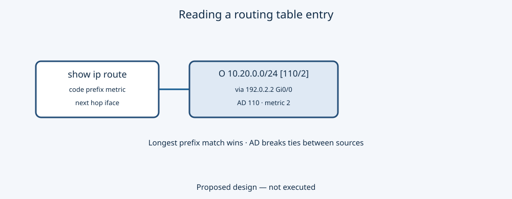

# CCNA IC-01 — تفسیر جدول Routing و انتخاب مسیر

**سطح:** CCNA. **پیش‌نیاز:** NF-09، NF-10 و NF-11. **اهداف رسمی:** `3.1.a` کد پروتکل Routing؛ `3.1.b` Prefix؛ `3.1.c` Network Mask؛ `3.1.d` Next Hop؛ `3.1.e` Administrative Distance؛ `3.1.f` Metric؛ `3.1.g` Gateway of Last Resort؛ `3.2.a` تعیین Longest Prefix Match؛ `3.2.b` تعیین Administrative Distance؛ `3.2.c` تعیین Metric پروتکل Routing. **وضعیت:** پیش‌نویس محتوایی؛ خروجی‌ها نمونهٔ طراحی‌شده و اجرا‌نشده‌اند.

## اهداف

1. هر ردیف جدول Routing را به اجزایش بشکنید.
2. تفاوت **Prefix**، **Mask** و **Next Hop** را دقیق بیان کنید.
3. با ترتیب صحیح، مسیر انتخاب‌شده برای یک مقصد را تعیین کنید.
4. تفاوت **Administrative Distance** و **Metric** را بفهمید و بدانید هر کدام کجا مقایسه می‌شوند.

## ۱. جدول Routing چیست؟

روتر برای هر بستهٔ ورودی باید بداند آن را از کدام Interface و به کدام همسایه بفرستد. جدول Routing مجموعه‌ای از بهترین مسیرهای شناخته‌شده برای هر مقصد است.

منابع مسیر:

- **Connected (C)** — شبکه‌ای که روی Interface تنظیم شده و Interface بالاست.
- **Local (L)** — آدرس خود Interface با `/32`؛ برای پاسخ به Ping خود آدرس.
- **Static (S)** — مسیر دستی.
- **OSPF (O)** — مسیر یادگرفته‌شده از OSPF.
- **EIGRP (D)** — مسیر یادگرفته‌شده از EIGRP.
- **BGP (B)** — مسیر BGP.
- **RIP (R)** — مسیر RIP.



## ۲. اجزای یک ردیف

```text
کد    Prefix/Mask            [AD/Metric]   via Next Hop       Interface
O     10.10.0.0/16            [110/20]      via 192.0.2.254    GigabitEthernet0/0
```

| جزء | معنا | نکته |
|---|---|---|
| `O` | منبع مسیر | OSPF |
| `10.10.0.0/16` | **Prefix** و **Mask** | شبکهٔ مقصد و اندازهٔ آن |
| `[110/20]` | **AD / Metric** | اعتماد به منبع / هزینهٔ مسیر |
| `192.0.2.254` | **Next Hop** | آدرس روتر بعدی |
| `GigabitEthernet0/0` | Interface خروجی | رابطی که بسته از آن خارج می‌شود |

جدول مسیر یا **RIB** مسیرهای منتخب Control Plane را نگه می‌دارد؛ **FIB/Forwarding Table** برای Lookup بسته‌ها به‌کار می‌رود و از RIB/Adjacency تغذیه می‌شود. `show ip route` معمولاً RIB را نمایش می‌دهد؛ وجود Route به‌تنهایی تحویل Packet یا سازگاری همهٔ Hardware Stateها را اثبات نمی‌کند. فرمان‌های مشاهدهٔ FIB وابسته به پلتفرم‌اند.

**Prefix** با **Mask** فرق دارد: Prefix آدرس شروع شبکه است، Mask (یا همان طول `/`) اندازهٔ شبکه را می‌گوید. `10.10.0.0` با Mask `/16` شبکه‌ای از `10.10.0.0` تا `10.10.255.255` است؛ با `/24` فقط تا `10.10.0.255`.

**Next Hop** باید برای Router به‌طور بازگشتی قابل‌حل باشد؛ در Static Route مبتنی بر Next Hop، مقصد بعدی لزوماً همیشه روی یک شبکهٔ مستقیماً متصل نیست. Router می‌تواند با Route دیگری Next Hop را Resolve کند، اما اگر زنجیرهٔ Resolve معتبر نباشد، Next Hop خود Router باشد یا محدودیت پلتفرم برقرار شود، Route ممکن است نصب نشود. `show ip route <next-hop>` و `show ip route <prefix>` را برای دیدن زنجیرهٔ Resolution بررسی کنید؛ رفتار و پیام CLI به IOS/پلتفرم وابسته است.

## ۳. Administrative Distance

AD معیار **اعتماد** به منبع مسیر است، نه کیفیت خود مسیر. مدیر شبکه به‌طور پیش‌فرض می‌گوید «مسیر دستی من از مسیر پروتکل بیشتر قابل‌اعتماد است».

| منبع | AD پیش‌فرض | پایه |
|---|---|---|
| Connected | 0 | Prefix روی Interface بالا و متصلِ مستقیم شناخته شده؛ رابط می‌تواند فیزیکی یا منطقی/SVI باشد |
| Static | 1 | تصمیم مدیر |
| eBGP | 20 | — |
| EIGRP (داخلی) | 90 | — |
| OSPF | 110 | — |
| RIP | 120 | — |
| EIGRP (خارجی) | 170 | — |
| iBGP | 200 | — |
| مسیر نامعتبر | 255 | هرگز نصب نمی‌شود |

نکتهٔ حیاتی: **AD برای انتخاب میان Routeهای کاندیدِ همان Prefix مقصد مقایسه می‌شود.** دو Route با Prefixهای متفاوت (`/24` و `/16`) را با AD در یک مقایسه رتبه‌بندی نمی‌کنیم؛ اگر هر دو نصب باشند، FIB برای هر Packet با Longest Prefix Match میان آن‌ها انتخاب می‌کند. این دو مرحله در §۵ جدا توضیح داده شده‌اند.

## ۴. Metric

Metric **هزینهٔ** رسیدن به مقصد است و معنایش در هر پروتکل متفاوت است:

| پروتکل | Metric |
|---|---|
| OSPF | Cost بر پایهٔ Bandwidth (به‌طور پیش‌فرض `10^8 / bandwidth`) |
| EIGRP | در Metric مرکب پیش‌فرض، حداقل Bandwidth و مجموع Delay؛ Load/Reliability فقط با تغییر K-valueها دخیل می‌شوند. MTU در Metric پیش‌فرض محاسبه نمی‌شود |
| RIP | شمارش Hop؛ تا 15 Hop قابل‌استفاده، 16 به معنی unreachable است |

**Metric دو پروتکل مختلف با هم مقایسه نمی‌شود.** عدد `20` در OSPF با عدد `20` در EIGRP هیچ ارتباطی ندارد. مقایسهٔ Metric تنها وقتی معنا دارد که هر دو مسیر از **یک پروتکل و یک Prefix** آمده باشند. در این حالت AD برابر است و Metric تعیین‌کننده می‌شود.

## ۵. انتخاب Route و Forwarding — دو مرحلهٔ جدا

**LPM، AD و Metric را در یک رتبه‌بندی سراسری نریزید.** دو تصمیم متفاوت داریم:

1. **Control Plane / RIB:** برای مسیرهای کاندید با همان Prefix مقصد، منبع Route و Administrative Distance مهم‌اند؛ برای چند مسیر از یک Protocol، Metric و Tie-breakهای همان Protocol به‌کار می‌روند. مسیرهای هم‌هزینه ممکن است با ECMP هم‌زمان نصب شوند.
2. **Forwarding / FIB:** پس از نصب بهترین Routeها برای Prefixهای مختلف، برای هر مقصد Packet، **Longest Prefix Match** در میان Routeهای موجود انتخاب می‌کند. بنابراین AD یک Route `/24` با AD یک Route `/16` برای مقایسهٔ مستقیم نیست؛ اگر هر دو نصب باشند، `/24` برای مقصد داخل آن خاص‌تر است.

### مرحلهٔ A — انتخاب منبع/Metric برای همان Prefix

دو منبع برای دقیقاً یک Prefix `10.10.0.0/16` را در نظر بگیرید:

```text
S     10.10.0.0/16  [1/0]      via 192.0.2.2
O     10.10.0.0/16  [110/20]   via 192.0.2.254
```

روی IOS با AD پیش‌فرض، Static با AD 1 بر OSPF با AD 110 ترجیح می‌یابد و در RIB نصب می‌شود؛ OSPF ممکن است همچنان مسیر را در Protocol State/LSDB داشته باشد. Static با AD بالاتر می‌تواند به‌عنوان Floating Static پیکربندی شود و وقتی Route با AD پایین‌تر حذف/نامعتبر شد، در صورت قابل‌حل بودن Next Hop نصب شود.

اگر چند Route **از یک Protocol** برای همان Prefix وجود داشته باشند، Metric همان Protocol را تفسیر کنید؛ مثلاً در OSPF Cost کمتر ترجیح دارد. Metricهای OSPF و EIGRP را با هم مقایسه نکنید.

### مرحلهٔ B — Longest Prefix Match میان Routeهای نصب‌شده

برای مقصد `10.10.1.5` فرض کنید RIB/FIB این Routeهای قابل‌استفاده را دارد:

```text
O     10.0.0.0/8        [110/2]
O     10.10.0.0/16      [110/20]
R     10.10.1.0/24      [120/2]
```

هر سه Prefix مقصد را پوشش می‌دهند. در Lookup این مقصد، `/24` خاص‌تر از `/16` و `/8` است؛ بنابراین `/24` انتخاب می‌شود، حتی اگر Route آن از RIP و AD پیش‌فرضش از OSPF بیشتر باشد. این نتیجه فقط وقتی برقرار است که هر دو Route برای Prefixهای **متفاوت** در جدول باشند؛ اگر AD بالاتر مانع نصبِ Route هم‌Prefix شده باشد، آن Route در FIB برای LPM شرکت نمی‌کند.

### ECMP — چند Next Hop

اگر Routeهای واجد شرایط برای همان Prefix از نظر معیارهای Protocol هم‌هزینه باشند، Router ممکن است چند Next Hop را هم‌زمان نصب کند. تعداد مسیرها، قابلیت Protocol و روش Load-Balancing (معمولاً Per-Flow و گاهی وابسته به Platform) پیکربندی/نسخه‌وابسته است؛ عدد ثابتی برای همهٔ دستگاه‌ها فرض نکنید.

## ۶. Gateway of Last Resort

اگر هیچ مسیر دقیقی برای مقصد نباشد، روتر به **Default Route** می‌رود:

```text
Gateway of last resort is 192.0.2.1 to network 0.0.0.0
```

این خط در خروجی `show ip route` تنها وقتی دیده می‌شود که Default Route نصب شده باشد. Default Route با Prefix `0.0.0.0/0` کم‌اختصاص‌ترین Route است؛ در Forwarding فقط برای مقصدهایی استفاده می‌شود که Route خاص‌تر قابل‌استفاده ندارند. نصب‌شدنش به Resolve شدن مسیر و تنظیمات روتر وابسته است.

## ۷. خروجی نمونه و تفسیر خط‌به‌خط

**نمونهٔ طراحی‌شده، اجرا‌نشده.** توپولوژی فرضی: R1 با `Gi0/0` به `192.0.2.0/24` (که R2 با آدرس `192.0.2.254` در آن است) و `Gi0/1` به `198.51.100.0/30`.

```text
R1# show ip route
Codes: L - local, C - connected, S - static, R - RIP, M - mobile, B - BGP
       D - EIGRP, EX - EIGRP external, O - OSPF, IA - OSPF inter area
       * - candidate default, U - per-user static route

Gateway of last resort is 192.0.2.254 to network 0.0.0.0

     192.0.2.0/24 is variably subnetted, 2 subnets, 2 masks
C       192.0.2.0/24 is directly connected, GigabitEthernet0/0
L       192.0.2.1/32 is directly connected, GigabitEthernet0/0
     198.51.100.0/30 is subnetted, 1 subnets
C       198.51.100.0/30 is directly connected, GigabitEthernet0/1
L       198.51.100.1/32 is directly connected, GigabitEthernet0/1
O     10.10.0.0/16 [110/20] via 192.0.2.254, GigabitEthernet0/0
S     10.20.0.0/24 [1/0] via 192.0.2.254, GigabitEthernet0/0
S*    0.0.0.0/0 [1/0] via 192.0.2.254, GigabitEthernet0/0
```

تفسیر خط‌به‌خط:

- `Gateway of last resort is 192.0.2.254 to network 0.0.0.0` — Default Route وجود دارد و از `192.0.2.254` می‌گذرد.
- `192.0.2.0/24 is variably subnetted, 2 subnets, 2 masks` — این شبکه با دو Mask مختلف در جدول است (`/24` و `/32`). همین جمله نشان می‌دهد چرا Local جدا نمایش داده می‌شود.
- `C 192.0.2.0/24 is directly connected, Gi0/0` — شبکهٔ متصل مستقیم.
- `L 192.0.2.1/32 is directly connected, Gi0/0` — آدرس خود Interface. **Reason for the L entry:** اگر کسی `192.0.2.1` را Ping کند، روتر باید بداند این آدرس خودش است و بسته را از سمت شبکه نفرستد.
- `C 198.51.100.0/30` و `L 198.51.100.1/32` — همان دو مورد برای Interface دوم.
- `O 10.10.0.0/16 [110/20] via 192.0.2.254, Gi0/0` — مسیر OSPF: AD = 110، Metric = 20. **Interface خروجی `Gi0/0` است**، چون Next Hop `192.0.2.254` در همان شبکهٔ `192.0.2.0/24` قرار دارد که به `Gi0/0` وصل است. اگر Next Hop در شبکه‌ای روی `Gi0/1` بود، Interface خروجی هم `Gi0/1` می‌شد؛ این دو همیشه باید با هم بخوانند.
- `S 10.20.0.0/24 [1/0]` — مسیر Static با AD = 1؛ بهتر از هر مسیر Dynamic.
- `S* 0.0.0.0/0 [1/0]` — ستاره یعنی نامزد Default. AD = 1 هم نشان می‌دهد Static است.

**نکته:** ترتیب سطرها در خروجی هیچ معنایی در انتخاب مسیر ندارد. `O` قبل از `S` آمده چون IOS مسیرها را بر اساس نوع مرتب نشان می‌دهد، نه اولویت.

```text
R1# show ip route 10.10.1.5
Routing entry for 10.10.0.0/16
  Known via "ospf 1", distance 110, metric 20, type intra area
  Routing Descriptor Blocks:
  * 192.0.2.254, from 192.0.2.254, via GigabitEthernet0/0
      Route metric is 20, traffic share count is 1
```

این فرمان دقیق‌ترین روش بررسی است: خود IOS می‌گوید کدام مسیر برای این مقصد انتخاب شده، از کدام منبع، با چه AD و چه Metric.

## ۸. عیب‌یابی

| نشانه | علت محتمل | بررسی |
|---|---|---|
| مقصد به Default می‌رود | هیچ Prefix دقیق‌تری در جدول نیست | `show ip route <dest>` |
| مسیر Static نصب نمی‌شود | مسیر Dynamic با AD کمتر وجود دارد | `show ip route <prefix>` |
| Route نصب نیست یا Interface/Next Hop مورد انتظار نیست | Resolve بازگشتی Next Hop، Routeهای میانی، Interface و محدودیت پلتفرم را بررسی کنید | `show ip route <next-hop>` و `show ip route <prefix>`؛ متن خطای واحدی برای همهٔ IOSها فرض نکنید |
| دو مسیر با AD برابر | برای ECMP باید همان Prefix و معیارهای لازم، از جمله Metric/Policy پروتکل، نیز برابر و قابلیت Multipath فعال باشد | `show ip route <prefix>` و تنظیمات همان پروتکل/Platform |
| Metric غیرمنتظره در OSPF | Reference Bandwidth پیش‌فرض | `show ip ospf interface` |

**سناریوی نقص طراحی‌شده (اجرا نشده):** مسیری با `/24` و AD = 120 اضافه می‌کنیم در حالی که مسیر `/16` با AD = 110 وجود دارد. انتظار: `/24` برنده است. بررسی: `show ip route <destination>`. این رفتار با اجرای واقعی ثبت نشده است.

## ۹. کاربرگ مشاهده‌ای اختیاری (PNETLab، طراحی‌شده و اجرا‌نشده)

این Objectiveها «تعیین/تفسیر» هستند، نه Configure and Verify؛ بخش اصلی با مثال‌های داده‌شده حل می‌شود. این Lab اختیاری است تا RIB، مسیرهای Connected/Local/Static و LPM را روی IOS-compatible Image ببینید. نام/نسخهٔ Image و Syntax VPCS را پیش از اجرا ثبت کنید؛ همهٔ فرمان‌ها فقط برای محیط ایزوله‌اند.

### توپولوژی و IP

```text
PC-A ─ Gi0/0 R1 Gi0/1 ── 192.0.2.0/30 ── Gi0/1 R2 Gi0/0 ─ PC-B
      10.10.0.1          .1         .2          10.20.0.1
PC-A: 10.10.0.10/24, GW 10.10.0.1     PC-B: 10.20.0.10/24, GW 10.20.0.1
```

| دستگاه | Interface | آدرس | نقش |
|---|---|---|---|
| R1 | Gi0/0 | `10.10.0.1/24` | Gateway LAN-A |
| R1 | Gi0/1 | `192.0.2.1/30` | لینک به R2 |
| R2 | Gi0/1 | `192.0.2.2/30` | لینک به R1 |
| R2 | Gi0/0 | `10.20.0.1/24` | Gateway LAN-B |
| PC-A | Ethernet | `10.10.0.10/24` | Client LAN-A |
| PC-B | Ethernet | `10.20.0.10/24` | Client LAN-B |

**پیکربندی پایهٔ پیشنهادی (نمونه، اجرا‌نشده):** روی R1 و R2 آدرس Interfaceها را تنظیم و `no shutdown` بزنید؛ سپس مسیر برگشت آزمایشی روی R2 قرار دهید. نام Interface ممکن است متفاوت باشد.

```text
R1(config)# interface GigabitEthernet0/0
R1(config-if)# ip address 10.10.0.1 255.255.255.0
R1(config-if)# no shutdown
R1(config)# interface GigabitEthernet0/1
R1(config-if)# ip address 192.0.2.1 255.255.255.252
R1(config-if)# no shutdown

R2(config)# interface GigabitEthernet0/1
R2(config-if)# ip address 192.0.2.2 255.255.255.252
R2(config-if)# no shutdown
R2(config)# interface GigabitEthernet0/0
R2(config-if)# ip address 10.20.0.1 255.255.255.0
R2(config-if)# no shutdown
R2(config)# ip route 10.10.0.0 255.255.255.0 192.0.2.1
```

روی VPCS، syntax متداول `ip <address>/<prefix> <gateway>` است؛ نسخه را بررسی کنید. پس از آدرس‌دهی PC-A/PC-B، ابتدا هرکدام Gateway خود را Ping کند. در R1 هنوز Route به LAN-B وجود ندارد.

### مراحل مشاهدهٔ Routing

1. روی R1 `show ip route` بگیرید. انتظار مفهومی: Routeهای `C` و `L` برای Interfaceهای بالا؛ قالب واقعی به IOS/نسخه وابسته است.
2. روی R1 Route شبکه‌ای و Default Route آزمایشی اضافه کنید:

   ```text
   ip route 10.20.0.0 255.255.255.0 192.0.2.2
   ip route 0.0.0.0 0.0.0.0 192.0.2.2
   ```

   سپس `show ip route 10.20.0.10` و `show ip route` را ثبت کنید؛ Default فقط در صورت نصب/Resolve شدن نمایش داده می‌شود.
3. یک Static Route کم‌تخصیص‌تر به همان Supernet اضافه کنید: `ip route 10.20.0.0 255.255.0.0 192.0.2.2`. هر دو Prefix `/16` و `/24` می‌توانند در RIB باشند؛ از R1 به PC-B Ping بزنید و با `show ip route 10.20.0.10` مشخص کنید `/24` خاص‌تر انتخاب می‌شود. Ping فقط Reachability همین آزمون را می‌سنجد.
4. فقط در Lab، `/24` را موقتاً با `no ip route 10.20.0.0 255.255.255.0 192.0.2.2` حذف کنید؛ `/16` اکنون برای مقصد `10.20.0.10` استفاده می‌شود. پس از ثبت، `/24` را بازگردانید و نتیجه را دوباره Verify کنید.
5. نمونهٔ RIB و خروجی را زمان‌دار ثبت کنید؛ ترتیب چاپ سطرها رتبهٔ انتخاب نیست. اگر `show ip cef` یا معادل FIB در Image موجود است، تفاوت RIB/FIB را هم یادداشت کنید. فرمان‌ها و خروجی‌های واقعی فقط بعد از اجرای مجاز قابل ثبت‌اند.

### تمرین تحلیلی AD و Metric (بدون OSPF lab)

این جدول **ورودی فرضی برای حل مسئله است، نه Capture**:

```text
S     10.20.0.0/24 [1/0]       via 192.0.2.2
O     10.20.0.0/24 [110/30]    via 192.0.2.6
R     10.20.0.0/16 [120/2]     via 192.0.2.10
```

- برای Prefix `/24` یکسان، AD کمترِ Static مسیر برندهٔ RIB است؛ OSPF با AD بالاتر در همان RIB نصب نمی‌شود.
- Route `/16` مقصد را نیز پوشش می‌دهد، اما اگر `/24` نصب و قابل‌استفاده باشد، FIB برای مقصد داخل آن `/24` را با LPM انتخاب می‌کند.
- اگر دو Route OSPF برای همان Prefix Cost `20` و `50` داشته باشند، Cost `20` ترجیح دارد؛ Routeهای برابر ممکن است ECMP شوند، مشروط به قابلیت/تنظیم.

### معیار موفقیت و شواهد تحویلی

در تحلیل دادهٔ نمونه، کدهای Route، Prefix/Mask، Next Hop و Gateway of Last Resort درست تفسیر شوند؛ برای همان Prefix، AD و سپس معیارهای پروتکل مربوطه از هم تفکیک شوند؛ برای مقصد نهایی، LPM میان Routeهای نصب‌شده اعمال شود. در Lab اختیاری، Routeهای C/L و Static باید با `show ip route` دیده شوند؛ با حذف کنترل‌شدهٔ `/24` مقصد به `/16` برود و با بازگرداندن `/24` انتخاب دوباره به Prefix دقیق‌تر برگردد. خروجی RIB/FIB (اگر پشتیبانی شود)، Pingهای مجاز و حالت قبل/نقص/بازیابی همراه Image/Version و زمان ثبت شوند. این Lab به‌تنهایی OSPF Metric، Floating Static واقعی یا انتخاب Route میان پروتکل‌ها را اثبات نمی‌کند؛ آن‌ها فقط با دادهٔ تحلیلی یا Topology/Protocol مکمل سنجیده می‌شوند. هیچ فرمانی اجرا یا پلتفرمی تأیید نشده است.

## ۱۰. سؤال‌ها و پاسخ

1. **Prefix و Mask چه تفاوتی دارند؟** Prefix آدرس شبکه است؛ Mask طول آن را می‌گوید. `10.0.0.0/8` و `10.0.0.0/16` دو شبکهٔ متفاوت با آدرس شروع یکسان‌اند.

2. **AD چیست و چرا وجود دارد؟** معیار اعتماد به منبع مسیر. به مدیر اجازه می‌دهد بدون حذف یک پروتکل، منبع دیگری را ترجیح دهد.

3. **AD، Metric و LPM چه ترتیبی دارند؟** یک رتبه‌بندی سراسری ندارند: RIB برای کاندیدهای همان Prefix منبع/AD و سپس معیارهای همان Protocol را می‌سنجد؛ FIB پس از نصب Routeها برای مقصد Packet، LPM را میان Prefixهای موجود اجرا می‌کند.

4. **برای مقصد داخل هر دو Prefix، `/24` از RIP و `/16` از OSPF در RIB نصب‌اند. کدام Forward می‌شود؟** `/24`، چون FIB در میان Routeهای نصب‌شده LPM می‌کند؛ این به معنی مقایسهٔ AD دو Prefix متفاوت نیست.

5. **دو مسیر `/16` داریم، یکی Static و یکی OSPF. کدام؟** Static با AD = 1.

6. **دو مسیر `/16` از OSPF با Metric 20 و 50 داریم. کدام؟** مسیر با Metric = 20.

7. **آیا می‌توان Metric یک مسیر OSPF را با Metric یک مسیر EIGRP مقایسه کرد؟** خیر؛ هر پروتکل Metric خودش را دارد. مقایسهٔ آن‌ها بی‌معناست.

8. **Gateway of Last Resort چیست؟** Default Route نصب‌شده. معادل محاوره‌ای «آخرین درِ خروجی» است.

9. **کد `L` چه تفاوتی با `C` دارد؟** `C` شبکهٔ متصل است، `L` آدرس خود Interface با `/32`. هر دو از Interface می‌آیند ولی دامنهٔ متفاوتی دارند.

10. **چرا Interface خروجی در سطر OSPF مهم است؟** چون باید با شبکهٔ Next Hop هم‌خوان باشد. اگر Next Hop در `Gi0/0` است، Interface خروجی هم باید `Gi0/0` باشد.

11. **ECMP چیست؟** نصب هم‌زمان چند مسیر با هزینهٔ برابر و توزیع ترافیک بین آن‌ها.

12. **ترتیب سطرهای `show ip route` چه معنایی دارد؟** فقط مرتب‌سازی نمایشی. هیچ ارتباطی با انتخاب مسیر ندارد.

## واژه‌نامه و چک‌لیست

Prefix: شبکهٔ مقصد؛ Mask: اندازهٔ شبکه؛ AD: اعتماد به منبع؛ Metric: هزینهٔ مسیر در یک پروتکل؛ Next Hop: روتر بعدی؛ Gateway of Last Resort: مسیر پیش‌فرض؛ ECMP: چند مسیر هم‌هزینه.

- [ ] انتخاب Route در RIB برای همان Prefix را از LPM در FIB میان Prefixهای نصب‌شده تفکیک می‌کنم.
- [ ] می‌دانم AD فقط برای همان Prefix مقایسه می‌شود.
- [ ] می‌دانم Metric بین پروتکل‌های مختلف مقایسه نمی‌شود.
- [ ] Interface خروجی را با شبکهٔ Next Hop هم‌خوان بررسی می‌کنم.
- [ ] برای یافتن مسیر واقعی از `show ip route <dest>` استفاده می‌کنم، نه از نگاه کلی به جدول.
