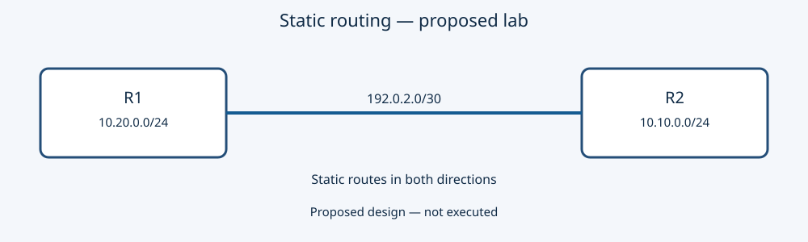

# CCNA IC-02 — Static Routing در IPv4 و IPv6

**سطح:** CCNA. **پیش‌نیاز:** IC-01 و NF-09. **اهداف رسمی:** `3.3.a` پیکربندی و بررسی Static Default Route در IPv4 و IPv6؛ `3.3.b` Static Network Route؛ `3.3.c` Static Host Route؛ `3.3.d` Floating Static Route. **وضعیت:** پیش‌نویس محتوایی؛ طراحی عملی انجام شده و **اجرا نشده** است. مدل و نسخهٔ IOS انتخاب نشده. همهٔ خروجی‌ها نمونهٔ طراحی‌شده‌اند.

## اهداف

1. چهار نوع Static Route را تشخیص دهید و بدانید هر کدام چه زمانی به‌کار می‌آید.
2. مسیر را با Mask درست بنویسید و اشتباه رایج Mask را تشخیص دهید.
3. جدول Routing را بعد از افزودن مسیر بخوانید و بگویید چرا مسیر آمده یا نیامده.
4. Floating Static را با Administrative Distance بسازید و رفتار آن را در قطع مسیر اصلی توضیح دهید.

## ۱. چرا Static Route؟

روتر برای فورواردکردن بسته از جدول مسیریابی خود استفاده می‌کند؛ مسیرهای شبکه‌های مستقیم از رابط‌های فعال می‌آیند و مسیرهای مقصدهای دیگر باید دستی تعریف شوند (**Static**) یا از پروتکل Routing آموخته شوند (**Dynamic** مانند OSPF).

Static کجا مناسب است؟

- شبکهٔ کوچک با توپولوژی ثابت.
- مسیر پیش‌فرض به سمت ISP.
- مسیر پشتیبان برای یک لینک اصلی (Floating Static).
- مسیر به یک Prefix که پروتکل Routing آن را تبلیغ نمی‌کند.

محدودیت مهم Static: مسیر ثابت خودش کیفیت دسترسی تا مقصد را نمی‌سنجد. اگر رابط مستقیم یا مسیر حل Next Hop حذف شود، IOS معمولاً مسیر وابسته را هم کنار می‌گذارد؛ اما اگر Next Hop هنوز از مسیری دیگر Resolve شود یا خرابی در پایین‌دست باشد، مسیر ممکن است نصب بماند و ترافیک سیاه‌چاله شود. برای پایش دسترس‌پذیری فراتر از همسایگی، به Tracking/IP SLA یا Routing پویا و طراحی متناسب با پلتفرم نیاز است.

## ۲. چهار نوع Static Route

| نوع | IPv4 | IPv6 | کاربرد |
|---|---|---|---|
| **Default** | `0.0.0.0/0` | `::/0` | «هر مقصدی که مسیر دقیق‌تر ندارد» — معمولاً به سمت ISP |
| **Network** | Prefix و Mask شبکه | Prefix/طول | کل یک Subnet یا Supernet |
| **Host** | `/32` | `/128` | یک دستگاه خاص |
| **Floating** | همان Prefix با AD بالاتر | همان | پشتیبان؛ فقط وقتی مسیر اصلی نیست |

### دربارهٔ Mask — رایج‌ترین خطای نوشتن Static Route

اگر شبکهٔ شما `10.10.0.0/24` است، Mask آن `255.255.255.0` است. نوشتن `ip route 10.10.0.0 255.255.0.0 ...` مسیر را برای `10.10.0.0/16` می‌سازد که از LAN واقعی گسترده‌تر است. روتر ممکن است آن را در جدول نصب کند و مقصدهای ناخواستهٔ دیگرِ داخل `/16` را هم به همان Next Hop بفرستد؛ اگر مسیر دقیق‌تری مثل `/24` وجود داشته باشد، آن Prefix دقیق‌تر برای محدودهٔ خودش برنده است. نتیجه به کل جدول مسیریابی بستگی دارد.

قاعدهٔ عملی: Mask را از همان `/` عددی که در طراحی نوشته‌اید بسازید. `/24` یعنی `255.255.255.0`، نه `255.255.0.0`.

## ۳. توپولوژی کاربرگ

**PNETLab مستقل — طراحی‌شده و اجرا‌نشده.** توپولوژی پایه دو روتر و یک LAN پشت هر کدام دارد. برای مثال Floating Static در §۴، یک روتر R3 و لینک پشتیبان جداگانه نیز اضافه می‌شود؛ این افزونه در شکل پایه نیست.

```text
   LAN-A 10.20.0.0/24                          LAN-B 10.10.0.0/24
        |                                            |
   [Gi0/1] R1 [Gi0/0] ── 192.0.2.0/30 ── [Gi0/0] R2 [Gi0/1]
   10.20.0.1                                  10.10.0.1
        |                                            |
     PC-A                                          PC-B
   10.20.0.10                                    10.10.0.10
```

| دستگاه | رابط | آدرس IPv4 | آدرس IPv6 |
|---|---|---|---|
| R1 | Gi0/0 | `192.0.2.1/30` | `2001:db8:12::1/64` |
| R1 | Gi0/1 | `10.20.0.1/24` | `2001:db8:20::1/64` |
| R2 | Gi0/0 | `192.0.2.2/30` | `2001:db8:12::2/64` |
| R2 | Gi0/1 | `10.10.0.1/24` | `2001:db8:10::1/64` |
| R1 (پشتیبان، فقط مثال Floating) | Gi0/2 | `192.0.2.5/30` | `2001:db8:13::1/64` |
| R3 (پشتیبان، فقط مثال Floating) | Gi0/0 | `192.0.2.6/30` | `2001:db8:13::2/64` |
| R3 (متصل به LAN-B) | Gi0/1 | `10.10.0.2/24` | `2001:db8:10::2/64` |
| PC-A | eth0 | `10.20.0.10/24` | `2001:db8:20::10/64` |
| PC-B | eth0 | `10.10.0.10/24` | `2001:db8:10::10/64` |

Gateway پیش‌فرض PC-A همان `10.20.0.1` و PC-B همان `10.10.0.1` است. برای مثال Floating، رابط LAN-B روترهای R2 (`10.10.0.1/24`) و R3 (`10.10.0.2/24`) باید به یک دامنهٔ لایهٔ ۲ مشترک وصل باشد؛ R1 به R3 از لینک جداگانهٔ `192.0.2.4/30` می‌رسد. R3 باید مسیر بازگشت به LAN-A را از R1 داشته باشد. این افزونه فقط برای بخش Floating است و در نمودار پایهٔ زیر نمایش داده نشده است.

**VPCS برای دو Client در سناریوی پایه، syntax نمونه و نسخه‌وابسته:**

```text
PC-A> ip 10.20.0.10/24 10.20.0.1
PC-A> ip6 2001:db8:20::10/64 2001:db8:20::1
PC-B> ip 10.10.0.10/24 10.10.0.1
PC-B> ip6 2001:db8:10::10/64 2001:db8:10::1
```

نام فرمان IPv6 یا روش پیکربندی و Verification در VPCS/Imageهای مختلف باید با نسخهٔ واقعی تطبیق شود؛ دستورهای نمونه اجرا نشده‌اند. اگر نسخهٔ لاب IPv6 را پشتیبانی نکند، از Client سازگار استفاده کنید یا IPv6 را به‌عنوان بخش متنی نگه دارید—عدم پشتیبانی را نتیجهٔ Routing تلقی نکنید.



## ۴. پیکربندی به ترتیب اجرا

**همهٔ فرمان‌ها اجرا‌نشده‌اند.**

### گام ۱ — آدرس‌دهی رابط‌ها (پیش‌نیاز هر مسیر)

روی R1:

```text
enable
configure terminal
interface GigabitEthernet0/0
 ip address 192.0.2.1 255.255.255.252
 ipv6 address 2001:db8:12::1/64
 no shutdown
 exit
interface GigabitEthernet0/1
 ip address 10.20.0.1 255.255.255.0
 ipv6 address 2001:db8:20::1/64
 no shutdown
 exit
end
```

روی R2:

```text
enable
configure terminal
interface GigabitEthernet0/0
 ip address 192.0.2.2 255.255.255.252
 ipv6 address 2001:db8:12::2/64
 no shutdown
 exit
interface GigabitEthernet0/1
 ip address 10.10.0.1 255.255.255.0
 ipv6 address 2001:db8:10::1/64
 no shutdown
 exit
end
```

`255.255.255.252` همان `/30` است. مثال‌های این درس از Mask نقطه‌ایِ متداول IOS استفاده می‌کنند؛ پذیرش قالب Prefix-length مانند `ip address 192.0.2.1/30` به نسخه و پلتفرم وابسته است و باید در Command Reference همان دستگاه بررسی شود.

### گام ۲ — Static Route در IPv4

روی R1 (شبکهٔ B پشت R2 است):

```text
configure terminal
ip route 10.10.0.0 255.255.255.0 192.0.2.2
end
```

روی R2 (شبکهٔ A پشت R1 است):

```text
configure terminal
ip route 10.20.0.0 255.255.255.0 192.0.2.1
end
```

تفسیر فرمان `ip route 10.10.0.0 255.255.255.0 192.0.2.2`:

- `ip route` — ساخت یک مسیر Static در جدول IPv4.
- `10.10.0.0` — مقصد (Prefix).
- `255.255.255.0` — Mask مقصد؛ همان `/24`.
- `192.0.2.2` — Next Hop؛ آدرس روتر بعدی که بسته باید به او تحویل شود.

توجه: در مثال‌های این درس، Next Hop در شبکهٔ مستقیم قرار دارد. برخی نسخه‌ها/پلتفرم‌ها Static Next Hop را به‌طور بازگشتی از روی مسیرهای دیگر Resolve می‌کنند، اما قواعد، امکان نصب و زمان به‌روزرسانی وابسته به نسخه است؛ حتی همهٔ Routeها (برای مثال Default) الزاماً برای Resolution مجاز نیستند. مسیرِ معمولی فقط وقتی واجد نصب است که Next Hop طبق قواعد همان پلتفرم به Interface خروجی معتبر Resolve شود و به خود مسیر برنگردد. اگر Resolve ممکن نباشد، مسیر در RIB نصب نمی‌شود؛ نحو و رفتار دقیق را در Command Reference نسخهٔ هدف بررسی کنید.

### گام ۳ — Default Route

روی R1، در طراحی‌ای که R2 واقعاً Next Hop به سمت بالادست است، Default Route می‌تواند چنین باشد؛ ISP/بالادست در توپولوژی این درس مدل نشده است:

```text
configure terminal
ip route 0.0.0.0 0.0.0.0 192.0.2.2
end
```

در این مثال، فقط Default Route روی R1 به سمت R2 نشان داده می‌شود. در توپولوژی فعلی، روی R2 مسیر پیش‌فرض به R1 اضافه نکنید: دو Default Route متقابل می‌توانند ترافیک مقصدهای ناشناخته را بین دو روتر Loop کنند. اگر R2 روتر مرزیِ شبکه‌ای با بالادست واقعی باشد، Default Route آن باید به Next Hop بالادستِ قابل‌دسترسی اشاره کند؛ چنین ISP/لینکی در توپولوژی این درس نیست.

`0.0.0.0 0.0.0.0` یعنی «هر مقصدی». طولانی‌ترین Prefix برنده است، پس مسیرهای دقیق‌تر مثل `/24` همیشه بر Default مقدم‌اند.

### گام ۴ — Host Route

اگر می‌خواهید برای یک میزبان خاص مسیرِ جداگانه‌ای تعریف کنید (مثلاً `10.10.0.50` در شبکهٔ LAN-B):

```text
configure terminal
ip route 10.10.0.50 255.255.255.255 192.0.2.2
end
```

`/32` دقیق‌ترین Prefix ممکن است؛ حتی از `/24` هم مقدم است.

### گام ۵ — IPv6 Static Route

روی روترهایی که باید IPv6 را فوروارد کنند، قابلیت را بر اساس پشتیبانی/پیش‌فرض نسخه فعال یا بررسی کنید: در توپولوژی پایه R1 و R2؛ اگر افزونهٔ Floating IPv6 را به‌کار می‌برید، R3 نیز.

```text
R1(config)# ipv6 unicast-routing
R2(config)# ipv6 unicast-routing
```

مسیر رفت از R1 به LAN-B و یک Host Route نمونه:

```text
R1(config)# ipv6 route 2001:db8:10::/64 2001:db8:12::2
R1(config)# ipv6 route 2001:db8:10::50/128 2001:db8:12::2
R1(config)# ipv6 route ::/0 2001:db8:12::2
```

مسیر بازگشت از R2 به LAN-A:

```text
R2(config)# ipv6 route 2001:db8:20::/64 2001:db8:12::1
```

Default Route در این توپولوژی فقط روی R1 به R2 نشان داده شده است. Default روی روتر مرزی باید به بالادست واقعی برسد؛ مسیرهای پیش‌فرض متقابل به همسایهٔ داخل شبکه نسازید. `ipv6 unicast-routing` برای Forwarding IPv6 لازم است؛ رفتار پیش‌فرض و پیکربندی را در نسخهٔ IOS هدف بررسی کنید.

### گام ۶ — Floating Static و Next Hop پشتیبان

این بخش از R3 و لینک پشتیبانِ افزوده‌شده در جدول §۳ استفاده می‌کند. Next Hop `192.0.2.6` روی لینک مستقیم R1–R3 قرار دارد؛ R3 باید مسیر خروج به LAN-B و مسیر بازگشت به LAN-A داشته باشد.

در توپولوژی پایه، مسیر IPv4 اصلی R1 به LAN-B یک Static با AD=1 است که در بخش ۴، گام ۲ پیکربندی می‌شود. ابتدا لینک‌ها و رابط‌های R3 را در Image آزمایشیِ مجاز آدرس‌دهی کنید؛ نام رابط‌ها به دستگاه انتخابی بستگی دارد:

```text
R1(config)# interface GigabitEthernet0/2
R1(config-if)# ip address 192.0.2.5 255.255.255.252
R1(config-if)# ipv6 address 2001:db8:13::1/64
R1(config-if)# no shutdown

R3(config)# ipv6 unicast-routing
R3(config)# interface GigabitEthernet0/0
R3(config-if)# ip address 192.0.2.6 255.255.255.252
R3(config-if)# ipv6 address 2001:db8:13::2/64
R3(config-if)# no shutdown
R3(config)# interface GigabitEthernet0/1
R3(config-if)# ip address 10.10.0.2 255.255.255.0
R3(config-if)# ipv6 address 2001:db8:10::2/64
R3(config-if)# no shutdown
```

اگر همان مسیر اصلی را حفظ می‌کنید، پشتیبان با AD=10 نمونه‌ای روشن است:

```text
R1(config)# ip route 10.10.0.0 255.255.255.0 192.0.2.6 10
R3(config)# ip route 10.20.0.0 255.255.255.0 192.0.2.5
R2(config)# ip route 10.20.0.0 255.255.255.0 10.10.0.2 200
```

R1 مسیر LAN-B را از R2 با AD=1 ترجیح می‌دهد؛ وقتی آن مسیر از جدول حذف شود، مسیر R1 از راه R3 قابل نصب است. مسیر R2 با AD=200 فقط برای بازگشت در صورت ناموجودشدن مسیر اصلی R2 به LAN-A است؛ R3 مسیر مستقیم به LAN-B دارد و از راه `192.0.2.5` به LAN-A می‌رسد. مسیر رفت و برگشت باید هر دو بررسی شوند.

اگر به‌جای Static اصلی، R1 مسیر OSPF با AD پیش‌فرض 110 داشته باشد، مسیر Static با AD=200 می‌تواند پشتیبان باشد؛ **اما** Static اصلی `10.10.0.0/24` با AD=1 که در بخش ۴، گام ۲ تنظیم شد را باید در این آزمایش حذف/غیرفعال کرد تا OSPF Route در RIB نصب شود. همین شرط را برای هر پروتکل/مسیر اصلی اعمال کنید.

```text
R1(config)# no ip route 10.10.0.0 255.255.255.0 192.0.2.2
R1(config)# ip route 10.10.0.0 255.255.255.0 192.0.2.6 200
```

برای IPv6، با مسیر اصلی Static از بخش ۴، گام ۵ می‌توان یک پشتیبان AD=10 به لینک R1–R3 افزود؛ R3 و R2 نیز برای مسیر بازگشت به مسیرهای متناسب نیاز دارند:

```text
R1(config)# ipv6 route 2001:db8:10::/64 2001:db8:13::2 10
R2(config)# ipv6 route 2001:db8:20::/64 2001:db8:12::1
R2(config)# ipv6 route 2001:db8:20::/64 2001:db8:10::2 10
R3(config)# ipv6 route 2001:db8:20::/64 2001:db8:13::1
```

اگر مسیر اصلی IPv6 پویا با AD=110 است، Static اصلیِ هم‌Prefix را حذف/غیرفعال و برای پشتیبان AD بالاتر (مثلاً 200) انتخاب کنید. عدد AD فقط مقایسهٔ نصب در جدول محلی است؛ سلامت کامل مسیر، وجود Route بازگشت یا پایان‌به‌پایان را تضمین نمی‌کند.

## ۵. Verification و تفسیر خروجی

**نمونهٔ طراحی‌شده، اجرا‌نشده.**

```text
R1# show ip route
Codes: L - local, C - connected, S - static, R - RIP, M - mobile, B - BGP
       D - EIGRP, EX - EIGRP external, O - OSPF, IA - OSPF inter area
       * - candidate default, U - per-user static route

Gateway of last resort is 192.0.2.2 to network 0.0.0.0

     192.0.2.0/30 is subnetted, 1 subnets
C        192.0.2.0/30 is directly connected, GigabitEthernet0/0
L        192.0.2.1/32 is directly connected, GigabitEthernet0/0
     10.0.0.0/8 is variably subnetted, 4 subnets, 2 masks
C        10.20.0.0/24 is directly connected, GigabitEthernet0/1
L        10.20.0.1/32 is directly connected, GigabitEthernet0/1
S     10.10.0.50/32 [1/0] via 192.0.2.2
S     10.10.0.0/24 [1/0] via 192.0.2.2
S*    0.0.0.0/0 [1/0] via 192.0.2.2
```

خط‌به‌خط:

- `C` — Connected؛ شبکه‌ای که روی Interface تنظیم شده است.
- `L` — Local؛ آدرس خود Interface با `/32`. این مسیر برای پاسخ به Ping خود آدرس است.
- `S` — Static.
- `S*` — Static Default Route؛ ستاره یعنی نامزد Default.
- `[1/0]` — اول عدد **Administrative Distance** و دوم **Metric**. برای Static مقدار پیش‌فرض AD = 1 و Metric = 0 است.
- `via 192.0.2.2` — Next Hop.
- `Gateway of last resort is 192.0.2.2` — روتر Default Route دارد و آن را برای مقاصد ناشناخته استفاده می‌کند.

**نکتهٔ مهم در این خروجی:** ترتیب نمایش `10.10.0.50/32` قبل از `10.10.0.0/24` است. این ترتیب فقط نمایشی است. هنگام فوروارد، **همیشه طولانی‌ترین Prefix برنده است**، مستقل از ترتیب سطرها.

```text
R1# show ip route 10.10.0.50
Routing entry for 10.10.0.50/32
  Known via "static", distance 1, metric 0
  Routing Descriptor Blocks:
  * 192.0.2.2
      Route metric is 0, traffic share count is 1
```

`Routing entry for .../32` و `Known via "static", distance 1` دقیقاً نشان می‌دهند کدام مسیر انتخاب شده است. برای بررسی انتخاب مسیر همیشه این فرمان دقیق‌تر از نگاه کردن به جدول کامل است.

```text
R1# show ip route static
S     10.10.0.50/32 [1/0] via 192.0.2.2
S     10.10.0.0/24 [1/0] via 192.0.2.2
S*    0.0.0.0/0 [1/0] via 192.0.2.2
```

```text
R1# show ipv6 route static
S   2001:db8:10::50/128 [1/0]
     via 2001:db8:12::2
S   2001:db8:10::/64 [1/0]
     via 2001:db8:12::2
S   ::/0 [1/0]
     via 2001:db8:12::2
```

در IPv6، `[1/0]` همان AD و Metric است. Default Route در IPv6 به‌صورت `::/0` نمایش داده می‌شود.

## ۶. عیب‌یابی

| نشانه | علت‌های محتمل | بررسی |
|---|---|---|
| مسیر در جدول نیست | Mask اشتباه، Next Hop غیرقابل‌دسترسی، Interface خاموش | `show ip route`، `show ip interface brief` |
| مسیر هست ولی Ping جواب نمی‌دهد | مسیر برگشت در روتر مقابل نیست | `show ip route` روی هر دو روتر |
| مسیر به‌جای دیگری انتخاب می‌شود | Prefix دقیق‌تر یا AD کمتر وجود دارد | `show ip route <prefix>` |
| Floating فعال نمی‌شود | مسیر اصلی هنوز در جدول است | `show ip route` و بررسی وضعیت لینک اصلی |
| IPv6 کار نمی‌کند | `ipv6 unicast-routing` فعال نیست | `show ipv6 route` و `show running-config` |
| Ping یک‌طرفه | مسیر برگشت، ACL/Firewall یا فیلتر ICMP | Ping از هر دو سمت، مسیرها و سیاست‌های فیلتر را بررسی کنید |

**سناریوی نقص طراحی‌شده (اجرا نشده):** اگر مسیر R2 به LAN-A به‌اشتباه با `10.20.0.0 255.255.0.0` تعریف شود، Route گسترده‌ترِ `10.20.0.0/16` ممکن است در جدول نصب شود. اگر Static صحیح `/24` هم باقی مانده باشد، ترافیک واقعی LAN-A از Prefix دقیق‌تر `/24` می‌رود؛ اما آدرس‌هایی مانند `10.20.1.10` با `/16` از R2 به R1 می‌روند و Default یک‌طرفهٔ R1 به R2 می‌تواند برای آن‌ها Loop بسازد. اگر `/24` را با `/16` جایگزین کنید، R2 همچنان مقصدهای مجاور را به R1 می‌فرستد؛ برای LAN-A خود R1 مسیر Connected دقیق‌تر `/24` دارد. خروجی و مسیر واقعی را فقط با آزمون روی جدول کامل همان توپولوژی می‌توان ثبت کرد.

## ۷. کاربرگ مستقل PNETLab

1. برای بخش پایه، دو Router و دو PC را با آدرس‌های جدول بخش ۳ پیکربندی کنید. برای Floating، افزونهٔ R3 و لینک R1–R3 و اتصال LAN-B به R2/R3 را دقیقاً طبق جدول/توضیح همان بخش بسازید؛ Floating را روی توپولوژی دو-Router ادعا نکنید.
2. بدون هیچ Static Route، از PC-A به PC-B پینگ کنید و شکست را ثبت کنید.
3. مسیر رفت را روی R1 اضافه کنید و دوباره پینگ کنید. شکست را ثبت کنید و دلیل آن را توضیح دهید.
4. مسیر برگشت را روی R2 اضافه کنید و موفقیت پینگ را ثبت کنید.
5. در R1 مسیر Host برای `10.10.0.10/32` اضافه کنید و با `show ip route 10.10.0.10` تایید کنید که `/32` انتخاب می‌شود.
6. مسیر پشتیبان R1 را به Next Hop واقعیِ لینک R1–R3 (`192.0.2.6`) با AD=10 اضافه کنید، در حالی که Static اصلی با AD=1 برقرار است؛ تفاوت مسیرِ پیکربندی‌شده و مسیرِ نصب‌شده در RIB را ثبت کنید.
7. در محیط ایزوله، مسیر اصلی را حذف یا لینک اصلی را قطع کنید و بررسی کنید Floating فقط در صورت Resolve شدن Next Hop پشتیبان نصب می‌شود. برای آزمون OSPF به‌عنوان Primary، ابتدا Static اصلی هم‌Prefix روی R1 را حذف کنید و برای Backup از AD بالاتر از 110 (مثلاً 200) استفاده کنید. مسیر بازگشت R2 و Route روی R3 را نیز بررسی کنید؛ سپس مسیر/لینک اصلی و مسیرهای موقت را دقیقاً به حالت پایه برگردانید و RIB را دوباره Verify کنید.
8. همین مراحل را با IPv6 تکرار کنید؛ Prefix/Routeهای IPv6 موقت و مسیر بازگشت را نیز پس از آزمون Restore کنید.

### معیار موفقیت و بستهٔ شواهد

برای IPv4 و IPv6، Routeهای شبکه/Default/Host باید با Prefix/Mask درست و Next Hop قابل‌Resolve پیکربندی و در جدول مشاهده شوند؛ آزمون رفت‌وبرگشت Clientها پس از افزودن Routeهای دو سمت ثبت شود. `/32` و `/128` باید برای مقصد میزبان از Prefix کم‌تخصیص‌تر انتخاب شوند. در افزونهٔ Floating، R3 و مسیر برگشت باید حاضر باشند؛ مسیر اصلی هنگام سلامت در RIB منتخب بماند، پس از حذف/قطع کنترل‌شده مسیر جایگزین فقط اگر Next Hop قابل‌دسترسی است نصب شود و با بازیابی مسیر اصلی، RIB/Reachability به حالت پایه برگردد. تحویل شامل Image/Version/Interface، جدول آدرس، فرمان‌های واقعی، `show ip route` و `show ipv6 route` قبل/حین/پس از نقص، و Pingهای دوطرفه است؛ خروجی‌ها فقط پس از اجرای مجاز ثبت شوند. **هیچ‌یک از این مراحل در نسخهٔ فعلی اجرا نشده‌اند.**

## ۸. سؤال‌ها و پاسخ

1. **شبکهٔ مقصد `10.10.0.0/24` است. Mask در Static Route چه باید باشد؟** `255.255.255.0`. نوشتن `255.255.0.0` مسیر را برای `/16` می‌سازد که شبکهٔ دیگری است.

2. **چرا مسیر در جدول نمی‌آید؟** رابط خاموش، Next Hop غیرقابل‌دسترسی/خودبازگشتی، محدودیت Resolution در نسخه یا مسیر هم‌Prefix با AD پایین‌تر را بررسی کنید. Resolution بازگشتی در همهٔ پلتفرم‌ها و برای همهٔ Routeها یکسان نیست؛ Command Reference همان نسخه را ببینید.

3. **`[1/0]` یعنی چه؟** Administrative Distance = 1 و Metric = 0.

4. **چرا Static به‌طور پیش‌فرض AD = 1 دارد؟** این مقدار، انتخاب منبع مسیر در همان روتر است؛ در رقابت برای Prefix یکسان، AD کمتر معمولاً ترجیح داده می‌شود (Static=1، OSPF=110، RIP=120 در IOS). AD کیفیت واقعی یا سلامت پایان‌به‌پایان مسیر را اندازه نمی‌گیرد.

5. **Floating Static چطور کار می‌کند؟** برای همان Prefix، AD آن از مسیر اصلی بالاتر تنظیم می‌شود تا مسیر ترجیحیِ با AD کمتر اولویت داشته باشد. پشتیبان فقط وقتی قابل انتخاب است که مسیر اصلی کنار برود و Next Hop پشتیبان طبق قواعد پلتفرم Resolve شود؛ AD به‌تنهایی سلامت مقصد را نمی‌سنجد.

6. **مرز Host Route و Network Route چیست؟** `/32` برای یک آدرس، `/24` و مشابه برای یک شبکه. هر دو Static‌اند؛ تفاوت فقط در طول Prefix است.

7. **Ping یک‌طرفه چه معنایی دارد؟** به‌تنهایی ثابت نمی‌کند Echo به مقصد رسیده یا فقط مسیر برگشت مشکل دارد؛ ACL/Firewall، فیلتر ICMP و مسیر نامتقارن هم محتمل‌اند. مسیر رفت‌وبرگشت و سیاست فیلتر را جدا بررسی کنید.

8. **Default Route چه زمانی استفاده می‌شود؟** فقط وقتی هیچ Prefix دقیق‌تری برای مقصد وجود ندارد.

9. **چرا IPv6 به `ipv6 unicast-routing` نیاز دارد؟** بدون آن، روتر بسته‌های IPv6 را فوروارد نمی‌کند حتی اگر Interface آدرس داشته باشد.

10. **اگر لینک قطع شود، Static Route خودش حذف می‌شود؟** برای Static معمولی، اگر Interface یا مسیر Resolve کردن Next Hop از RIB خارج شود، IOS معمولاً Route را از RIB برمی‌دارد؛ گزینه‌هایی مثل `permanent` و تنظیمات Tracking می‌توانند رفتار را تغییر دهند. خرابی پایین‌دست که Next Hop را همچنان قابل Resolve بگذارد ممکن است آشکار نشود و ترافیک سیاه‌چاله شود. برای پایش عمیق‌تر، Tracking/IP SLA یا Routing پویا را متناسب با نسخه به‌کار ببرید.

## واژه‌نامه و چک‌لیست

Static Route: مسیر دستی؛ Default Route: مسیر پیش‌فرض `0.0.0.0/0` یا `::/0`؛ Host Route: مسیر تک‌آدرس؛ Floating Static: مسیر پشتیبان با AD بالاتر؛ Next Hop: روتر بعدی.

- [ ] Mask را از همان طول Prefix می‌سازم، نه از حافظه.
- [ ] مسیر برگشت را همیشه در هر دو سمت بررسی می‌کنم.
- [ ] تفاوت ترتیب نمایش با ترتیب انتخاب (Longest Prefix) را می‌دانم.
- [ ] می‌دانم ماندن Static در RIB به Resolve شدن Next Hop، وضعیت Interface و گزینه‌هایی مثل `permanent`/Tracking بستگی دارد.
- [ ] در IPv6 فرمان `ipv6 unicast-routing` را فراموش نمی‌کنم.

### منبع فنی برای رفتار و نحو فرمان

- [Cisco IOS XE 17.6 — `ip route`](https://www.cisco.com/c/en/us/td/docs/ios-xml/ios/iproute_pi/command/iri-cr-book/iri-cr-a1.html#wp1220876511) و [حل بازگشتی مسیرهای IPv6](https://www.cisco.com/c/en/us/td/docs/ios-xml/ios/iproute_pi/command/iri-cr-book/iri-cr-a1.html#wp3763896393) — پیش‌فرض AD و قواعد/محدودیت‌های نسخه‌ای؛ برای IOS هدف، Command Reference همان نسخه را بررسی کنید.
