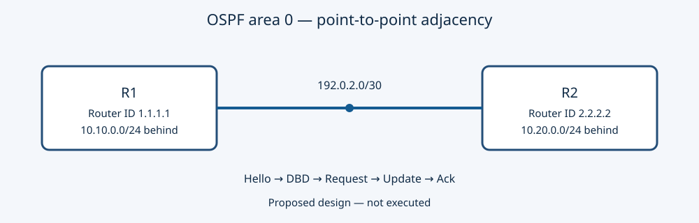

# CCNA IC-03 — OSPFv2 در Single-Area: Neighbor، Adjacency و Router ID

**سطح:** CCNA. **پیش‌نیاز:** IC-01، IC-02 و NF-09. **اهداف رسمی:** `3.4.a` پیکربندی و بررسی Single-Area OSPFv2 Neighbor Adjacencies؛ `3.4.b` پیکربندی و بررسی لینک Point-to-Point؛ `3.4.d` پیکربندی و بررسی Router ID. **وضعیت:** پیش‌نویس محتوایی؛ طراحی عملی انجام شده و **اجرا نشده** است. مدل و نسخهٔ IOS انتخاب نشده. همهٔ خروجی‌ها نمونهٔ طراحی‌شده‌اند.

## اهداف

1. توضیح دهید OSPF چه چیزی را حساب می‌کند و چرا به همسایگی نیاز دارد.
2. تفاوت **Neighbor** و **Adjacency** را دقیق بیان کنید.
3. تفاوت **آدرس‌دهی Interface** و **فعال‌سازی OSPF با فرمان network** را تشخیص دهید.
4. Router ID را انتخاب و تنظیم کنید و بدانید چرا یکتا بودن آن اجباری است.
5. حالت‌های Neighbor را از خروجی `show ip ospf neighbor` بخوانید.

## ۱. OSPF چه می‌کند؟

OSPF یک پروتکل **Link-State** است. هر روتر:

1. همسایه‌هایش را با پیام **Hello** کشف می‌کند.
2. با همسایه‌ها اطلاعات لینک‌ها را مبادله می‌کند (LSA).
3. یک پایگاه دادهٔ کامل از توپولوژی می‌سازد (**LSDB**).
4. با الگوریتم **Dijkstra (SPF)** بهترین درخت مسیر را از دید خودش حساب می‌کند.
5. نتیجه را در جدول Routing نصب می‌کند.

تفاوت بنیادی با Distance-Vector (مثل RIP): در RIP هر روتر فقط به همسایه‌اش اعتماد می‌کند و «مسیر من ۲ هاپ است» را می‌پذیرد. در OSPF هر روتر **نقشهٔ کامل** را دارد و خودش تصمیم می‌گیرد. همین موضوع باعث می‌شود OSPF در برابر حلقه مقاوم‌تر و دقیق‌تر باشد.

## ۲. Neighbor در برابر Adjacency

این دو کلمه در OSPF یکی نیستند و در آزمون و کار واقعی زیاد اشتباه گرفته می‌شوند.

| مفهوم | تعریف |
|---|---|
| **Neighbor** | روتری که Hello آن را دیده‌ایم. پارامترهای Hello با ما سازگار است. |
| **Adjacency** | همسایگی کامل: LSDB دو طرف همگام شده و حالت `FULL` است. |

یعنی هر Adjacency یک Neighbor است، ولی هر Neighbor لزوماً Adjacency نیست. در شبکهٔ Broadcast، دو روتر غیر-DR/BDR با هم `2-WAY` می‌مانند: Neighbor دارند ولی Adjacency کامل با هم نمی‌سازند، چون هر دو فقط با DR و BDR همگام می‌شوند.

## ۳. هشت حالت Neighbor

| حالت | معنا |
|---|---|
| **Down** | هیچ Hello از همسایه دریافت نشده |
| **Attempt** | فقط در NBMA دستی؛ Hello ارسال شده، پاسخی نیست |
| **Init** | Hello دریافت شد ولی Router ID خودمان در آن نبود (یک‌طرفه) |
| **2-WAY** | Hello دوطرفه برقرار است؛ در Broadcast برای غیر-DR/BDR نهایی است |
| **ExStart** | مذاکرهٔ Master/Slave برای تبادل Database |
| **Exchange** | تبادل DBD (فهرست خلاصهٔ LSAها) |
| **Loading** | درخواست و دریافت LSAهای کامل با LSR/LSU |
| **Full** | LSDB همگام؛ Adjacency کامل |

ماندن در `ExStart` یا `Exchange` معمولاً نشانهٔ **MTU ناهماهنگ** است. ماندن در `Init` یعنی Hello یک‌طرفه است. ماندن در `2-WAY` در Broadcast طبیعی است، ولی در Point-to-Point غیرطبیعی و نشانهٔ مشکل است.



## ۴. تفاوت آدرس‌دهی Interface و فرمان network

**این بخش مهم‌ترین نکتهٔ این درس است** و بیشترین اشتباه مبتدیان در همین‌جاست.

فرمان `network` در OSPF **آدرس IP نمی‌دهد**. کار آن این است:

> «به همهٔ Interfaceهایی که آدرس IP آن‌ها در محدودهٔ این Network/Wildcard است نگاه کن و OSPF را روی آن‌ها فعال کن؛ آن شبکه را در همان Area تبلیغ کن.»

پس دو مرحلهٔ کاملاً جدا وجود دارد:

**مرحلهٔ ۱ — آدرس‌دهی:** `ip address` روی Interface. بدون این کار، Interface آدرس ندارد و هیچ `network`ی آن را پیدا نمی‌کند.

**مرحلهٔ ۲ — فعال‌سازی:** `network` در `router ospf`. بدون این کار، Interface آدرس دارد ولی OSPF روی آن اجرا نمی‌شود؛ Hello نمی‌رود و هیچ Neighborی ساخته نمی‌شود.

اگر `network` را بزنید ولی Interface آدرس نداشته باشد، **هیچ اتفاقی نمی‌افتد و هیچ خطایی هم نمی‌گیرید**. این سکوت، رایج‌ترین دلیل «چرا Neighbor ندارم» است.

**Wildcard Mask** مکمل Subnet Mask است:

| Mask | Wildcard |
|---|---|
| `255.255.255.0` (`/24`) | `0.0.0.255` |
| `255.255.255.252` (`/30`) | `0.0.0.3` |
| `255.255.255.255` (یک Host) | `0.0.0.0` |

روش جایگزین (و در نسخه‌های جدید توصیه‌شده) فعال‌سازی مستقیم روی Interface است:

```text
interface GigabitEthernet0/0
 ip ospf 1 area 0
```

این روش `network` را حذف می‌کند و خطای «Wildcard اشتباه» را از بین می‌برد. در این درس هر دو روش را نشان می‌دهیم و توضیح می‌دهیم چرا روش دوم ساده‌تر است.

## ۵. Router ID

Router ID یک عدد ۳۲ بیتی به شکل آدرس IPv4 است که هر روتر را در OSPF یکتا معرفی می‌کند.

ترتیب انتخاب Router ID:

1. اگر `router-id` دستی تنظیم شده باشد → همان.
2. وگرنه بالاترین آدرس IP روی **Loopback**ها.
3. وگرنه بالاترین آدرس IP روی Interfaceهای **فعال فیزیکی**.

نکتهٔ عملی: Router ID **پویا** است و هنگام راه‌اندازی فرایند OSPF انتخاب می‌شود. اگر بعداً Loopback بالاتری اضافه کنید، Router ID تا ری‌استارت فرایند تغییر نمی‌کند. برای همین در طراحی واقعی، همیشه `router-id` را دستی تنظیم می‌کنند.

**Router ID تکراری** دو مشکل می‌سازد: ناپایداری Neighbor و در شبکهٔ Broadcast، اختلال در انتخاب DR. اگر Loopback را برای Router ID استفاده می‌کنید، باید یکتا باشد و بهتر است با `ip ospf 1 area 0` روی همان Loopback هم تبلیغ شود تا مسیر آن پشتیبان داشته باشد.

## ۶. توپولوژی کاربرگ

**PNETLab مستقل — طراحی‌شده و اجرا‌نشده.** دو روتر با یک لینک Point-to-Point و یک LAN پشت هر کدام.

```text
   LAN-A 10.10.0.0/24                            LAN-B 10.20.0.0/24
         |                                              |
    [Gi0/1] R1 [Gi0/0] ── 192.0.2.0/30 ── [Gi0/0] R2 [Gi0/1]
    10.10.0.1                                    10.20.0.1
```

| روتر | Interface | آدرس IPv4 | Router ID | نقش Interface |
|---|---|---|---|---|
| R1 | Gi0/0 | `192.0.2.1/30` | `1.1.1.1` | لینک بین‌روتری (P2P) |
| R1 | Gi0/1 | `10.10.0.1/24` | — | LAN پشت R1 |
| R2 | Gi0/0 | `192.0.2.2/30` | `2.2.2.2` | لینک بین‌روتری (P2P) |
| R2 | Gi0/1 | `10.20.0.1/24` | — | LAN پشت R2 |

هر دو Interface باید در **همان Area** باشند. اگر لینک را Area 0 و LAN را Area 1 بگذارید، Neighbor درست می‌شود ولی شبکهٔ LAN به‌عنوان مسیر Inter-Area تبلیغ می‌شود — که در این درس خارج از محدودهٔ Single-Area است.

## ۷. پیکربندی به ترتیب اجرا

**همهٔ فرمان‌ها اجرا‌نشده‌اند.**

### گام ۱ — آدرس‌دهی (پیش‌نیاز OSPF)

روی R1:

```text
enable
configure terminal
hostname R1
interface GigabitEthernet0/0
 ip address 192.0.2.1 255.255.255.252
 ip ospf network point-to-point
 no shutdown
 exit
interface GigabitEthernet0/1
 ip address 10.10.0.1 255.255.255.0
 no shutdown
 exit
end
```

روی R2:

```text
enable
configure terminal
hostname R2
interface GigabitEthernet0/0
 ip address 192.0.2.2 255.255.255.252
 ip ospf network point-to-point
 no shutdown
 exit
interface GigabitEthernet0/1
 ip address 10.20.0.1 255.255.255.0
 no shutdown
 exit
end
```

تا اینجا هیچ OSPFی اجرا نشده است. اگر همین‌جا `show ip ospf neighbor` بزنید، خالی است.

### گام ۲ — فعال‌سازی OSPF (روش network)

روی R1:

```text
configure terminal
router ospf 1
 router-id 1.1.1.1
 network 192.0.2.0 0.0.0.3 area 0
 network 10.10.0.0 0.0.0.255 area 0
 exit
end
```

روی R2:

```text
configure terminal
router ospf 1
 router-id 2.2.2.2
 network 192.0.2.0 0.0.0.3 area 0
 network 10.20.0.0 0.0.0.255 area 0
 exit
end
```

تفسیر هر فرمان:

- `router ospf 1` — ساخت فرایند OSPF با Process ID = 1. این عدد **فقط محلی** است و لازم نیست روی دو روتر یکسان باشد؛ اگر R1 از `1` و R2 از `100` استفاده کند باز هم Neighbor می‌شوند.
- `router-id 1.1.1.1` — تعیین دستی Router ID. یکتا در کل Domain باید باشد.
- `network 192.0.2.0 0.0.0.3 area 0` — تمام Interfaceهایی که آدرسشان در `192.0.2.0/30` است (یعنی Gi0/0) در Area 0 فعال می‌شوند.
- `network 10.10.0.0 0.0.0.255 area 0` — Interface `Gi0/1` با `10.10.0.1` در همین محدوده است، پس آن هم فعال و تبلیغ می‌شود.

`router-id` را **قبل از** رسیدن Neighbor تنظیم کنید. اگر بعد از برقراری اجرا شود، معمولاً اثر نمی‌کند تا فرایند ری‌استارت شود؛ برای ری‌استارت اجباری از `clear ip ospf process` استفاده می‌شود که یک هشدار تأیید دارد.

### گام ۲ (جایگزین) — فعال‌سازی مستقیم روی Interface

این روش به‌جای `network` روی **هر دو روتر** اعمال می‌شود؛ Router ID همچنان یکتا لازم است. Gi0/0 در هر دو طرف باید Network Type Point-to-Point بگیرد:

R1:

```text
configure terminal
router ospf 1
 router-id 1.1.1.1
exit
interface GigabitEthernet0/0
 ip ospf network point-to-point
 ip ospf 1 area 0
exit
interface GigabitEthernet0/1
 ip ospf 1 area 0
end
```

R2:

```text
configure terminal
router ospf 1
 router-id 2.2.2.2
exit
interface GigabitEthernet0/0
 ip ospf network point-to-point
 ip ospf 1 area 0
exit
interface GigabitEthernet0/1
 ip ospf 1 area 0
end
```

این روش صریحاً Interface هدف را مشخص می‌کند و خطای Wildcard را حذف می‌کند؛ Addressing و سازگاری Area همچنان پیش‌نیازند. `ip ospf network point-to-point` Network Type را تعیین می‌کند، نه IP یا Area را. فرمان‌ها نمونه و اجرا‌نشده‌اند.

## ۸. Verification و تفسیر خروجی

**نمونهٔ طراحی‌شده، اجرا‌نشده.**

```text
R1# show ip ospf neighbor
Neighbor ID     Pri   State           Dead Time   Address         Interface
2.2.2.2           0   FULL/  -        00:00:37    192.0.2.2       GigabitEthernet0/0
```

خط‌به‌خط:

- `2.2.2.2` — Router ID همسایه. این همان چیزی است که روی R2 تنظیم کردیم، نه آدرس Interface.
- `Pri 0` — Priority در Point-to-Point معنایی ندارد و صفر نشان داده می‌شود؛ این طبیعی است، نه خطا.
- `FULL/ -` — حالت FULL و نقش خالی (`-`)، چون در Point-to-Point DR/BDR وجود ندارد.
- `Dead Time 00:00:37` — شمارش معکوس تا اعلام قطع همسایه (پیش‌فرض ۴۰ ثانیه، چهار برابر Hello ۱۰ ثانیه). عدد پایین‌تر از ۴۰ همیشه یعنی Helloها می‌رسند.
- `Address 192.0.2.2` — آدرس همسایه در همان لینک.
- `Interface` — رابطی که Hello از آن آمده است.

```text
R1# show ip ospf interface GigabitEthernet0/0
GigabitEthernet0/0 is up, line protocol is up
  Internet Address 192.0.2.1/30, Area 0, Attached via Network Statement
  Process ID 1, Router ID 1.1.1.1, Network Type POINT_TO_POINT, Cost: 1
  Topology-MTID    Cost    Disabled    Shutdown      Topology Name
        0           1         no          no            Base
  Transmit Delay is 1 sec, State POINT_TO_POINT
  Timer intervals configured, Hello 10, Dead 40, Wait 40, Retransmit 5
    Hello due in 00:00:03
  Neighbor Count is 1, Adjacent neighbor count is 1
```

خط‌به‌خط:

- `Internet Address 192.0.2.1/30, Area 0` — این Interface در Area 0 است. اگر اینجا Area دیگری می‌دیدید، `network` را اشتباه تبلیغ کرده‌اید.
- `Attached via Network Statement` — یعنی با `network` فعال شده، نه `ip ospf`. اگر روش دوم را استفاده کرده باشید، این جمله `Attached via Interface Enable` می‌شود. این خط دقیقاً همان تفکیکی است که در بخش ۴ توضیح دادیم.
- `Router ID 1.1.1.1` — تایید Router ID.
- `Network Type POINT_TO_POINT` — در این سناریو از فرمان صریح `ip ospf network point-to-point` آمده است؛ Ethernet بدون آن معمولاً Broadcast می‌ماند.
- `Cost: 1` — هزینهٔ مسیر در OSPF؛ با Reference Bandwidth پیش‌فرض `10^8` و لینک ۱۰۰ Mbps یا بالاتر، نتیجه ۱ می‌شود.
- `Hello 10, Dead 40` — Timerها پیش‌فرض‌اند. اگر این دو روی دو روتر متفاوت باشند، Neighbor ساخته نمی‌شود.
- `Neighbor Count is 1, Adjacent neighbor count is 1` — یکی Neighbor است و یکی Adjacency کامل. در Point-to-Point این دو باید مساوی باشند.

```text
R1# show ip ospf
Routing Process "ospf 1" with ID 1.1.1.1
  Start time: 00:00:12.340, Time elapsed: 00:05:41.120
  Supports only single TOS(TOS0) routes
  Number of areas in this router is 1. 1 normal 0 stub 0 nssa
  ...
```

`Routing Process "ospf 1" with ID 1.1.1.1` — تایید نهایی هم Process و هم Router ID.

```text
R1# show ip route ospf
O     10.20.0.0/24 [110/2] via 192.0.2.2, 00:05:12, GigabitEthernet0/0
```

مسیر LAN پشت R2 به‌عنوان مسیر OSPF با AD = 110 و Metric = 2 نصب شده است. Metric = 2 از مجموع دو به‌علاوهٔ هزینهٔ دو رابط به دست آمده: `1 (Gi0/0) + 1 (Gi0/1 در R2)`. این عدد را با `show ip ospf interface` روی هر دو روتر قابل بازبینی است.

## ۹. عیب‌یابی

| نشانه | علت محتمل | بررسی |
|---|---|---|
| `show ip ospf neighbor` خالی است | `network` اشتباه، Interface بدون IP، Down | `show ip ospf interface brief` |
| همهٔ Interfaceها در OSPF نیستند | Wildcard اشتباه | `show ip ospf interface brief` |
| حالت `INIT` | Hello یک‌طرفه یا ACL | `debug ip ospf hello` در محیط ایزوله |
| حالت `EXSTART` / `EXCHANGE` | **MTU ناهماهنگ** | `show ip ospf interface` روی هر دو + `ping ... df-bit` |
| حالت `2-WAY` در Point-to-Point | Timer یا Network Type ناهماهنگ | `show ip ospf interface` هر دو سمت |
| Neighbor قطع و وصل می‌شود | Router ID تکراری یا لینک ناپایدار | `show ip ospf` و بررسی Router ID |
| Area اشتباه | `network` با area متفاوت | ستون Area در `show ip ospf interface` |

**سناریوی نقص طراحی‌شده (اجرا نشده):** روی R1 فقط یک `network` می‌زنیم و Interface `Gi0/1` را فراموش می‌کنیم. انتظار: Neighbor `FULL` می‌شود ولی شبکهٔ `10.10.0.0/24` در R2 ظاهر نمی‌شود. بررسی: `show ip ospf interface brief` روی R1 و `show ip route ospf` روی R2.

## ۱۰. کاربرگ مستقل PNETLab

1. دو روتر را با جدول بخش ۶ آدرس‌دهی کنید. **بدون OSPF** روی R2 `show ip ospf neighbor` بزنید و خالی بودن را ثبت کنید.
2. روی R1 فقط `network` را بزنید (بدون Router ID) و `show ip ospf` را ثبت کنید. ببینید Router ID از کجا آمده است.
3. `router-id` را به `1.1.1.1` تغییر دهید و ببینید چه زمانی اثر می‌کند. برای اعمال فوری `clear ip ospf process` بزنید.
4. OSPF را روی R2 فعال کنید و `show ip ospf neighbor` را ثبت کنید.
5. `show ip ospf interface Gi0/0` را روی هر دو ثبت کنید و `Hello`/`Dead`/`Cost`/`Area` را مقایسه کنید.
6. با روش `ip ospf 1 area 0` روی `Gi0/1`، `network 10.10.0.0` را حذف کنید و تفاوت `Attached via` را ثبت کنید.
7. MTU یک سمت را در محیط ایزوله تغییر دهید و با توجه به نسخه، گیرکردن در `EXSTART`/`EXCHANGE` را مشاهده کنید؛ سپس دقیقاً مقدار اولیه را برگردانید.
8. Timer Hello یک سمت را در محیط ایزوله تغییر دهید، رفتار Neighbor را ثبت کنید، سپس مقدار دقیق اولیه را بازگردانید و رسیدن دوباره به State مورد انتظار را Verify کنید؛ در صورت ابهام Snapshot را Restore کنید.

**معیار موفقیت و تحویل:** هر دو Router ID یکتا، آدرس و Area همسان روی لینک همسایگی، Interface/Network Type مورد انتظار و State `FULL` روی لینک Point-to-Point ثبت شوند؛ مسیر LAN دوردست با OSPF در RIB ظاهر شود. دو روش فعال‌سازی `network` و `ip ospf <process> area` از روی `Attached via` جدا تشخیص داده شوند. حذف `network` روی LAN باید Neighbor لینک را نگه دارد ولی Prefix آن LAN را از R2 بردارد؛ پس از Restore Prefix دوباره دیده شود. در MTU/Timer آزمون، خطا و مقدار دقیق بازگشت ثبت شود. بستهٔ شاهد شامل Image/Version/Interface، `show ip ospf neighbor`, `show ip ospf interface`, `show ip route ospf` قبل/بعد و ثبت Fault/Recovery است. خروجی‌های موجود نمونه‌اند و اجرا نشده‌اند.

## ۱۱. سؤال‌ها و پاسخ

1. **آیا `network` در OSPF آدرس IP می‌دهد؟** خیر. `network` فقط OSPF را روی Interfaceهایی که آدرسشان در آن محدوده است فعال و تبلیغ می‌کند. آدرس‌دهی کار `ip address` است.

2. **چرا با وجود `network` هیچ Neighborی ساخته نمی‌شود؟** محتمل‌ترین دلیل: Interface آدرس IP ندارد یا Down است. دلیل دوم: Wildcard اشتباه است و Interface را پیدا نکرده.

3. **Wildcard `192.0.2.0 0.0.0.3` چه Interfaceهایی را شامل می‌شود؟** Interfaceهایی با آدرس در `192.0.2.0/30`، یعنی `192.0.2.1` یا `192.0.2.2`.

4. **`router-id` را بعد از تشکیل Neighbor گذاشتم، چرا اثر نکرد؟** Router ID هنگام راه‌اندازی فرایند انتخاب می‌شود. برای اعمال، `clear ip ospf process` لازم است.

5. **Process ID در `router ospf 1` باید روی دو روتر یکسان باشد؟** خیر. Process ID محلی است و در تبادل OSPF فرستاده نمی‌شود.

6. **Router ID از کجا انتخاب می‌شود؟** اول `router-id` دستی، سپس بالاترین IP روی Loopback، سپس بالاترین IP روی Interface فعال.

7. **تفاوت `Attached via Network Statement` و `Attached via Interface Enable` در چیست؟** اولی از `network` آمده، دومی از `ip ospf 1 area 0` روی Interface. هر دو معتبرند.

8. **`FULL/ -` یعنی چه؟** حالت FULL (Adjacency کامل) و بدون نقش DR/BDR، چون در Point-to-Point انتخاب DR وجود ندارد.

9. **`Pri 0` در `show ip ospf neighbor` طبیعی است؟** در Point-to-Point بله. در Broadcast، `Pri 0` یعنی آن روتر در انتخابات DR شرکت نمی‌کند.

10. **Neighbor در `EXSTART`/`EXCHANGE` می‌ماند؛ چه چیزی را بررسی می‌کنیم؟** MTU دو Interface فرضیهٔ رایج است، اما تنها علت نیست؛ Router ID تکراری، نوع شبکه و رسیدن DBD/ACL نیز بررسی شوند. بستهٔ Database Description ممکن است به‌علت MTU ناسازگار پذیرفته نشود؛ علت را با مشاهدهٔ دو سمت پیدا کنید.

11. **چرا `2-WAY` در Broadcast طبیعی است ولی در Point-to-Point نه؟** در Broadcast، دو روتر غیر-DR/BDR عمداً Adjacency کامل نمی‌سازند. در Point-to-Point DR/BDR وجود ندارد، پس همه باید `FULL` شوند.

12. **Metric = 2 برای مسیر `10.20.0.0/24` از کجا آمده؟** مجموع هزینهٔ Interfaceهای مسیر: `1 + 1`.

## واژه‌نامه و چک‌لیست

Neighbor: همسایهٔ کشف‌شده با Hello؛ Adjacency: همسایگی کامل با LSDB همگام؛ Router ID: شناسهٔ ۳۲ بیتی یکتا؛ LSDB: پایگاه دادهٔ حالت لینک؛ SPF: الگوریتم محاسبهٔ کوتاه‌ترین مسیر؛ Wildcard: مکمل Subnet Mask.

- [ ] آدرس‌دهی Interface را از فعال‌سازی OSPF جدا می‌کنم.
- [ ] می‌دانم `network` ساکت است اگر Interface آدرس نداشته باشد.
- [ ] Router ID را دستی و یکتا تنظیم می‌کنم.
- [ ] تفاوت Neighbor و Adjacency را می‌دانم.
- [ ] `Pri 0` را در Point-to-Point طبیعی می‌دانم.
- [ ] روی Ethernet، Point-to-Point بودن کابل را با OSPF Network Type یکی نمی‌گیرم.
- [ ] برای `EXSTART`/`EXCHANGE` ابتدا MTU را در کنار سایر شواهد بررسی می‌کنم.
