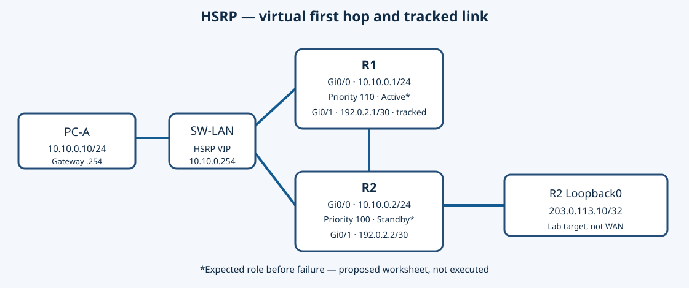

# CCNA IC-06 — First Hop Redundancy Protocols

**سطح:** CCNA. **پیش‌نیاز:** IC-01 و NA-04. **هدف رسمی:** `3.5` هدف، عملکرد و مفاهیم پروتکل‌های افزونگی First Hop. **وضعیت:** پیش‌نویس؛ فرمان‌ها و خروجی‌ها طراحی‌شده و اجرا‌نشده‌اند؛ مدل و نسخهٔ IOS انتخاب نشده است.

## اهداف

نقش FHRP را توضیح دهید، HSRP و GLBP را مقایسه کنید و یک سناریوی Gateway افزونه را Verification کنید.

## ۱. چرا FHRP؟

اگر Gateway یک LAN فقط یک روتر باشد، خرابی آن می‌تواند ارتباط میزبان با شبکه‌های دور را قطع کند. میزبان IP مجازی را به‌عنوان Default Gateway تنظیم می‌کند؛ FHRP اجازه می‌دهد چند Router در همان LAN یک Gateway مجازی را ارائه کنند. همسایه‌ها معمولاً به Virtual IP و MAC متناظر از طریق ARP/ND می‌رسند؛ Routerهای پشتیبان با پیام‌های پروتکل، نقش و سلامت Peer را دنبال می‌کنند. Failover به خرابیِ قابل‌تشخیص، Timer، وضعیت لایهٔ ۲، مسیر بالادست، مسیر برگشت و Policy وابسته است—Virtual Gateway به‌تنهایی کل مسیر را افزونه نمی‌کند.

| پروتکل | نقش/کارکرد | نکتهٔ کلیدی |
|---|---|---|
| **HSRP** (Cisco) | یک Active و یک Standby در هر گروه؛ عضوهای دیگر می‌توانند در حالت Listen باشند | معمولاً فقط Active ترافیک را با Virtual MAC دریافت/Forward می‌کند؛ Priority، Preempt و Tracking بر انتخاب اثر می‌گذارند |
| **GLBP** (Cisco) | Active Virtual Gateway (AVG) پاسخ ARP را مدیریت می‌کند؛ چند Active Virtual Forwarder (AVF) می‌توانند ترافیک را Forward کنند | علاوه بر Redundancy، می‌تواند بار را میان AVFها با روش‌های مانند Round-Robin، Weighted یا Host-Dependent توزیع کند؛ رفتار و ظرفیت نسخه‌محور است |
| **VRRP** (استاندارد؛ با پشتیبانی سازنده) | Master/Backup یک Virtual Router را ارائه می‌کنند | مفهوم افزونگی First Hop مشابه است، اما CLI/نسخه و جزئیات با HSRP فرق دارند |

FHRP جای Dynamic Routing یا Monitoring سرویس نیست. روتر Active می‌تواند سالم به‌نظر برسد درحالی‌که مسیر WAN/بالادستش خراب است؛ Interface tracking، Route tracking یا IP SLA در صورت پشتیبانی و طراحی لازم می‌تواند دامنهٔ سلامت را بهتر بسنجد.

## ۲. سناریو و جدول آدرس

**PNETLab مستقل، طراحی‌شده و اجرا‌نشده:** دو Router IOS، یک Switch داخلی برای LAN، یک VPCS Client، یک لینک آزمایشی میان R1/R2 و Console. اتصال بیرونی لازم نیست. R2 Loopback مقصد تست است؛ آن را WAN/سرویس اینترنت واقعی فرض نکنید. Image/Version/Interface پیش از اجرا باید ثبت شوند.

```text
                         R1 Gi0/1 192.0.2.1/30 ── R2 Gi0/1 192.0.2.2/30 ── Lo0 203.0.113.10/32
                        /                                /
PC-A 10.10.0.10/24 ─ SW-LAN ─ R1 Gi0/0 .1/24  ···  R2 Gi0/0 .2/24
Gateway for PC-A: 10.10.0.254 (HSRP virtual IP)
```

| Node/Interface | Address | Function |
|---|---|---|
| PC-A | `10.10.0.10/24`, GW `10.10.0.254` | Client in isolated LAN |
| R1 Gi0/0 | `10.10.0.1/24` | HSRP priority 110; expected Active |
| R2 Gi0/0 | `10.10.0.2/24` | HSRP priority 100; Standby |
| HSRP Group 1 | Virtual IP `10.10.0.254` | Single default gateway for PC-A |
| R1 Gi0/1 | `192.0.2.1/30` | Tracked lab link |
| R2 Gi0/1 | `192.0.2.2/30` | Other end of lab link |
| R2 Loopback0 | `203.0.113.10/32` | Test destination; not an external network |



## ۳. پیکربندی پیشنهادی HSRP

**فرمان‌ها اجرا‌نشده‌اند.** روی R1:

```text
configure terminal
interface GigabitEthernet0/0
 ip address 10.10.0.1 255.255.255.0
 standby 1 ip 10.10.0.254
 standby 1 priority 110
 standby 1 preempt
 no shutdown
exit
interface GigabitEthernet0/1
 ip address 192.0.2.1 255.255.255.252
 no shutdown
exit
ip route 203.0.113.10 255.255.255.255 192.0.2.2
track 1 interface GigabitEthernet0/1 line-protocol
interface GigabitEthernet0/0
 standby 1 track 1 decrement 20
end
```

روی R2:

```text
configure terminal
interface GigabitEthernet0/0
 ip address 10.10.0.2 255.255.255.0
 standby 1 ip 10.10.0.254
 standby 1 priority 100
 standby 1 preempt
 no shutdown
exit
interface GigabitEthernet0/1
 ip address 192.0.2.2 255.255.255.252
 no shutdown
exit
interface Loopback0
 ip address 203.0.113.10 255.255.255.255
end
```

`standby 1 ip` آدرس مجازی را می‌سازد؛ `priority` شانس Active شدن را تعیین می‌کند؛ `preempt` به روتر با Priority بالاتر اجازه می‌دهد پس از بازگشت Active شود. انتظار طراحی، Active شدن R1 است؛ نتیجهٔ واقعی فقط با خروجی تأیید می‌شود.

### سه نکتهٔ تکمیلی برای تحلیل پیکربندی

**۱ — آدرس Virtual باید خارج از محدودهٔ DHCP باشد.** اگر Gateway مجازی `10.10.0.254` باشد ولی Pool DHCP آن را شامل شود، ممکن است یک کلاینت همان آدرس را بگیرد و شبکه قطع شود. Virtual IP باید همیشه در Pool نباشد یا با `excluded-address` حذف شود.

**۲ — Track باعث می‌شود وضعیت منبعی که صریحاً پایش می‌کنیم بر Priority اثر بگذارد؛ بدون آن، خرابی مسیر بالادست ممکن است از دید HSRP پنهان بماند.** در یک شبکهٔ واقعی، فرض کنید R1 (Active) روشن است و HSRP Hello می‌فرستد ولی لینک بالادستش قطع شده؛ ممکن است Active بماند، هرچند مقصد دور در دسترس نیست. در این لاب، `Gi0/1` لینک آزمایشی R1–R2 و مقصد `203.0.113.10` Loopback خود R2 است، نه WAN واقعی.

```text
R1(config)# track 1 interface GigabitEthernet0/1 line-protocol
R1(config)# interface GigabitEthernet0/0
R1(config-if)# standby 1 track 1 decrement 20
```

`decrement 20` یعنی اگر لینکِ تحت Track در لاب Down شود، Priority از ۱۱۰ به ۹۰ کاهش می‌یابد—کمتر از R2 (۱۰۰). R2 نیز باید `preempt` داشته باشد تا با افت Priority روتر Active بتواند نقش را بگیرد؛ `preempt` روی R1 به‌تنهایی این جابه‌جایی را انجام نمی‌دهد. در این Lab، R2 Loopback مقصد آزمایشی است؛ این آزمون جای اعتبارسنجی WAN/سرویس بالادست واقعی را نمی‌گیرد. **Track و Preempt دو نقش متفاوت دارند: اولی افت را می‌سنجد، دومی اجازهٔ نقش‌گیری با Priority بالاتر را می‌دهد.**

**۳ — نسخه: HSRPv1 در برابر HSRPv2.** مقدار پیش‌فرض بستگی به پلتفرم دارد. تفاوت‌ها:

| ویژگی | HSRPv1 | HSRPv2 |
|---|---|---|
| Group range | ۰–۲۵۵ | ۰–۴۰۹۵ |
| Virtual MAC | `0000.0c07.acXX` | `0000.0c9f.fXXX` |
| Hello / Hold (پیش‌فرض) | ۳ / ۱۰ ثانیه | ۳ / ۱۰ ثانیه (قابل تغییر به ms) |
| IPv6 | ندارد | دارد |

برای یکسان‌سازی، `standby version 2` را روی **همهٔ** روترهای گروه بزنید. نسخهٔ متفاوت = عدم تشکیل گروه.

**نکتهٔ CCNA:** در آزمون، هدف `3.5` فقط **مفهوم** FHRP است، نه پیکربندی. عمق پیکربندی بالا برای درک چرایی است؛ حفظ کردن شمارهٔ گروه لازم نیست.

## ۴. Verification

**فرمان و خروجی آموزشی، اجرا‌نشده:**

```text
R1# show standby brief
Interface   Grp  Pri P State   Active  Standby      Virtual IP
Gi0/0       1    110 P Active  local   10.10.0.2   10.10.0.254
```

`Active` یعنی روتر فعال فعلی؛ `Standby` یعنی پشتیبان. فرمان‌های `show standby` و `show standby interface GigabitEthernet0/0` برای جزئیات مفیدند. برای GLBP، فرمان `show glbp` به‌کار می‌رود؛ در این درس فقط مفهوم آن آموزش داده شده و پیکربندی نشده است.

## ۵. کاربرگ مستقل PNETLab — HSRP، Tracking و Failover

**طراحی‌شده و اجرا‌نشده:** از توپولوژی و فرمان‌های §۲–۳ با دو Router و PC-A استفاده کنید. اگر Image انتخابی HSRP/Track را پشتیبانی نکند، آن Image برای این Worksheet مناسب نیست؛ syntax/version باید ثبت شود. Snapshot و Console access الزامی است.

1. PC-A را با `ip 10.10.0.10/24 10.10.0.254` تنظیم کنید (syntax VPCS را با نسخه بررسی کنید). از **هر دو** Router `show standby brief`, `show standby` و `show ip route` بگیرید؛ `show track 1` را روی R1 ثبت کنید. انتظار اولیه: R1 Active، R2 Standby، PC-A Gateway برابر VIP؛ Ping به `10.10.0.254` و سپس به `203.0.113.10` را در صورت مجاز بودن ICMP ثبت کنید.
2. **ازکارافتادن Active:** در لاب، Interface LANِ R1 (`Gi0/0`) را Shutdown کنید. R2 باید Active شود؛ PC-A همان VIP را نگه می‌دارد. بعد رابط را بالا بیاورید و بازگشت R1 را با preempt بررسی کنید.
3. **Uplink failure بدون Track:** در لاب، ابتدا از Snapshot/Running Config مطمئن شوید. زیر Gi0/0 روی R1 موقتاً `no standby 1 track 1` اجرا کنید؛ سپس Gi0/1 را Shutdown کنید. R1 ممکن است همچنان Active بماند، چون Hello روی LAN سالم است، اما مسیر Static به R2 Loopback از دست می‌رود و Ping به `203.0.113.10` شکست می‌خورد. این هدف صرفاً شبیه‌سازی خرابی Next-Hop لینک است، نه WAN/Internet واقعی.
4. Gi0/1 را بالا بیاورید، `standby 1 track 1 decrement 20` را برگردانید و وضعیت پایه را Verify کنید.
5. **Uplink failure با Track:** دوباره فقط Gi0/1 R1 را Shutdown کنید. Priority R1 از 110 به 90 می‌رسد؛ R2 با Priority 100 و `preempt` باید Active شود. PC-A همچنان از طریق VIP به Loopback آزمایشی R2 برسد. Gi0/1 را برگردانید؛ Track Up و R1 با Priority 110 دوباره Active می‌شود.
6. اگر نقش تغییر نکرد، `show standby`, `show track 1`, وضعیت Hello/Interface و Preempt/priority هر دو سمت را با Timestamp مقایسه کنید؛ یک Ping تنها اثبات علت نیست. پس از آزمون تمام پیکربندی را به Snapshot اولیه برگردانید.

**معیار موفقیت/شواهد:** Active/Standby واقعی هر دو قبل و بعد؛ Gateway PC ثابت؛ Track Up/Down و Priority 110→90 مشاهده؛ سناریوی بدون Track و با Track مقایسه؛ ارتباط VIP و Loopback پس از Failover بررسی؛ Image/Version، خروجی زمان‌دار، نقص و بازگشت ثبت شوند. **هیچ مرحله‌ای در این سند اجرا نشده است؛ Loopback فقط مقصد آزمایشی است و WAN واقعی اعتبارسنجی نشده.**

### Troubleshooting

| نشانه | بررسی |
|---|---|
| Active انتخاب نشده | Group/Virtual IP، Priority، Preempt، Hello و Subnet دو سمت |
| VIP روی LAN پاسخ نمی‌دهد | رابط/VLAN، ARP، Active واقعی و IP تکراری |
| Track Down ولی Active تغییر نکرد | decrement کافی هست؟ Priority R2 بالاتر شده؟ R2 `preempt` دارد؟ |
| با Failover، مقصد دور جواب نمی‌دهد | مسیر بالادست/برگشت، Static route و سلامت مقصد را بررسی کنید؛ VIP صرفاً Gateway مجازی است |
| R1 بعد از برگشت Active نمی‌شود | Track، Priority، Preempt و نسخهٔ HSRP هر دو سمت |

## ۶. سؤال‌ها و پاسخ

1. **FHRP چیست؟** پروتکل افزونگی Gateway در First Hop.
2. **Virtual Gateway چیست؟** آدرس مجازی مشترک بین چند روتر.
3. **Active و Standby چه هستند؟** روتر فعال و پشتیبان.
4. **HSRP چه می‌کند؟** یک Active و یک Standby.
5. **GLBP چه مزیتی دارد؟** افزونگی و توزیع Gateway؛ AVG مدیریت Virtual MACها را انجام می‌دهد و AVFها می‌توانند Forward کنند.
6. **Preempt چیست؟** اجازهٔ بازگشت روتر با Priority بالاتر به Active.
7. **Priority بالاتر چه اثری دارد؟** شانس بیشتر برای Active شدن.
8. **اگر Active از کار بیفتد چه می‌شود؟** Standby به‌عنوان Active انتخاب می‌شود.
9. **کلاینت چه آدرسی را Gateway می‌داند؟** آدرس مجازی.
10. **VRRP چیست؟** پروتکل مشابه FHRP.
11. **چرا Gateway واحد خطرناک است؟** خرابی آن کل LAN را قطع می‌کند.
12. **آیا این سناریو اجرا شده است؟** خیر.
13. **HSRP و GLBP هر دو Load Balance می‌کنند؟** HSRP معمولاً یک Active دارد؛ GLBP می‌تواند چند AVF را با روش انتخاب‌شده به‌کار گیرد.
14. **HSRP با Active شدن R2، سلامت WAN را حتماً تضمین می‌کند؟** خیر؛ Tracking/Route/Service Health و مسیر برگشت باید جدا Verify شوند.
15. **اگر R1 همچنان HSRP Hello می‌فرستد ولی مسیر بالادست ندارد، چه می‌شود؟** ممکن است Active بماند و ترافیک را جذب کند؛ Track فقط منبعی را که پیکربندی شده پایش می‌کند و سلامت همهٔ مسیر را تضمین نمی‌کند.

## واژه‌نامه و چک‌لیست

FHRP: افزونگی First Hop؛ Virtual Gateway: آدرس مجازی؛ Active: روتر فعال؛ Standby: پشتیبان؛ Preempt: بازگشت به Active.

- [ ] Virtual Gateway را با آدرس واقعی قاطی نمی‌کنم.
- [ ] HSRP و GLBP را از نظر Load Balancing جدا می‌دانم.
- [ ] Active را با خروجی تأیید می‌کنم.
