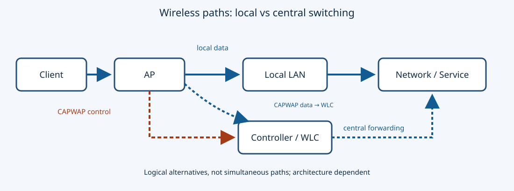

# CCNA NF-03 — AP و Controller: نقش‌ها و مسیر ارتباط

**سطح:** مقدماتی CCNA. **اهداف مرتبط:** v1.1 `1.1.d` و `1.1.e`؛ RF و تنظیمات WLAN اهداف مستقل و درس‌های بعدی‌اند. **پیش‌نیاز:** NF-01 و NF-02. **وضعیت:** پیش‌نویس و اجرا‌نشده؛ پوشش نهایی اهداف هنوز ممیزی نشده است.

## اهداف و محدوده

دانشجو نقش AP و Controller را تفکیک کند، مسیر اتصال Client تا سرویس را به‌صورت مفهومی توضیح دهد و روشن‌بودن AP را با موفقیت اتصال و سرویس یکی نگیرد. پیکربندی GUI، WPA2، RF و معماری‌های محصول‌محور در درس‌های مستقل بعدی‌اند.

## ۱. AP و Controller

**Access Point** ارتباط بی‌سیم را برای Clientهای سازگار فراهم می‌کند و آن‌ها را طبق طراحی به زیرساخت متصل می‌کند. AP مانند یک نقطهٔ دسترسی به ساختمان است؛ اما تشبیه بیانگر تمام فرایندهای رادیویی و امنیتی نیست.

**Wireless LAN Controller** در معماری‌های پشتیبانی‌شده می‌تواند پیکربندی، سیاست و مدیریت گروهی APها را انجام دهد. Controller الزاماً مسیریاب، DHCP Server یا Firewall نیست. بسته به طراحی، محل عبور دادهٔ کاربران و نحوهٔ مدیریت متفاوت است؛ نباید ادعا کرد ترافیک همهٔ معماری‌ها همیشه از Controller عبور می‌کند.

| جزء | نقش مفهومی | چه چیزی را به‌تنهایی ثابت نمی‌کند؟ |
|---|---|---|
| **AP** | ارسال/دریافت 802.11، Radio/Beacon و اتصال Client؛ سپس Frameها را طبق Mode/Policy Bridge یا Tunnel می‌کند | SSID دیده‌شدن، Auth موفق یا دسترسی به Subnet/Service |
| **WLC/Controller** | مدیریت و Policy/Configuration گروهی؛ ممکن است Radio Coordination و AAA/Client State را هماهنگ کند | Router بودن، DHCP دادن، Firewall بودن یا عبور همهٔ Client Data از خود Controller |
| **Switch/LAN** | حمل VLAN/Management و در برخی طرح‌ها Client Data بین AP و Wired Network | اینکه VLAN/Trunk/Path درست است، مگر آن را Verify کنید |

در AP مستقل/Autonomous بعضی Policyها محلی‌اند؛ در Lightweight/CAPWAP یا Cloud-managed بخشی از مدیریت/کنترل می‌تواند بیرون AP باشد. Mode، مسیر داده و Fail Mode را از طراحی محصول بخوانید؛ این دسته‌ها در همهٔ Vendorها دقیقاً هم‌نام/هم‌رفتار نیستند.



## ۲. مسیر ساده‌شده

```text
[Wireless Client] ))) [AP] ── [Switch] ── [شبکه و سرویس]
                        │
              ارتباط مدیریتی با Controller
```

این تصویر مسیر منطقی مدیریت را نشان می‌دهد، نه محل فیزیکی ثابت یا مسیر قطعی داده. SSID نام شبکهٔ بی‌سیم برای شناسایی است؛ دیدن نام الزاماً اتصال، دریافت IP یا دسترسی به سرویس را ثابت نمی‌کند. جزئیات RF، رمزنگاری و کانال‌ها درس جدا دارند.

### CAPWAP، مدیریت و مسیر داده

در معماری Cisco با AP کنترلری، CAPWAP برای ارتباط کنترلی و مدیریت بین AP و WLC به کار می‌رود. در **Central Switching** معمول، دادهٔ WLAN نیز از AP در تونل CAPWAP به WLC می‌رسد و از آنجا وارد شبکه می‌شود. در **Local Switching** پشتیبانی‌شده، AP دادهٔ Client را در شبکه/VLAN محلی Forward می‌کند؛ ارتباط کنترلی AP و WLC همچنان می‌تواند برقرار باشد. احراز هویت و رفتار هنگام قطع WLC به معماری، پیکربندی و نسخه بستگی دارد و الزاماً محلی نیست. برای مقایسه به [راهنمای Cisco](https://www.cisco.com/c/en/us/products/collateral/wireless/unified-wireless-network-sg.html) مراجعه کنید؛ نمودار زیر یک مدل آموزشی است، نه تضمین رفتار هر محصول.

**مثال:** شعبه‌ای با AP متصل به WLC مرکزی، با Central Switching می‌تواند داده را تا مرکز تونل کند؛ با Local Switching پشتیبانی‌شده، دادهٔ انتخاب‌شده به LAN شعبه می‌رود. مسیر، VLAN و سیاست واقعی باید در محصول و نسخهٔ هدف بررسی شوند.

## ۳. سناریوی فرضی

**طراحی‌شده و اجرا‌نشده:** AP برق دارد و Client نام شبکه را می‌بیند، اما پورتال داخلی باز نمی‌شود. ممکن است مشکل در احراز هویت بی‌سیم، آدرس‌دهی، مسیر، سیاست دسترسی یا سرویس باشد. با اطلاعات موجود هیچ‌کدام علت قطعی نیست.

| لایهٔ مشاهده | سؤال | شاهد پیشنهادی |
|---|---|---|
| Client/AP | آیا اتصال و احراز هویت موفق است؟ | وضعیت گزارش‌شده و زمان خطا |
| آدرس‌دهی | آیا Client آدرس مناسب دارد؟ | اطلاعات IP مشاهده‌ای Client |
| زیرساخت | AP و Controller وضعیت مورد انتظار دارند؟ | وضعیت و لاگ‌های مجاز، مطابق مدل |
| سرویس | آیا درخواست از نقطهٔ دیگر پاسخ می‌گیرد؟ | آزمون مجاز و مقایسه با زمان رخداد |

## ۴. کاربرگ تحلیلی

**طراحی‌شده و اجرا‌نشده؛** مدل AP، WLC، نسخه و GUI تعیین نشده‌اند؛ PNETLab در این بخش ادعای پوشش تجهیزات واقعی بی‌سیم ندارد.

1. در نمودار نقش Client، AP، Switch، Controller و سرویس را نام ببرید.
2. سه شاهد برای تفکیک «دیدن SSID»، «اتصال موفق» و «پاسخ سرویس» بنویسید.
3. دو فرضیه دربارهٔ زیرساخت و یک فرضیه دربارهٔ سرویس مطرح کنید.
4. توضیح دهید چرا جای مسیر داده را بدون شناخت معماری نمی‌توان قطعی دانست.

**راهنمای پاسخ:** وضعیت ارتباط و احراز هویت، آدرس IP و نتیجهٔ درخواست مجاز سه مشاهدهٔ مستقل هستند. نحوهٔ Forwarding داده و نقش Controller را باید از طراحی و مستندات نسخهٔ هدف گرفت.

## ۵. Verification و عیب‌یابی

ابتدا کاربران متاثر، زمان و پیام را ثبت کنید. سپس Client، AP، مدیریت و مسیر سرویس را بدون تغییر مقایسه کنید. بازنشانی AP یا تغییر سیاست امنیتی بدون مجوز و برنامهٔ بازگشت ممنوع است. هیچ فرمان یا خروجی عملی اینجا تأیید نشده است.

## ۶. آزمون سناریویی

1. **AP چه می‌کند؟** دسترسی بی‌سیم Clientها را طبق طراحی فراهم می‌کند.
2. **Controller همیشه Router است؟** خیر؛ نقش‌ها وابسته به محصول و معماری‌اند.
3. **آیا همهٔ ترافیک همیشه از Controller می‌گذرد؟** خیر؛ مسیر داده به طراحی بستگی دارد.
4. **Client SSID را می‌بیند؛ سرویس سالم است؟** ثابت نمی‌شود؛ احراز هویت، IP، مسیر و سرویس بررسی شوند.
5. **AP روشن است؛ داده حتماً برقرار است؟** خیر؛ توان و وضعیت داده مستقل‌اند.
6. **SSID چیست؟** نام شناسایی شبکهٔ بی‌سیم در سطح مقدماتی.
7. **چرا مدل و نسخه مهم‌اند؟** قابلیت مدیریت، خروجی و نحوهٔ Forwarding محصول‌محورند.
8. **دو کاربر متفاوت مشکل دارند؛ علت قطعی؟** بدون شواهد مشخص نیست؛ Client، زیرساخت و سرویس بررسی شوند.
9. **آیا دیدن AP در مدیریت سلامت Client را ثابت می‌کند؟** خیر؛ ارتباط Client جدا سنجیده می‌شود.
10. **چرا AP را فوراً Restart نمی‌کنیم؟** ممکن است شواهد از بین بروند یا اختلال ایجاد شود؛ مجوز و بررسی لازم است.
11. **آیا این کاربرگ پیکربندی واقعی WLC است؟** خیر؛ تمرین تحلیلی طراحی‌شده است.

## واژه‌نامه و چک‌لیست

AP: نقطهٔ دسترسی؛ WLC: کنترلر شبکهٔ بی‌سیم؛ SSID: نام شبکه؛ Client: درخواست‌کننده.

- [ ] AP و Controller را جدا تعریف می‌کنم.
- [ ] مسیر داده را بدون بررسی معماری قطعی فرض نمی‌کنم.
- [ ] مشاهدهٔ SSID، اتصال و پاسخ سرویس را تفکیک می‌کنم.
