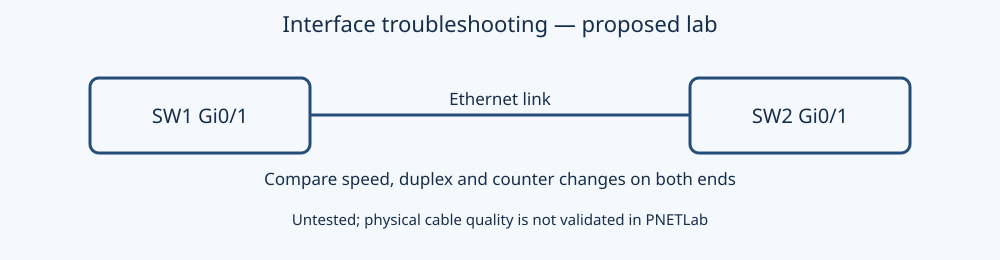

# CCNA NF-07 — تشخیص خطای رابط، سرعت و Duplex

**سطح:** CCNA مقدماتی. **پیش‌نیاز:** NF-06 و آشنایی ابتدایی CLI سیسکو. **هدف رسمی مرتبط:** `1.4`، فعل Identify. **بازبینی ردیفی ۲۰۲۶-۱۱-۲۰:** متن برای تشخیص Collision، خطا و mismatch سرعت/Duplex کافی ارزیابی شد؛ هیچ خروجی واقعی یا سخت‌افزاری تأیید نشده است. **وضعیت:** پیکربندی و خروجی‌ها نمونهٔ طراحی‌شده و اجرا‌نشده؛ مدل، نسخه و نام رابط‌ها تأیید نشده‌اند.

## اهداف

وضعیت رابط، سرعت، Duplex، Collision و شمارنده‌های خطا را در کنار هم تفسیر کنید؛ عدم تطابق را با مشاهدهٔ دو سمت بررسی کنید؛ بین شناسایی نشانه و اثبات علت ریشه‌ای تمایز بگذارید.

## ۱. سرعت، Duplex و مذاکره

سرعت رابط ظرفیت اسمی اتصال محلی است، نه تضمین نرخ مؤثر برنامه در تمام مسیر. Full-duplex امکان ارسال و دریافت هم‌زمان را فراهم می‌کند؛ Half-duplex امکان استفادهٔ هم‌زمان از رسانه را به همان شکل ندارد. Auto-negotiation بسته به استاندارد و قابلیت دو سمت می‌تواند سرعت و Duplex مناسب را توافق کند؛ رفتار جزئی به فناوری و دستگاه وابسته است. برای 10/100BASE-T، خاموش‌کردن مذاکره در یک سمت، درحالی‌که سمت دیگر روی Auto است، می‌تواند Speed را تشخیص‌پذیر نگه دارد ولی Duplex را در یک طرف پیش‌فرض Half کند و mismatch بسازد؛ فقط وضعیت Auto دو طرف برای جمع‌بندی کافی نیست.

اگر دو انتهای لینک Duplex ناسازگار داشته باشند، لینک ممکن است ظاهراً بالا باشد اما کارایی ضعیف یا خطا رخ دهد. بااین‌حال هر خطایی نشانهٔ قطعی Duplex mismatch نیست. سرعت را نیز در هر دو سمت با رسانه و قابلیت پورت مقایسه کنید: تنظیم اجباری ناسازگار می‌تواند لینک را پایین بیاورد یا ارتباط را مختل کند؛ در حالت Auto دو پورت با قابلیت‌های متفاوت ممکن است روی یک سرعت مشترک پایین‌تر کار کنند، پس اختلاف «حداکثر ظرفیت درج‌شده» با سرعت عملیاتی به‌تنهایی اثبات mismatch نیست. پیش از هر تغییر، مذاکره، وضعیت و تنظیم هر دو انتها را بررسی کنید؛ تنظیم دستی یک سمت بدون شناخت طرف مقابل می‌تواند مشکل بسازد.

## ۲. شمارنده‌ها چه می‌گویند؟

Collision در محیط Half-duplex اشتراکی ممکن است رخ دهد؛ در Full-duplex صحیح برخورد CSMA/CD انتظار نمی‌رود. Late collision، خطای CRC، Input/Output Errors و Drops بسته به پلتفرم علت‌های متفاوت دارند؛ توضیح دقیق شمارنده باید در مستند مدل بررسی شود. شمارندهٔ تجمعی می‌تواند از رخداد قدیمی باقی مانده باشد: **زمان و میزان تغییر** مهم است.



## ۳. سناریو و توپولوژی

**طراحی‌شده، اجرا‌نشده:** ارتباط دو Switch بالا گزارش می‌شود اما انتقال فایل کند است.

```text
SW1 Gi0/1 ───────── کابل آزمایشی ───────── Gi0/1 SW2
            سرعت، Duplex و شمارنده‌ها را در هر دو سمت بررسی کنید
```

| دستگاه | رابط نمونه | آدرس/VLAN | نقش |
|---|---|---|---|
| SW1 | Gi0/1 | برای این بررسی فیزیکی لازم نیست | یک سر لینک |
| SW2 | Gi0/1 | برای این بررسی فیزیکی لازم نیست | سر دیگر لینک |

نام رابط، نوع تصویر Switch، قابلیت شبیه‌ساز و نسخه باید پیش از اجرا تعیین شوند. این تمرین کیفیت واقعی کابل یا تداخل را در PNETLab اعتبارسنجی نمی‌کند.

## ۴. کاربرگ مستقل و Verification

**طراحی‌شده و اجرا‌نشده؛** تجهیزات پیشنهادی دو Switch سازگار در محیط آزمایش ایزوله، اتصال Gi0/1 به Gi0/1 و کنسول مجاز است. تصویر PNETLab انتخاب نشده؛ این دستورات را روی شبکهٔ عملیاتی اجرا نکنید.

1. وضعیت کابل و رابط‌های دو سمت را با نقشهٔ آزمایش مقایسه کنید.
2. روی هر دو Switch، فرمان مشاهده‌ای مناسب نسخه را اجرا و نتیجه را همراه تاریخ ثبت کنید:

```text
show interfaces GigabitEthernet0/1
show interfaces status
```

`show interfaces` برای وضعیت، سرعت، Duplex و شمارنده‌ها استفاده می‌شود؛ `show interfaces status` در پلتفرم‌های پشتیبان خلاصه‌ای از وضعیت پورت می‌دهد. وجود و قالب فرمان‌ها باید در تصویر هدف بررسی شوند.

**خروجی آموزشیِ ساختگی، نه مشاهده‌شده:**

```text
GigabitEthernet0/1 is up, line protocol is up
  Full-duplex, 1000Mb/s
  0 input errors, 0 CRC, 0 collisions
```

`up/up` وضعیت رابط/پروتکل گزارش‌شده، `Full-duplex` و `1000Mb/s` تنظیم یا وضعیت عملیاتی گزارش‌شده و اعداد شمارنده‌ها هستند. این خروجی نمونه نشان‌دهندهٔ سلامت تمام مسیر یا سرعت واقعی برنامه نیست.

3. بعد از فاصلهٔ زمانی مشخص، شمارنده‌ها را دوباره مشاهده و اختلاف و نرخ تغییر را ثبت کنید. به‌طور پیش‌فرض شمارنده‌ها را پاک نکنید؛ پاک‌کردن شواهد نیازمند مجوز است.
4. سرعت و Duplex هر دو سمت، نوع رسانه و وضعیت مذاکره را مقایسه کنید. هر تغییر باید با پیکربندی تاییدشدهٔ هر دو سمت، مجوز و برنامهٔ بازگشت انجام شود.

## ۵. عیب‌یابی سناریویی

| نشانه | فرضیه و شاهد | محدودیت |
|---|---|---|
| `administratively down` | پورت طبق پیکربندی بسته است؛ تنظیمات و مجوز را بررسی کنید | بازکردن پورت بدون مجوز ممنوع |
| `up/up` ولی کند | بررسی خطاهای در حال افزایش، Duplex و سایر گلوگاه‌ها | up بودن سلامت انتهابه‌انتها را ثابت نمی‌کند |
| CRC رو به افزایش | رسانه، پورت و استاندارد را بررسی کنید | CRC به‌تنهایی علت یا محل قطعی را مشخص نمی‌کند |
| یک سمت Full و سمت دیگر Half | mismatch محتمل؛ هر دو سمت، مذاکره/تنظیم ثابت، سرعت و نرخ خطا را بررسی کنید | در 10/100BASE-T، Speed ممکن است Auto-detect و Duplex در سمت Auto به Half fallback شود؛ این الگو همهٔ سرعت‌ها/فناوری‌ها را یکسان شامل نمی‌شود |
| سرعت عملیاتی دو سر متفاوت یا لینک برقرار نمی‌شود | قابلیت رسانه و پورت، Speed و حالت Auto/ثابت هر دو طرف را با هم مقایسه کنید | اختلاف حداکثر سرعت اسمی پورت‌ها به‌تنهایی mismatch نیست؛ ممکن است Auto روی سرعت مشترک پایین‌تر توافق کند |
| شمارندهٔ قدیمی غیرصفر | مقایسهٔ نمونه‌های زمان‌دار | مقدار تجمعی، نرخ فعلی نیست |

## ۶. پرسش‌های سناریویی

1. **لینک up/up است؛ آیا برنامه حتماً سریع است؟** خیر، خطا، بار، مسیر و سرویس نیز مهم‌اند.
2. **یک سمت Full و سمت دیگر Half است؛ چه می‌کنید؟** وضعیت، مذاکره و تنظیم دو سمت را بررسی و پیش از تغییر مجوز می‌گیرید.
3. **شمارنده CRC غیرصفر است؛ آیا کابل قطعاً خراب است؟** خیر، نرخ تغییر و سایر علل باید بررسی شوند.
4. **چرا دو نمونهٔ زمانی می‌گیریم؟** مقدار تجمعی بدون زمان، خطای در حال افزایش را نشان نمی‌دهد.
5. **آیا در Full-duplex صحیح Collision انتظار می‌رود؟** برخورد CSMA/CD انتظار نمی‌رود؛ فیلد و پلتفرم را بررسی کنید.
6. **administratively down چه می‌گوید؟** رابط از نظر پیکربندی خاموش گزارش شده؛ علت و مجوز تغییر جداگانه بررسی شود.
7. **آیا `show interfaces status` روی تمام تجهیزات قالب یکسانی دارد؟** خیر؛ نسخه و قابلیت مهم‌اند.
8. **برای یافتن mismatch تنها یک سمت کافی است؟** خیر، وضعیت و تنظیمات هر دو سمت لازم است.
9. **چگونه mismatch سرعت را تشخیص می‌دهیم؟** سرعت عملیاتی، حالت Auto/ثابت و قابلیت رسانه/پورت را در هر دو سمت مقایسه می‌کنیم؛ اختلاف حداکثر سرعت اسمی به‌تنهایی خطا نیست.
10. **آیا ابتدا شمارنده‌ها را پاک می‌کنید؟** خیر؛ این کار شواهد را از بین می‌برد و نیازمند برنامه است.
11. **PNETLab کابل نوری واقعی را تأیید می‌کند؟** خیر؛ بررسی فیزیکی و تجهیزات لازم‌اند.
12. **سرعت ۱ Gbps به معنی دانلود ۱ Gbps است؟** خیر، ظرفیت محلی و عملکرد انتهابه‌انتها متفاوت‌اند.
13. **خروجی فوق واقعی است؟** خیر؛ نمونهٔ آموزشی طراحی‌شده است.

## واژه‌نامه و چک‌لیست

Duplex: شیوهٔ ارسال/دریافت؛ CRC: سازوکار بررسی خطا و در خروجی نام یک شمارنده؛ Collision: برخورد در رسانهٔ مربوط؛ Auto-negotiation: مذاکرهٔ پارامترهای پشتیبانی‌شده.

- [ ] سرعت و Duplex هر دو طرف را مقایسه می‌کنم.
- [ ] شمارندهٔ تجمعی را از نرخ تغییر جدا می‌کنم.
- [ ] هیچ تغییر پورت یا پاک‌کردن شواهدی را بدون مجوز انجام نمی‌دهم.
