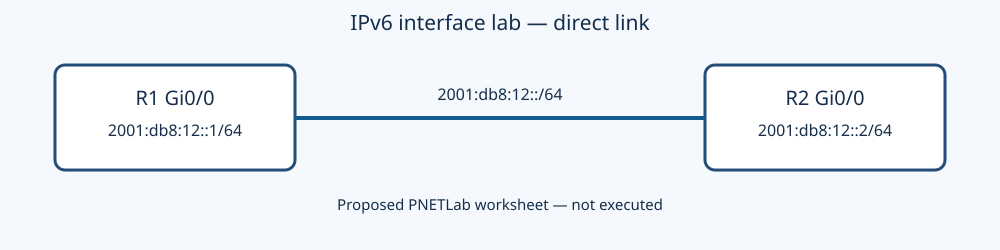

# CCNA NF-12 — پیکربندی IPv6 و Prefix روی رابط IOS

**سطح:** CCNA. **پیش‌نیاز:** NF-11. **هدف مرتبط:** v1.1 `1.8` Configure and verify IPv6 addressing and prefix. **بازبینی متنی ۲۰۲۶-۱۱-۲۰:** توپولوژی/گام‌ها/Verification پیشنهادی بازبینی شدند؛ چون فعل هدف عملی است، کفایت نهایی تا اجرای IOS/Image و ثبت Verification واقعی باز می‌ماند. **وضعیت:** کاربرگ، فرمان‌ها و خروجی‌ها طراحی‌شده و اجرا‌نشده‌اند؛ ایمیج و نسخهٔ IOS تعیین نشده است.

## اهداف

یک Prefix و دو آدرس IPv6 هم‌لینک را در سناریوی آموزشی بخوانید، فرمان‌های رابط را در ترتیب منطقی توضیح دهید و وضعیت آدرس، Link-Local و اتصال را با خروجی مورد انتظار مقایسه کنید.



## ۱. سناریو و آدرس‌ها

**کاربرگ مستقل PNETLab، طراحی‌شده و اجرا‌نشده:** دو Router IOS با یک لینک Ethernet، کنسول و محیط ایزوله. نام رابط و پشتیبانی IOS باید با ایمیج انتخاب‌شده بررسی شود؛ این کاربرگ به شبیه‌ساز داخلی آکادمی نیاز ندارد.

```text
R1 Gi0/0 ─────────────────────── Gi0/0 R2
2001:db8:12::1/64                2001:db8:12::2/64
             لینک 2001:db8:12::/64
```

| دستگاه | رابط نمونه | Global نمونه | Link-Local |
|---|---|---|---|
| R1 | Gi0/0 | `2001:db8:12::1/64` | معمولاً خودکار؛ مقدار واقعی باید دیده شود |
| R2 | Gi0/0 | `2001:db8:12::2/64` | معمولاً خودکار؛ مقدار واقعی باید دیده شود |

Prefix `2001:db8::/32` مستنداتی است. هدف فقط اتصال یک لینک است؛ مسیر به شبکهٔ دیگر یا OSPFv3 در این کاربرگ تنظیم نشده است.

## ۲. فرمان‌های پیشنهادی R1 و R2

**پیکربندی پیشنهادی، اجرا‌نشده و وابسته به IOS:**

```text
R1> enable
R1# configure terminal
R1(config)# ipv6 unicast-routing
R1(config)# interface GigabitEthernet0/0
R1(config-if)# ipv6 address 2001:db8:12::1/64
R1(config-if)# no shutdown
R1(config-if)# end
```

```text
R2> enable
R2# configure terminal
R2(config)# ipv6 unicast-routing
R2(config)# interface GigabitEthernet0/0
R2(config-if)# ipv6 address 2001:db8:12::2/64
R2(config-if)# no shutdown
R2(config-if)# end
```

`ipv6 unicast-routing` در IOS پشتیبان، Forwarding IPv6 را به‌طور سراسری فعال می‌کند؛ برای صرف Ping به آدرس متصل لزوماً اثبات نیاز به Forwarding بین شبکه‌ها نیست. `ipv6 address` آدرس و Prefix رابط را تعیین و `no shutdown` حالت اداری را فعال می‌کند. `enable`، `configure terminal`، `interface` و `end` حالت و رابط CLI را تغییر می‌دهند. هیچ فرمانی در این درس روی محیط واقعی اجرا نشده است.

## ۳. Verification

**فرمان‌های پیشنهادی، اجرا‌نشده:**

```text
show ipv6 interface brief
show ipv6 interface GigabitEthernet0/0
show ipv6 neighbors
show ipv6 route connected
ping 2001:db8:12::2
```

`show ipv6 interface brief` وضعیت و آدرس‌های رابط، `show ipv6 interface` جزئیات و Link-Local، و `show ipv6 route connected` مسیر متصل را در پلتفرم پشتیبان بررسی می‌کنند. `ping` از R1 به R2 اتصال مورد انتظار را آزمون می‌کند؛ نتیجهٔ واقعی به وضعیت رابط، مسیر و فیلتر بستگی دارد.

**نمونهٔ آموزشی کوتاه‌شده، نه خروجی واقعی:**

```text
R1# show ipv6 interface brief
GigabitEthernet0/0 [up/up]
    FE80::1
    2001:DB8:12::1
```

`up/up` وضعیت گزارش‌شدهٔ رابط، `FE80::1` فقط نمونهٔ Link-Local و آدرس `2001:DB8:12::1` آدرس Global مستنداتی پیکربندی‌شده است. Link-Local خودکار واقعی الزاماً `FE80::1` نیست. شکل خروجی و آدرس دقیق باید در اجرای واقعی ثبت شوند.

## ۴. عیب‌یابی

| نشانه | بررسی پیشنهادی | محدودیت |
|---|---|---|
| رابط Down | نام رابط، اتصال دو سمت و وضعیت اداری | بدون مجوز شبکهٔ عملیاتی را تغییر ندهید |
| آدرس انتظار دیده نمی‌شود | تنظیم رابط، Prefix و پشتیبانی نسخه | آدرس Link-Local با Global یکی نیست |
| Ping موفق نیست | آدرس هر دو سمت، Link-Local، رابط، مسیر و فیلتر | یک نتیجه علت قطعی نمی‌دهد |
| مقصد در شبکهٔ دیگر نیست | مسیر و Forwarding هر دو سمت | این کاربرگ اصلاً شبکهٔ دوم ندارد |

## ۵. کاربرگ مستقل PNETLab — IPv6 Prefix و Interface

**Objective عملی `1.8`:** IPv6 address/prefix را پیکربندی و Verification کنید. **کاربرگ طراحی‌شده و اجرا‌نشده است.** دو Router IOSv/IOL، Console، یک Ethernet link و محیط PNETLab ایزوله لازم‌اند. Image/نسخه/Interface را ثبت کنید؛ Prefixهای `2001:db8::/32` فقط برای مستندات‌اند و در اینترنت عمومی استفاده نمی‌شوند.

1. Snapshot بگیرید و ابتدا با `show ipv6 interface brief`، `show ipv6 interface Gi0/0` و `show ipv6 route connected` حالت اولیهٔ هر دو سمت را ثبت کنید.
2. مطابق §۲ روی R1 `2001:db8:12::1/64` و روی R2 `2001:db8:12::2/64` تنظیم کنید؛ رابط‌ها را بالا بیاورید. `ipv6 unicast-routing` را فقط در صورتی فعال کنید که هدف از تمرین Forwarding بین شبکه‌ها نیز باشد؛ برای پینگ آدرس Global متصل روی یک لینک، این دستور به‌تنهایی پیش‌شرط Neighbor/Address نیست.
3. روی هر دو، Global و Link-Local واقعی را با فرمان‌های Verification ببینید. `FE80::1` را فرض نکنید؛ Link-Local ممکن است متفاوت یا به‌صورت پلتفرم‌ویژه ساخته شود. `show ipv6 route connected` باید Prefix `2001:db8:12::/64` را روی Gi0/0 نشان دهد.
4. از R1 به `2001:db8:12::2` و از R2 به `2001:db8:12::1` Ping کنید و خروجی واقعی را با زمان/Image ثبت کنید. فقط از رابط و آدرس مجاز استفاده کنید.
5. **نقص کنترل‌شده:** موقتاً Prefix جهانی R2 را به `2001:db8:13::2/64` تغییر دهید. جدول Connected دو سمت را مقایسه و Pingهای Global را دوباره آزمایش کنید؛ R1 نباید Prefix مقصد را روی لینک خود Connected ببیند. اگر Link-Local هنوز کار می‌کند، آن را با Global routing اشتباه نگیرید. سپس R2 را به `2001:db8:12::2/64` برگردانید و Verification را تکرار کنید.
6. رابط، آدرس و تنظیمات را با Snapshot بازگردانید؛ `no shutdown` یا تغییر مسیر را در شبکهٔ واقعی بدون مجوز انجام ندهید.

**معیار موفقیت/تحویل:** Version و رابط ثبت شده، Prefix هر دو طرف درست و یکسان، Link-Local به‌صورت مشاهده‌شده (نه حدس) ثبت، Route Connected و Ping دوطرفه بررسی، خطای Prefix تشخیص و بازگردانی شده باشد. خروجی‌های فعلی آموزشی‌اند؛ هیچ فرمان واقعی اجرا نشده است.

## ۶. سؤال‌های سناریویی و پاسخ

1. **Prefix دو آدرس اصلی چیست؟** هر دو `2001:db8:12::/64` هستند.
2. **فرمان تخصیص آدرس چیست؟** در IOS پشتیبان `ipv6 address .../64` زیر رابط.
3. **`no shutdown` چه تضمینی می‌دهد؟** رابط را از Shutdown اداری خارج می‌کند؛ موفقیت اتصال را تضمین نمی‌کند.
4. **`ipv6 unicast-routing` برای چیست؟** فعال‌سازی Forwarding IPv6 در IOS پشتیبان.
5. **Link-Local نمونه حتماً `FE80::1` است؟** خیر، آن مقدار صرفاً نمونه است.
6. **چرا Prefix طرف مقابل مهم است؟** برای تحلیل آدرس‌دهی و ارتباط طراحی‌شده، هر دو سمت باید با طرح لینک تطبیق داشته باشند.
7. **Ping شکست بخورد، کابل حتماً خراب است؟** خیر؛ رابط، آدرس، فیلتر و مقصد نیز بررسی می‌شوند.
8. **آیا این کاربرگ OSPFv3 را پیکربندی می‌کند؟** خیر، فقط آدرس‌دهی و اتصال مستقیم است.
9. **آیا Prefix مستنداتی اینترنت عمومی واقعی است؟** خیر؛ برای مستندسازی به کار می‌رود.
10. **`show ipv6 interface` چه کمکی می‌کند؟** نمایش جزئیات رابط و آدرس‌ها در پلتفرم پشتیبان.
11. **رابط up/up به معنی سلامت همهٔ سرویس‌هاست؟** خیر.
12. **آیا این خروجی عملی است؟** خیر؛ نمونهٔ آموزشی و اجرا‌نشده است.

## واژه‌نامه و چک‌لیست

IPv6 Prefix: بخش شبکه؛ Link-Local: آدرس محدود به لینک؛ Forwarding: هدایت بسته؛ Connected Route: مسیر شبکهٔ متصل.

- [ ] آدرس‌ها و Prefix دو سمت را تشخیص می‌دهم.
- [ ] نقش هر فرمان را توضیح می‌دهم.
- [ ] آدرس نمونهٔ Link-Local را نتیجهٔ واقعی فرض نمی‌کنم.
