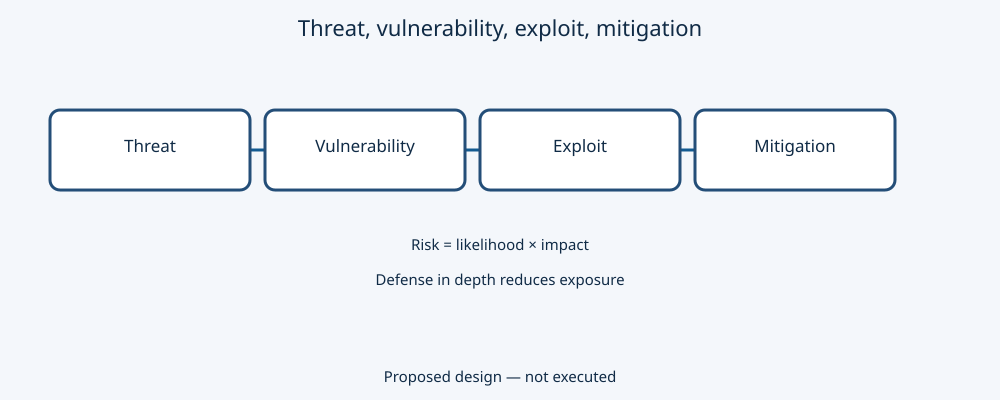

# CCNA SEC-01 — Threats، Vulnerabilities، Exploits و Mitigation

**سطح:** CCNA. **پیش‌نیاز:** NF-04 و NF-08. **هدف رسمی:** `5.1` تعریف تهدید، آسیب‌پذیری، اکسپلویت و روش‌های کاهش. **وضعیت:** پیش‌نویس؛ سناریو طراحی‌شده و اجرا‌نشده؛ ابزار و نسخه انتخاب نشده است.

## اهداف

چهار مفهوم Threat، Vulnerability، Exploit و Mitigation را از هم تفکیک کنید، چند حملهٔ رایج را بشناسید و برای هر یک کاهش مناسب تعیین کنید.

## ۱. چهار مفهوم پایه

| مفهوم | معنا | نمونه |
|---|---|---|
| Threat | عامل یا رویدادی که می‌تواند آسیب بزند | مهاجم خارجی، بدافزار، کارمند ناراضی |
| Vulnerability | ضعف قابل بهره‌برداری | گذرواژهٔ پیش‌فرض، IOS قدیمیِ آسیب‌پذیر، سرویس/پورت غیرضروریِ در معرض دسترس |
| Exploit | استفادهٔ عملی از ضعف | اجرای کد با گذرواژهٔ پیش‌فرض |
| Risk | ترکیب احتمال و اثر | احتمال × شدت آسیب |

**Mitigation** کاهش ریسک است، نه حذف کامل آن. کاهش می‌تواند پیشگیرانه (پچ، گذرواژهٔ قوی، ACL) یا تشخیصی (Log، IDS) یا اصلاحی (بازگردانی پشتیبان) باشد. Risk را نمی‌توان با یک کنترل به صفر رساند؛ لایه‌بندی دفاعی (**Defense in Depth**) رویکرد واقع‌بینانه است.

## ۲. حملات رایج و کاهش

| حمله | مکانیزم | کاهش |
|---|---|---|
| Phishing | فریب کاربر برای افشای اطلاعات | آموزش، MFA، فیلتر ایمیل |
| Malware | نفوذ بدافزار | Endpoint protection، پچ، محدودیت اجرا |
| Password attack | حدس یا Brute Force | گذرواژهٔ قوی، Rate Limit، MFA |
| DoS/DDoS | اشباع منابع | Rate limiting، سرویس مقابله، معماری توزیع‌شده |
| MITM | شنود یا تغییر مسیر | رمزنگاری، SSH، گواهی |
| Social engineering | فریب انسانی | آموزش و رویهٔ تأیید |
| Insider threat | سوءاستفادهٔ دسترسی مجاز | Least Privilege، Log و بازبینی |

یکی از روش‌های On-Path در LAN، جعل/مسموم‌سازی ARP است؛ **Dynamic ARP Inspection** می‌تواند آن را کاهش دهد، مشروط به Trust درست و Binding DHCP Snooping یا ARP ACL مناسب (SEC-07).

## ۳. سناریوی طراحی‌شده

**PNETLab مستقل، طراحی‌شده و اجرا‌نشده:** شبکهٔ کوچک با روتر مرزی، سوییچ دسترسی و دو کلاینت. یک Vulnerability فرضی (Telnet فعال و Community پیش‌فرض SNMP) شناسایی و Mitigation برای هر دو طراحی می‌شود. هیچ اسکن یا حملهٔ واقعی انجام نشده است.

## ۴. روش ارزیابی ریسک

1. فهرست دارایی‌ها (دستگاه، سرویس، داده).
2. فهرست Vulnerability هر دارایی.
3. تعیین Threat متناظر.
4. برآورد احتمال و اثر.
5. انتخاب Mitigation با نسبت هزینه به فایده.
6. بازبینی دوره‌ای.

بدون فهرست دارایی، اولویت‌بندی Mitigation حدس است. **Patch Management** و **Configuration Baseline** بخشی از همین چرخه‌اند.

## ۵. کاربرگ

1. سه دارایی شبکهٔ آزمایشی خود را فهرست و برای هر یک یک Vulnerability بنویسید.
2. برای هر Vulnerability یک Mitigation پیشگیرانه و یک تشخیصی تعیین کنید.
3. بررسی کنید کدام سرویس‌های ناامن (Telnet، HTTP، SNMPv2c) در طراحی باقی مانده‌اند؛ نتیجهٔ واقعی ثبت نشده است.

## ۶. سؤال‌ها و پاسخ

1. **Threat چیست؟** عامل آسیب‌زنندهٔ بالقوه.
2. **Vulnerability چیست؟** ضعف قابل بهره‌برداری.
3. **Exploit چیست؟** استفادهٔ عملی از ضعف.
4. **Mitigation چیست؟** کاهش ریسک.
5. **آیا ریسک صفر شدنی است؟** نه.
6. **Defense in Depth چیست؟** لایه‌های دفاعی متعدد.
7. **کاهش Phishing چیست؟** آموزش و MFA.
8. **کاهش Brute Force چیست؟** گذرواژهٔ قوی و Rate Limit.
9. **کاهش MITM چیست؟** رمزنگاری و گواهی.
10. **Insider threat چگونه کاهش می‌یابد؟** Least Privilege و Log.
11. **چرا Patch Management مهم است؟** حذف ضعف‌های شناخته‌شده.
12. **آیا در این درس حمله‌ای اجرا شده است؟** خیر.

## ۷. سناریوی حل‌شده: ضعف دیده شد، نفوذ اثبات نشده

**فرضی و بدون اسکن/حملهٔ واقعی.** موجودی مصوب نشان می‌دهد روی روتر آزمایشگاهی Telnet فعال است و یک سامانهٔ مانیتورینگ قدیمی از SNMPv2c استفاده می‌کند. این دو مورد را از هم جدا ثبت کنید:

| قلم | Threat | Vulnerability | Exploit/اثر | Mitigation و شاهد |
|---|---|---|---|---|
| Telnet | شنودگرِ قادر به مشاهدهٔ مسیر یا حساب‌کاربری سرقت‌شده | احراز/دادهٔ Telnet رمزگذاری نمی‌شود؛ سطح دسترسی سرویس شاید بیش‌ازحد باشد | Exploit یعنی استفاده از ضعف برای مشاهده/سوءاستفاده؛ روشن‌بودن Telnet اثبات رخداد نیست | در پنجرهٔ تغییر، SSH را با دسترسی Console آزمایش کنید، همهٔ VTYها را فقط SSH کنید، ACL و Log را طبق Policy بررسی کنید |
| SNMPv2c Community | کاربر غیرمجاز در شبکه یا مهاجم دارای دسترسی | Community مشترک و بدون حفاظت رمزنگاری مناسب در SNMPv2c | خواندن اطلاعات یا تغییر SET ممکن است، اگر مجوز و دسترسی مهیا باشد؛ این امکان به معنای نفوذ قطعی نیست | مهاجرت برنامه‌ریزی‌شده به SNMPv3، محدودسازی Manager و دسترسی Read/Write کمینه، سپس آزمون مجاز و بررسی لاگ |

**روش اولویت‌بندی:** دارایی و مالک را مشخص کنید؛ مواجهه/دسترسی لازم را با شواهد ثبت کنید؛ احتمال و اثر را به‌صورت کیفی برآورد کنید؛ سپس اقدام فوری کم‌ریسک، اقدام اصلاحی و کنترل کشف را جدا کنید. «آسیب‌پذیری وجود دارد» و «Exploit موفق رخ داده» دو ادعای متفاوت‌اند. یک Patch یا کنترل نیز فقط پس از Verification و بازبینی ریسک، کاهش را نشان می‌دهد نه حذف کامل.

**کار تمرینی:** برای هر مورد، (الف) یک Threat مستقل از Vulnerability بنویسید، (ب) شرایط لازم برای Exploit را مشخص کنید، (ج) یک پیشگیری و یک کنترل Detection پیشنهاد دهید، (د) شاهدی را تعیین کنید که نشان می‌دهد تنظیم اصلاح شده، بدون اینکه دادهٔ حساس یا حملهٔ واقعی اجرا شود.

## واژه‌نامه و چک‌لیست

Threat: تهدید؛ Vulnerability: آسیب‌پذیری؛ Exploit: بهره‌برداری؛ Risk: ریسک؛ Mitigation: کاهش.

- [ ] چهار مفهوم را از هم جدا می‌کنم.
- [ ] برای هر Vulnerability کاهش پیشگیرانه و تشخیصی می‌نویسم.
- [ ] هیچ تست نفوذ واقعی انجام نمی‌دهم.
