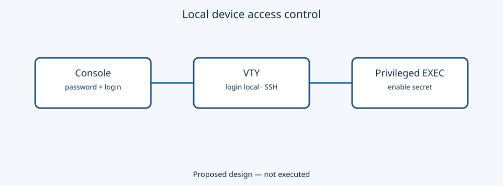

# CCNA SEC-03 — کنترل دسترسی دستگاه با گذرواژهٔ محلی

**سطح:** CCNA. **پیش‌نیاز:** IS-08. **هدف رسمی:** `5.3` پیکربندی و Verification کنترل دسترسی دستگاه با گذرواژهٔ محلی. **وضعیت:** پیش‌نویس؛ فرمان‌ها و خروجی‌ها طراحی‌شده و اجرا‌نشده‌اند؛ مدل و نسخهٔ IOS انتخاب نشده است.

## اهداف

گذرواژهٔ Privileged EXEC، Console و VTY را به‌صورت امن تنظیم کنید، رمزنگاری را فعال کنید و ضعف گذرواژهٔ روشن را توضیح دهید.

## ۱. لایه‌های دسترسی

دستگاه سه مسیر دسترسی اصلی دارد: **Console** (فیزیکی)، **VTY** (Telnet/SSH) و **Aux** (کمتر استفاده می‌شود). هر مسیر باید گذرواژه و سطح دسترسی داشته باشد. **Privileged EXEC** با `enable secret` محافظت می‌شود و دسترسی کامل می‌دهد.

گذرواژهٔ `enable password` به‌صورت روشن در Configuration ذخیره می‌شود و ناامن است؛ `enable secret` از هش استفاده می‌کند و باید جای آن را بگیرد. `service password-encryption` فقط رمزنگاری ضعیف و قابل بازگشت است؛ جایگزین هش نیست.

## ۲. سناریوی طراحی‌شده

**PNETLab مستقل، طراحی‌شده و اجرا‌نشده:** R1 و SW1 با گذرواژهٔ Console، VTY و Enable Secret، و بنر هشدار. کاربر محلی `netadmin` برای VTY. نام تصویر و نسخهٔ IOS تأیید نشده است.



## ۳. پیکربندی پیشنهادی

**فرمان‌ها اجرا‌نشده‌اند.**

```text
configure terminal
enable secret <unique-enable-secret>
username netadmin privilege 15 secret <long-unique-secret>
service password-encryption
banner motd #Authorized access only. Activity is logged.#
line console 0
 password <console-password>
 login
 exec-timeout 5 0
 exit
line vty 0 4
 login local
 transport input ssh
 exec-timeout 5 0
 exit
end
```

`exec-timeout` جلسهٔ رهاشده را می‌بندد. `login local` برای VTY به کاربر محلی نیاز دارد. `transport input ssh` به‌تنهایی SSH Server را آماده نمی‌کند: Hostname/Domain و کلیدهای RSA باید پیش‌تر پیکربندی شوند (مراحل کامل در Services-08). این نمونه فقط خطوط `VTY 0–4` را تنظیم می‌کند؛ برخی Imageها خطوط بیشتری دارند (مثلاً `5–15`). پیش از اجرا، با `show line` و `show running-config | section line vty` بازه‌ها را پیدا و `login local`، `transport input ssh` و Timeout را روی **همهٔ** خطوط VTY تنظیم کنید؛ در غیر این صورت ممکن است خطی با سیاست متفاوت باقی بماند. طول و پیچیدگی گذرواژه در تنظیمات امنیتی سازمان تعیین می‌شود؛ در این درس مقادیر نمونه‌اند.

## ۴. Verification

**فرمان و خروجی آموزشی، اجرا‌نشده:**

```text
R1# show running-config | include enable
enable secret 9 $9$Q1z8...redacted
```

```text
R1# show users
    Line       User       Host(s)              Idle       Location
   0 con 0                idle                 00:00:00
*  2 vty 0     netadmin   10.10.0.50           00:00:12
```

هش `enable secret` نمایش داده می‌شود، نه متن روشن. `show running-config` را نباید در محیط اشتراکی منتشر کرد. `show users` جلسات فعال را نشان می‌دهد.

## ۵. کاربرگ مستقل PNETLab — احراز محلی Console، VTY و Privileged EXEC

**هدف رسمی `5.3`:** پیکربندی و Verification کنترل دسترسی دستگاه با اعتبارنامهٔ محلی. **کاربرگ طراحی‌شده و اجرا‌نشده است.** یک IOSv Router، یک Linux Admin VM دارای SSH client، Console و Switch داخلی لازم است. LAN آزمایشی را به هیچ شبکهٔ واقعی وصل نکنید.

```text
ADMIN-VM 192.0.2.10/24 ── SW-LAB ── R1 Gi0/0 192.0.2.1/24
Console ───────────────────────────── R1 Console
```

پیش از اجرا، Image/نسخه، پشتیبانی `secret` و SSH، همهٔ VTY lineها و وضعیت Snapshot را ثبت کنید. دسترسی Console را در طول تمرین نگه دارید. برای VTY ابتدا SSH را طبق IS-08 آماده کنید. در نمونهٔ زیر حساب `labuser` سطح کمینهٔ دسترسی کاربر عادی (Privilege 1) دارد؛ با `enable secret` سطح مدیریتی جدا محافظت می‌شود. Placeholder را فقط در لاب با Secret یکتا جایگزین کنید؛ Secret واقعی را به سند/Git/خروجی نچسبانید.

### اجرا و Verification

1. از Console، `enable secret <unique-lab-secret>` و `username labuser privilege 1 secret <unique-lab-user-secret>` را تنظیم کنید. از `enable password` استفاده نکنید؛ اگر از Config قدیمی باقی مانده، آن را پس از Snapshot حذف کنید.
2. روی Console از `login local` استفاده کنید تا با کاربر محلی احراز شود؛ روی **تمام** VTY rangeها `login local`, `transport input ssh` و `exec-timeout 5 0` قرار دهید. `show line` و `show running-config | section line` را بررسی کنید تا Rangeهای VTY 5–15 یا بیشتر از قلم نیفتند.
3. با Console از سیستم خارج/دوباره وارد شوید و ورود `labuser` را امتحان کنید؛ سپس از ADMIN-VM با SSH همان کاربر را آزمایش کنید. `show users` نشست، `show privilege` سطح فعلی و `show running-config | include ^username|enable secret|enable password` وضعیت کلی Config را نشان می‌دهند. خروجی را پیش از تحویل از هرگونه hash/secret/آدرس حساس پاک‌سازی کنید.
4. در Prompt کاربر عادی `show privilege` را ببینید؛ سپس `enable` را با Secret جداگانه اجرا کنید و تغییر سطح را بررسی کنید. حساب‌های سطح 15 را فقط برای نقش‌های ضروری و طبق Policy بسازید؛ «مدیریت محلی» مجوز نامحدود برای همه نیست.
5. **نقص کنترل‌شده:** یک بار با Username ناموجود وارد شوید و ردشدن احراز را ثبت کنید. هرگز شمار زیادی رمز را امتحان نکنید. از Console Config را بررسی و حالت `login local` و کاربر آزمایش را بازیابی کنید.
6. اختیاری، فقط با Secret ساختگی: تفاوت `service password-encryption` و `secret` را در خروجی Config بررسی کنید. Type 7 برگشت‌پذیر/ضعیف است و جای الگوریتم امن Secret را نمی‌گیرد؛ روش Hash، Type و دستورات مشاهده در IOSهای مختلف تفاوت دارد.

| مشکل | بررسی و بازگشت |
|---|---|
| Console ورود نمی‌خواهد | `line console 0`, دستور `login`/`login local` و خطای Config را از Console در دسترس بررسی کنید |
| VTY کاربر را نمی‌شناسد | `username`, `login local`, همهٔ VTY rangeها و پیش‌نیاز SSH را بررسی کنید |
| `enable` رد می‌شود | Secret، Caps Lock/صفحه‌کلید، سطح کاربر و Policy را بررسی کنید؛ Secret را در فرمان/Log چاپ نکنید |
| در Config رشتهٔ Password دیده می‌شود | نوع ذخیره و وجود `enable password` قدیمی را بررسی کنید؛ Type 7 را رمزنگاری قوی تلقی نکنید |
| Admin از روتر قفل شده | فقط از Console و Snapshot آزمایش استفاده کنید؛ روی دستگاه واقعی آزمایش نکنید |

**معیار موفقیت:** Console و VTY مطابق Policy به حساب محلی وصل می‌شوند، کاربر سطح کمینه دارد، `enable secret` جداگانه مدیریت را باز می‌کند، همهٔ VTYها بررسی شده‌اند و خروجی تحویلی بدون Secret است. هیچ IOS/PNETLab در این نسخه اجرا نشده است.

## ۶. سؤال‌ها و پاسخ

1. **Privileged EXEC با چه محافظت می‌شود؟** `enable secret`.
2. **`enable password` چه ضعفی دارد؟** ذخیرهٔ روشن.
3. **`service password-encryption` کافی است؟** نه، رمزنگاری ضعیف است.
4. **Console کدام خط است؟** `line console 0`.
5. **VTY چیست؟** خطوط دسترسی از راه دور.
6. **`login local` چه می‌کند؟** احراز با کاربر محلی.
7. **`exec-timeout` چه می‌کند؟** بستن جلسهٔ بی‌استفاده.
8. **چرا بنر لازم است؟** هشدار حقوقی و دسترسی مجاز.
9. **چرا SSH بهتر است؟** رمزنگاری.
10. **سطح Privilege 15 چیست؟** دسترسی کامل.
11. **آیا پیکربندی حاوی هش را منتشر می‌کنیم؟** نه.
12. **آیا این درس اجرا شده است؟** خیر.

## واژه‌نامه و چک‌لیست

Enable Secret: گذرواژهٔ هش‌شده؛ VTY: خط دسترسی راه دور؛ Exec-Timeout: پایان جلسه؛ Login Local: احراز محلی.

- [ ] از Secret به‌جای Password استفاده می‌کنم.
- [ ] Console، VTY و Enable را جدا محافظت می‌کنم.
- [ ] Timeout و بنر را تنظیم می‌کنم.
