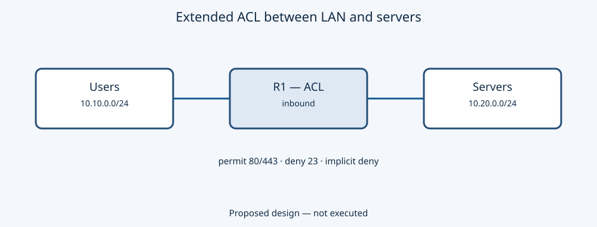

# CCNA SEC-06 — Access Control Lists: Standard، Extended و Named

**سطح:** CCNA. **پیش‌نیاز:** SEC-03 و IC-02. **هدف رسمی:** `5.6` پیکربندی و بررسی ACL. **وضعیت:** پیش‌نویس محتوایی؛ طراحی عملی انجام شده و **اجرا نشده**. مدل روتر و نسخهٔ IOS انتخاب نشده. همهٔ خروجی‌ها نمونهٔ طراحی‌شده‌اند.

## اهداف

1. Standard و Extended ACL را از نظر **چه چیزی را بررسی می‌کنند** و **کجا اعمال می‌شوند** تفکیک کنید.
2. Wildcard Mask را از Subnet Mask تشخیص دهید و درست محاسبه کنید.
3. جهت `in` و `out` را از **دید روتر** تعیین کنید.
4. اثر Implicit Deny را بفهمید و بدانید چه زمانی باید صریح نوشته شود.
5. ACL را با شمارندهٔ تطبیق بررسی کنید و خطاهای رایج را ریشه‌یابی کنید.

## ۱. ACL چیست و چه کاری نمی‌کند؟

ACL فهرستی **ترتیبی** از قواعد است. هر بسته یک‌بار با قواعد مقایسه می‌شود:

- **اولین تطبیق** اعمال می‌شود و بررسی متوقف می‌شود.
- اگر هیچ قاعده‌ای تطبیق نکند، **Implicit Deny All** در انتهای ACL بسته را دور می‌ریزد.

ACL **فقط فیلتر می‌کند**، نه کارهای دیگر:

| ACL انجام می‌دهد | ACL انجام نمی‌دهد |
|---|---|
| Permit/Deny بر اساس IP، پروتکل، پورت | Stateful Inspection (ردیابی اتصال) |
| محدودسازی روی Interface | محافظت در برابر حملهٔ لایهٔ ۲ |
| محدودسازی VTY و SNMP | رمزنگاری (برای آن به IPsec یا SSH نیاز است) |
| شناسایی ترافیک برای NAT و QoS | تشخیص نفوذ (نیاز به IPS) |

تفاوت مهم با **Firewall**: بسیاری از Firewallهای امروزی **Stateful** هستند و پاسخ‌های اتصال مجاز را دنبال می‌کنند، اما قابلیت‌ها به محصول و پیکربندی بستگی دارد. ACL معمولی روتر **Stateless** است و هر بسته را مستقل بررسی می‌کند؛ مسیر برگشت و قواعد آن را جداگانه طراحی کنید.

## ۲. Standard در برابر Extended

| ویژگی | Standard | Extended |
|---|---|---|
| شماره | `1–99`، `1300–1999` | `100–199`، `2000–2699` |
| چه چیزی را بررسی می‌کند | **فقط** آدرس مبدأ | مبدأ، مقصد، پروتکل، پورت، Flagهای TCP |
| نمونه | `access-list 10 permit 10.10.0.0 0.0.0.255` | `access-list 100 permit tcp 10.10.0.0 0.0.0.255 host 10.20.0.10 eq 443` |
| کجا اعمال شود | **نزدیک مقصد** | **نزدیک مبدأ** |
| دقت | کم | زیاد |

### چرا Standard نزدیک مقصد و Extended نزدیک مبدأ؟

این‌ها **راهنمای طراحی رایج** هستند، نه قانون اجباری؛ جای دقیق ACL به دامنهٔ سیاست، مسیرها و اثر بر ترافیک بستگی دارد. یک دلیل مهم انتخاب، محدودکردن اثر ناخواسته و دورریختن زودهنگام ترافیک نامجاز است:

- **Standard** فقط مبدأ را می‌بیند. اگر آن را نزدیک مبدأ بگذارید و بگویید «`10.10.0.5` را ببند»، ترافیک `10.10.0.5` به مقصد `10.20.0.10` هم بسته می‌شود، هرچند مقصد مجاز بود. پس باید نزدیک مقصد بگذارید تا فقط برای همان مقصد اعمال شود.
- **Extended** مقصد را هم می‌بیند. اگر نزدیک مقصد بگذارید، بسته‌ای که باید دور ریخته شود تا آن نقطه پهنای باند مصرف کرده است. پس نزدیک مبدأ می‌گذارید.

## ۳. Wildcard Mask — منبع بیشترین خطا

Wildcard **مکمل** Subnet Mask است:

```text
Wildcard = 255.255.255.255 − Subnet Mask
```

| Subnet Mask | طول | Wildcard | معنا |
|---|---|---|---|
| `255.255.255.0` | `/24` | `0.0.0.255` | ۲۵۶ آدرس |
| `255.255.255.252` | `/30` | `0.0.0.3` | ۴ آدرس |
| `255.255.0.0` | `/16` | `0.0.255.255` | ۶۵٬۵۳۶ آدرس |
| `255.255.255.255` | `/32` | `0.0.0.0` | یک آدرس |
| `0.0.0.0` | `/0` | `255.255.255.255` | همهٔ آدرس‌ها |

معنای بیت‌ها:

- بیت **۰** در Wildcard یعنی «این بیت باید دقیقاً مطابق باشد».
- بیت **۱** یعنی «این بیت مهم نیست».

نکتهٔ ظریف: Wildcard لزوماً یک بلوک پیوسته نیست. `0.0.0.254` همهٔ آدرس‌های **زوج** را پوشش می‌دهد. این کار قدرت بیشتری می‌دهد ولی خواندنش سخت است و در طراحی معمول توصیه نمی‌شود.

دو کلمهٔ کلیدی:

- `host 10.20.0.10` = `10.20.0.10 0.0.0.0`
- `any` = `0.0.0.0 255.255.255.255`

## ۴. جهت `in` و `out` — از دید روتر

این بخش بیشترین اشتباه را دارد. مرجع همیشه **روتر** است، نه شما:

| جهت | تعریف |
|---|---|
| **`in`** | بسته‌ای که از کابل **وارد** روتر می‌شود |
| **`out`** | بسته‌ای که روتر **خارج** می‌کند |

پس اگر می‌خواهید ترافیک کاربران را در سمت LAN فیلتر کنید، ACL را روی Interface سمت LAN با کلمهٔ `in` اعمال می‌کنید (چون بسته از آن سمت وارد روتر می‌شود).

```text
interface GigabitEthernet0/0
 ip access-group USER-FILTER in
```

قاعدهٔ حافظه: **`in` یعنی بسته از این Interface به سمت داخل روتر می‌آید.** اگر اشتباه بگیرید، ACL روی ترافیک بی‌ربط اعمال می‌شود و نتیجه کاملاً متفاوت است.

هر Interface، هر جهت، فقط **یک** ACL IPv4 می‌پذیرد. اگر دومی را اعمال کنید، اولی جایگزین می‌شود.

## ۵. توپولوژی کاربرگ

**PNETLab مستقل — طراحی‌شده و اجرا‌نشده.**

```text
   LAN کاربران 10.10.0.0/24                        شبکهٔ سرور 10.20.0.0/24
          |                                                 |
     [Gi0/0] R1 [Gi0/1] ── (ACL روی Gi0/0 in) ──→  [Server 10.20.0.10]
   10.10.0.1                                          سرور وب و DNS
          |
   PC-A 10.10.0.50
   PC-B 10.10.0.51
```

| دستگاه | Interface | آدرس | نقش |
|---|---|---|---|
| R1 | Gi0/0 | `10.10.0.1/24` | Gateway کاربران؛ محل اعمال ACL |
| R1 | Gi0/1 | `10.20.0.1/24` | Gateway سرور |
| Server | eth0 | `10.20.0.10/24` | وب‌سرور (۸۰ و ۴۴۳) و DNS |
| PC-A | eth0 | `10.10.0.50/24` | کاربر مجاز به وب |
| PC-B | eth0 | `10.10.0.51/24` | کاربر مجاز به وب و مدیریت (SSH) |



## ۶. طراحی سیاست — قبل از نوشتن ACL

سیاست مورد نیاز:

1. همهٔ کاربران به سرور وب (`10.20.0.10`) روی **HTTP و HTTPS** دسترسی دارند.
2. همهٔ کاربران اجازهٔ **DNS روی UDP و TCP پورت 53** به همان سرور دارند؛ UDP رایج است و TCP نیز برای پاسخ‌های بزرگ/موارد لازم DNS استفاده می‌شود.
3. فقط `PC-B` (`10.10.0.51`) اجازهٔ **SSH** (`22`) به سرور دارد.
4. **Telnet** (`23`) از LAN کاربران به هر مقصدی ممنوع است.
5. بقیهٔ ترافیک (غیر از موارد ۱ تا ۳) به شبکهٔ سرور ممنوع است.
6. ترافیک به اینترنت و سایر مقاصد باید آزاد بماند.

**دقت مهم در عبارت‌بندی بند ۴:** ACL روی `Gi0/0` فقط ترافیک **ورودی از LAN کاربران** را می‌بیند. پس این ACL می‌تواند Telnetِ *خروجی از LAN* را ببندد، ولی Telnet از شبکهٔ سرور یا از مسیر مدیریت را **نمی‌بیند**. برای بستن Telnet در کل توپولوژی باید یکی از این‌ها را هم انجام داد:

- ACL جدا روی `Gi0/1` (ورودی شبکهٔ سرور)؛
- یا بهتر: روی خود دستگاه `line vty 0 4` + `transport input ssh` (به SEC-06a/NA-09 مراجعه کنید)؛

`transport input ssh` جلسهٔ Telnet به خود روتر را می‌بندد و در برابر ACL، دقیق‌تر و کم‌هزینه‌تر است. این تفکیک را در طراحی واقعی حتماً در نظر بگیرید.

**نکتهٔ کلیدی که در طراحی‌های آماتور فراموش می‌شود:** بند ۲ (DNS) و بند ۶. اگر فقط بنویسید `deny ip any any`، کاربر حتی نمی‌تواند DNS بگیرد و مرورگر با «سایت پیدا نشد» شکست می‌خورد — در حالی که ICMP به IP مستقیم کار می‌کند. این یکی از گیج‌کننده‌ترین ایرادها در محیط عملیاتی است.

## ۷. پیکربندی به ترتیب اجرا

**همهٔ فرمان‌ها اجرا‌نشده‌اند.**

### گام ۱ — نوشتن ACL با شمارهٔ ترتیبی صریح

روش Named به شما اجازه می‌دهد قاعده را در جای دلخواه وارد یا حذف کنید. شماره‌گذاری به مضرب ۱۰، فضای درج می‌دهد:

```text
enable
configure terminal
ip access-list extended USER-TO-SERVER
 10 permit tcp 10.10.0.0 0.0.0.255 host 10.20.0.10 eq 80
 20 permit tcp 10.10.0.0 0.0.0.255 host 10.20.0.10 eq 443
 30 permit udp 10.10.0.0 0.0.0.255 host 10.20.0.10 eq 53
 35 permit tcp 10.10.0.0 0.0.0.255 host 10.20.0.10 eq 53
 40 permit tcp host 10.10.0.51 host 10.20.0.10 eq 22
 50 deny   tcp any any eq 23 log
 60 deny   ip  10.10.0.0 0.0.0.255 10.20.0.0 0.0.0.255 log
 70 permit ip  10.10.0.0 0.0.0.255 any
 exit
end
```

تفسیر هر قاعده:

| شماره | قاعده | چرا |
|---|---|---|
| `10` | `permit tcp ... host 10.20.0.10 eq 80` | HTTP فقط به همان یک سرور |
| `20` | `permit tcp ... eq 443` | HTTPS |
| `30` | `permit udp ... eq 53` | DNS معمولاً روی UDP؛ قاعدهٔ `35` TCP را هم مجاز می‌کند |
| `35` | `permit tcp ... eq 53` | DNS روی TCP برای پاسخ‌های بزرگ/مواردی که TCP لازم است |
| `40` | `permit tcp host 10.10.0.51 ... eq 22` | SSH فقط از PC-B به سرور |
| `50` | `deny tcp any any eq 23 log` | Telnet از **LAN** به هر مقصدی، با ثبت (نه کل توپولوژی — بخش ۶) |
| `60` | `deny ip 10.10.0.0 ... 10.20.0.0 ... log` | مسدود کردن **فقط** ترافیک LAN کاربران به شبکهٔ سرور |
| `70` | `permit ip 10.10.0.0 ... any` | عبور دادن ترافیک به مقصدهای دیگر، مثل اینترنت؛ بدون این Permit، Implicit Deny بقیه را می‌بندد |

نکتهٔ طراحی مهم: قاعدهٔ `60` **فقط** بین دو شبکه است، نه `any any`؛ اما پس از آن باید قاعدهٔ `70` صریحاً ترافیک LAN به مقصدهای دیگر را Permit کند. بدون `70`، Implicit Deny انتهای ACL اینترنت و همهٔ مقصدهای دیگر را هم می‌بندد. `any any` به‌عنوان Deny در اینجا استفاده نمی‌شود چون سیاست بند ۶ را نقض می‌کند. این Permit فقط تصمیم ACL را نشان می‌دهد؛ دسترسی واقعی به اینترنت هنوز به Route، NAT و کنترل‌های دیگر نیاز دارد.

`log` روی قواعد Deny به‌کار رفته، نه Permit، چون آن‌چه برای عیب‌یابی و امنیت مهم است، ترافیک مسدودشده است. `log` روی Permit می‌تواند حجم Log را ناگهان بالا ببرد.

### گام ۲ — اعمال روی Interface (با جهت درست)

```text
configure terminal
interface GigabitEthernet0/0
 ip access-group USER-TO-SERVER in
 exit
end
```

`in` روی `Gi0/0` یعنی «بسته‌ای که از LAN کاربران وارد روتر می‌شود». اگر به‌جای `in` بنویسید `out`، ACL روی بسته‌های **خارج‌شونده** به سمت LAN اعمال می‌شود — یعنی روی پاسخ‌های سرور. نتیجه کاملاً برعکس می‌شود و کاربران هیچ پاسخی نمی‌گیرند.

### گام ۳ — بررسی پیش از فعال‌سازی (اختیاری ولی توصیه‌شده)

روی روترهای پشتیبانی‌کننده:

```text
show access-lists USER-TO-SERVER
```

قبل از اعمال روی Interface، ترتیب و محتوا را بررسی کنید. اعمال روی Interface در محیط عملیاتی می‌تواند دسترسی خودتان را قطع کند (اگر از همان مسیر مدیریت می‌کنید). برای امنیت، از **Console** یا مسیر مدیریتی جدا استفاده کنید.

## ۸. Verification و تفسیر خروجی

**نمونهٔ طراحی‌شده، اجرا‌نشده.**

```text
R1# show ip interface GigabitEthernet0/0
GigabitEthernet0/0 is up, line protocol is up
  Internet address is 10.10.0.1/24
  Outgoing access list is not set
  Inbound  access list is USER-TO-SERVER
```

- `Inbound access list is USER-TO-SERVER` — تایید اعمال در جهت درست.
- `Outgoing access list is not set` — هیچ ACL روی ترافیک خروجی به LAN نیست. اگر اینجا هم ACL می‌خواستید، دومی روی `out` جدا اعمال می‌شد، ولی یک Interface در هر جهت فقط یک ACL می‌پذیرد.

```text
R1# show access-lists
Extended IP access list USER-TO-SERVER
    10 permit tcp 10.10.0.0 0.0.0.255 host 10.20.0.10 eq www (247 matches)
    20 permit tcp 10.10.0.0 0.0.0.255 host 10.20.0.10 eq 443 (183 matches)
    30 permit udp 10.10.0.0 0.0.0.255 host 10.20.0.10 eq domain (91 matches)
    35 permit tcp 10.10.0.0 0.0.0.255 host 10.20.0.10 eq domain (3 matches)
    40 permit tcp host 10.10.0.51 host 10.20.0.10 eq 22 (12 matches)
    50 deny tcp any any eq telnet log (0 matches)
    60 deny ip 10.10.0.0 0.0.0.255 10.20.0.0 0.0.0.255 log (34 matches)
    70 permit ip 10.10.0.0 0.0.0.255 any (384 matches)
```

تفسیر خط‌به‌خط:

- `(247 matches)` — این قاعده ۲۴۷ بسته را Match کرده است. شمارنده فقط نشان می‌دهد قاعده Hit داشته؛ برای اعتبارسنجی سیاست، تست مجاز/ممنوع را اجرا کنید و نتیجهٔ انتها‌به‌انتها را با انتظار مقایسه کنید.
- `(0 matches)` روی Telnet — یا کسی تلاش نکرده، یا قاعده اشتباه است. برای تست باید عمداً یک تلاش Telnet بزنید و ببینید شمارنده بالا می‌رود.
- `(34 matches)` روی `deny` بین دو شبکه — ۳۴ بستهٔ غیرمجاز دور ریخته شده. اگر این عدد غیرمنتظره بالاست، احتمالاً قاعده‌ای در طراحی جا افتاده است.
- `(384 matches)` روی Permit شمارهٔ ۷۰ — ترافیک کاربران به مقصدهای غیر از شبکهٔ سرور از این قاعده عبور کرده؛ در محیط واقعی شمارنده را با ترافیک مورد انتظار مقایسه کنید.
- `eq www` — IOS نام سرویس را جای شمارهٔ پورت نشان می‌دهد. `www` همان ۸۰، `domain` همان ۵۳، `telnet` همان ۲۳ است. نگاشت فقط نمایشی است؛ رفتار یکسان است.

```text
R1# show access-lists USER-TO-SERVER
Extended IP access list USER-TO-SERVER
    10 permit tcp 10.10.0.0 0.0.0.255 host 10.20.0.10 eq www
    20 permit tcp 10.10.0.0 0.0.0.255 host 10.20.0.10 eq 443
    30 permit udp 10.10.0.0 0.0.0.255 host 10.20.0.10 eq domain
    35 permit tcp 10.10.0.0 0.0.0.255 host 10.20.0.10 eq domain
    40 permit tcp host 10.10.0.51 host 10.20.0.10 eq 22
    50 deny tcp any any eq telnet log
    60 deny ip 10.10.0.0 0.0.0.255 10.20.0.0 0.0.0.255 log
    70 permit ip 10.10.0.0 0.0.0.255 any
```

بدون `matches`، همان ACL بدون شمارنده نشان داده می‌شود. برای پاک کردن شمارنده‌ها: `clear ip access-list counters`.

**نکتهٔ مهم دربارهٔ `show access-lists` روی ACL اعمال‌نشده:** ACL می‌تواند در Configuration باشد ولی روی هیچ Interface اعمال نشده باشد. در آن صورت `matches` همیشه صفر است. بررسی اعمال‌شدن از `show ip interface` می‌آید، نه از `show access-lists`.

## ۹. عیب‌یابی

| نشانه | علت محتمل | بررسی | اصلاح |
|---|---|---|---|
| همهٔ ترافیک بسته است | `deny ip any any` بدون قاعدهٔ Permit قبل از آن | `show access-lists` | ترتیب را اصلاح کنید |
| ترافیک مجاز بسته است | Wildcard اشتباه (مثلاً `0.0.255.0`) | قاعده را با Mask مقایسه کنید | Wildcard درست |
| ACL اثری ندارد | روی Interface اعمال نشده | `show ip interface` | `ip access-group ... in` |
| ACL روی ترافیک اشتباه اثر دارد | جهت `in`/`out` برعکس | همان | جهت را درست کنید |
| DNS از کار افتاده | Deny زودتر از Permit یا نبود Permit روی UDP/TCP 53 | `show access-lists` و تست Resolver | Permitهای UDP و TCP `eq 53` را پیش از Deny بگذارید |
| بعد از حذف قاعده، هنوز اعمال می‌شود | ACL حذف شده ولی Reference در Interface مانده | `show running-config interface` | `no ip access-group` روی Interface |
| `matches` صفر است | ACL روی Interface اعمال نشده یا ترافیک از مسیر دیگری می‌رود | `show ip interface` | اعمال درست |
| پورت اپراتور مسدود شده | Permit نبود برای SSH/SNMP | Logger و شمارنده | قاعدهٔ مدیریت را اضافه کنید |

### نسخه‌بندی و ویرایش

ویرایش ACL با CLI سادهٔ **Numbered** می‌تواند دشوارتر باشد؛ `no access-list 100` کل ACL را حذف می‌کند. در IOSهای جدیدتر ممکن است بتوان ACL شماره‌دار را هم در ACL Configuration Mode با Sequence Number ویرایش کرد؛ Syntax را بررسی کنید. **Named ACL** معمولاً خواناتر و مدیریت آن ساده‌تر است، اما تنها شکل قابل‌ویرایش نیست:

```text
ip access-list extended USER-TO-SERVER
 35 permit tcp 10.10.0.0 0.0.0.255 host 10.20.0.10 eq 8080
```

با شمارهٔ ۳۵، این قاعده **بین** ۳۰ و ۴۰ درج می‌شود و بقیه جابه‌جا نمی‌شوند.

## ۱۰. کاربرگ مستقل PNETLab

1. توپولوژی بخش ۵ را با آدرس‌های جدول بسازید و Connectivity را قبل از ACL تایید کنید.
2. ACL را در Configuration بنویسید ولی **اعمال نکنید**. با `show access-lists` ببینید `matches` صفر است.
3. ACL را اعمال کنید و HTTP/HTTPS از PC-A را بررسی کنید؛ Resolve نام سرور را هم آزمایش کنید و در صورت امکان هر دو مسیر DNS/UDP و DNS/TCP را ثبت کنید.
4. از PC-A به `10.20.0.10` SSH بزنید. باید شکست بخورد. شمارندهٔ قاعدهٔ `60` را ثبت کنید.
5. از PC-B SSH بزنید. باید موفق شود. شمارندهٔ قاعدهٔ `40` را ثبت کنید.
6. یک تلاش Telnet بزنید. شمارندهٔ قاعدهٔ `50` را ثبت کنید.
7. `deny ip 10.10.0.0 ... 10.20.0.0` را موقتاً به `deny ip any any` تغییر دهید و ببینید DNS و اینترنت قطع می‌شود. سپس برگردانید.
8. `ip access-group ... out` را به‌جای `in` امتحان کنید و ببینید کاربران هیچ پاسخی نمی‌گیرند. سپس برگردانید.
9. قاعده‌ای با شمارهٔ ۳۵ درج کنید و ترتیب را در `show access-lists` تایید کنید.

هیچ‌کدام از این مراحل اجرا نشده و هیچ شمارندهٔ واقعی ثبت نشده است.

## ۱۱. سؤال‌ها و پاسخ

1. **ACL روتر Stateful است یا Stateless؟** Stateless. هر بسته مستقل بررسی می‌شود و پاسخ یک اتصال مجاز خودش باید اجازه داشته باشد.

2. **ترتیب قواعد چه اهمیتی دارد؟** اولین تطبیق اعمال می‌شود. اگر `deny ip any any` اول بیاید، هیچ قاعدهٔ بعدی اجرا نمی‌شود.

3. **Implicit Deny در انتهای ACL چیست؟** اگر هیچ قاعده‌ای تطبیق نکند، بسته دور ریخته می‌شود. پس `deny ip any any` در انتها **فقط** برای ثبت Log لازم است، نه برای مسدودسازی.

4. **Wildcard برای `10.10.0.0/22` چه می‌شود؟** Mask آن `255.255.252.0` است، پس Wildcard = `0.0.3.255`.

5. **چرا Standard ACL نزدیک مقصد اعمال می‌شود؟** چون فقط مبدأ را می‌بیند؛ اگر نزدیک مبدأ اعمال شود، ترافیک همان مبدأ به همهٔ مقاصد مسدود می‌شود.

6. **چرا Extended نزدیک مبدأ اعمال می‌شود؟** تا بستهٔ غیرمجاز زودتر حذف شود و پهنای باند مصرف نکند.

7. **`in` و `out` از دید چه کسی تعریف می‌شوند؟** از دید روتر. `in` یعنی بسته از Interface وارد روتر می‌شود؛ `out` یعنی خارج می‌شود.

8. **چند ACL می‌توان روی یک Interface در هر جهت اعمال کرد؟** یک عدد. دومی اولی را جایگزین می‌کند.

9. **چرا بعد از Deny کاربران DNS نمی‌گیرند؟** چون DNS روی UDP یا TCP پورت ۵۳ هم با Deny IP مسدود می‌شود؛ هر دو پروتکل را در صورت نیاز پیش از Deny مجاز کنید.

10. **چگونه بررسی می‌کنید یک قاعده مطابق سیاست کار می‌کند؟** شمارندهٔ `matches` نشان می‌دهد قاعده Hit داشته است؛ علاوه بر آن، ترافیک مجاز و ممنوع را عمداً آزمایش کنید و نتیجهٔ انتها‌به‌انتها را با سیاست مورد انتظار بسنجید.

11. **تفاوت Named و Numbered در ویرایش چیست؟** هر دو در IOSهای مدرن ممکن است Sequence Number داشته باشند؛ Named معمولاً خواناتر است. Syntax/قابلیت ویرایشِ ACL شماره‌دار به IOS وابسته است و `no access-list <number>` کل ACL را حذف می‌کند.

12. **اگر ACL روی Interface باشد و بخواهید حذف کنید، چه می‌کنید؟** اول `no ip access-group` روی Interface، سپس ACL را حذف می‌کنید. اگر فقط ACL را حذف کنید، Reference می‌ماند و رفتار مبهم می‌شود.

## واژه‌نامه و چک‌لیست

ACL: فهرست کنترل دسترسی؛ **Standard**: فقط مبدأ؛ **Extended**: مبدأ/مقصد/پروتکل/پورت؛ **Wildcard**: ماسک معکوس؛ **Implicit Deny**: بستن پیش‌فرض انتهایی؛ **in/out**: جهت از دید روتر؛ Stateless: بدون ردیابی اتصال.

- [ ] می‌دانم ACL روتر Stateless است و مسیر برگشت را باید در نظر بگیرم.
- [ ] Wildcard را از Mask محاسبه می‌کنم، نه از حافظه.
- [ ] جهت `in`/`out` را از دید روتر تعیین می‌کنم.
- [ ] قاعدهٔ DNS را در طراحی فراموش نمی‌کنم.
- [ ] از `deny ip any any` بدون Permitهای لازم استفاده نمی‌کنم.
- [ ] Verification را با شمارندهٔ `matches` انجام می‌دهم.
- [ ] از Named ACL با شمارهٔ ترتیبی برای ویرایش‌پذیری استفاده می‌کنم.
