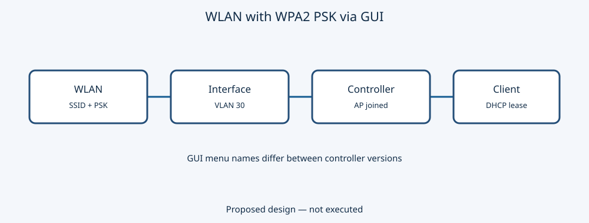

# CCNA SEC-10 — ساخت WLAN در GUI با WPA2 PSK

**سطح:** CCNA. **پیش‌نیاز:** SEC-09 و NA-09. **هدف رسمی:** `5.10` پیکربندی و Verification WLAN در GUI با WPA2 PSK. **وضعیت:** پیش‌نویس؛ مسیر GUI طراحی‌شده و اجرا‌نشده؛ هیچ کنترلر واقعی در دسترس نبوده و نام نسخه تأیید نشده است.

## اهداف

مراحل ساخت WLAN در GUI را به‌ترتیب انجام دهید، WPA2 PSK را تنظیم کنید و اتصال کلاینت را Verification کنید.

## ۱. پیش‌نیازها

قبل از ساخت WLAN باید مسیر VLAN/آدرس‌دهی و **DHCP** آماده و **AP** به کنترلر Join شده باشد. در معماری Central-Switching معمولاً Interface/VLAN روی کنترلر نگاشت می‌شود؛ در FlexConnect/Local Switching نیز VLAN mapping روی AP/site policy اهمیت دارد. WLAN profile ممکن است روی کنترلر موجود باشد، اما AP باید به آن Policy/Group تخصیص یابد تا SSID را پخش کند. مسیر منوها بین نسخه‌های کنترلر متفاوت است و در این درس فقط ترتیب منطقی مراحل بیان می‌شود، نه نام دقیق منو.

## ۲. مراحل طراحی‌شده

1. ورود به GUI کنترلر با حساب مدیریت.
2. بررسی وضعیت AP و Join بودن آن.
3. ساخت Interface/VLAN برای WLAN (در صورت نیاز).
4. رفتن به بخش مدیریت WLAN/SSID و ساخت WLAN جدید؛ نام و مسیر دقیق منو به نسخهٔ کنترلر بستگی دارد.
5. تعیین **SSID** و **Profile Name**.
6. فعال کردن WLAN و انتخاب Interface.
7. تنظیم **Security = WPA2-Personal/PSK** و Cipher برابر AES/CCMP (اگر GUI جداگانه انتخاب می‌کند؛ TKIP را فعال نکنید).
8. وارد کردن Passphrase منحصربه‌فرد و بلند؛ در WPA2-Personal معمولاً Passphrase باید ۸ تا ۶۳ نویسهٔ ASCII باشد (۶۴ رقم Hex قالب PSK خام است—فرمت مورد قبول Controller را بررسی کنید). رمز واقعی را در سند/تصویر ثبت نکنید.
9. اعمال (Apply) و بررسی انتشار SSID.
10. اتصال کلاینت با PSK و دریافت آدرس از DHCP.
11. ثبت خروجی وضعیت کلاینت و SSID.

**هیچ‌کدام از این مراحل اجرا نشده است.** نام SSID و PSK در این درس نمونه‌اند: `LAB-WPA2` و یک عبارت عبور طولانی.

## ۳. سناریوی طراحی‌شده

**PNETLab مستقل، طراحی‌شده و اجرا‌نشده:** یک کنترلر فرضی، یک AP با Join موفق، VLAN 30 برای WLAN، DHCP برای `10.30.0.0/24` و SSID `LAB-WPA2` با WPA2 Personal. کلاینت فرضی `10.30.0.50` می‌گیرد.



## ۴. Verification طراحی‌شده

بررسی‌های لازم پس از ساخت:

- وضعیت WLAN در فهرست: **Enabled** و به AP/Policy درست تخصیص یافته باشد.
- تنظیمات Security: **WPA2-Personal/PSK** با Cipher **AES/CCMP**؛ TKIP فعال نباشد.
- وضعیت AP: **Joined** و تعداد کلاینت متصل.
- کلاینت آدرس IP از DHCP گرفته باشد.
- اتصال به Gateway و مقصد داخلی برقرار شود.

**خروجی شماتیک، اجرا‌نشده** (فرمان و قالب دقیق IP-Config به سیستم‌عامل کلاینت بستگی دارد):

```text
Client# ipconfig
IP Address: 10.30.0.50
Default Gateway: 10.30.0.1
```

## ۵. کاربرگ مستقل PNETLab/کنترلر — WLAN با WPA2-PSK

**Objective عملی `5.10`:** WLAN را در GUI پیکربندی و WPA2 PSK را Verification کنید. **سناریو طراحی‌شده و اجرا‌نشده است.** اگر Image رسمی/مجاز Controller و AP در PNETLab موجود نیست، این تمرین را روی کنترلر/آزمایشگاه مجاز اجرا کنید؛ شبیه‌سازی CLI یا Wireless NIC به‌تنهایی GUI واقعی را اثبات نمی‌کند.

### توپولوژی، تجهیزات و آدرس‌دهی نمونه

```text
ADMIN-VM ── Mgmt VLAN ── WLC ── AP (joined)
Client-VM 802.11 ──────── AP ── VLAN 30 ── DHCP/Gateway
```

| جزء | نمونهٔ لاب | نیاز/مرز |
|---|---|---|
| WLC | Management `192.0.2.10/24` | ثبت مدل، Firmware/IOS-XE/AireOS و GUI واقعی |
| AP | Management `192.0.2.20/24` | مدل سازگار و وضعیت Joined؛ تأمین برق/Join در پلتفرم بررسی شود |
| VLAN 30 | WLAN client subnet `10.30.0.0/24`; GW `10.30.0.1` | Central vs FlexConnect/Local Switching را پیش از Map تعیین کنید |
| DHCP | Pool فقط برای `10.30.0.0/24` | Gateway/DNS متناسب با محیط ایزوله؛ از شبکهٔ واقعی جدا |
| Client | Wi-Fi NIC مجاز | اسکن SSID، اتصال و دریافت Lease |

### مراحل اجرا

1. پیش از تغییر، از WLC Backup/Snapshot بگیرید و Version، WLAN/Policy، AP Group/Tag، Interface/VLAN، switching mode و DHCP را ثبت کنید. PSK واقعی را در Screenshot، Markdown یا Git وارد نکنید؛ برای لاب از Secret ساختگی یکتا استفاده کنید.
2. ابتدا مسیر Management و Join شدن AP را در GUI Verification کنید. اگر AP Joined نیست، ساخت WLAN را به‌عنوان حل آن مشکل تلقی نکنید.
3. وجود VLAN 30 و مسیر تا DHCP/Gateway را بررسی کنید. در Central Switching، WLAN معمولاً به Interface/Policy کنترلر Map می‌شود؛ در FlexConnect/Local Switching، VLAN mapping/Policy سمت Site/AP نیز باید درست باشد. نام فیلد و ترتیب دقیق منو با Controller release فرق می‌کند.
4. در GUI یک Profile یکتا مانند `LAB-WPA2` بسازید؛ SSID=`LAB-WPA2`, VLAN/Policy مربوط به Client را Map کنید، WLAN را Enable کنید و AP Group/Tag مناسب را اختصاص دهید. تنظیمات را Deploy/Apply کنید.
5. در Security، **WPA2-Personal/PSK** و **AES/CCMP** انتخاب کنید؛ TKIP را روشن نکنید. Passphrase حداقل مطابق Policy و قالب کنترلر باشد؛ برای WPA2-Personal معمولاً 8–63 ASCII نویسه یا 64 رقم Hex PSK است. این رمز فقط لاب است.
6. Client را به SSID وصل کنید. در GUI وضعیت Association/Security/Cipher و تعداد Clientها را ثبت کنید؛ روی Client، آدرس/Prefix، Gateway، DNS و DHCP Lease را با ابزار سیستم‌عامل بررسی کنید؛ سپس Gateway و سرویس مجاز را جداگانه آزمون کنید.

### نقص کنترل‌شده، Troubleshooting و Rollback

یک متغیر را در هر آزمون تغییر دهید: (الف) یک‌بار PSK نادرست وارد کنید—Association نباید تکمیل شود؛ (ب) PSK صحیح را بازگردانید؛ (ج) اگر کلاینت وصل است ولی IP ندارد، DHCP/VLAN mapping را بررسی کنید. پیش از تغییر، از GUI Snapshot استفاده کنید. بعد از آزمون، WLAN آزمایشی را Disable/حذف، VLAN و DHCP موقت را بازگردانید و هیچ Policy تولیدی را پاک نکنید.

| نشانه | بررسی مرحله‌ای |
|---|---|
| SSID دیده نمی‌شود | WLAN Enabled، AP Joined، Profile/Group/Tag assignment، Radio/Band، Shutdown/Regulatory Domain و نشر SSID |
| Association/Authentication رد می‌شود | WPA2-Personal، AES/CCMP، Passphrase، Client capability و Controller logs؛ PSK را افشا نکنید |
| Client وصل است اما DHCP ندارد | Central/Local Switching، VLAN/Interface mapping، Trunk/Allowed VLAN، Pool/Scope و Relay/Gateway |
| IP می‌گیرد اما Gateway unreachable است | Subnet/Mask، VLAN، Gateway SVI، ARP و ACL؛ دریافت Lease به‌تنهایی مسیر را ثابت نمی‌کند |
| Gateway پاسخ می‌دهد اما نام باز نمی‌شود | DNS Resolver، DHCP option، route/policy و سرویس مقصد را جدا بررسی کنید |

**معیار تحویل:** Version و Topology ثبت شده، AP واقعاً Joined است، WLAN فعال و به Policy/AP درست Map شده، WPA2-PSK/AES-CCMP در GUI و Client Verification شده، Lease و Gateway بررسی شده، آزمون PSK نادرست/بازیابی و Rollback ثبت شده، و هیچ PSK/Secret در مدرک نیست. اگر Controller GUI واقعی در محیط موجود نیست، نتیجه «نیازمند اعتبارسنجی عملی» می‌ماند؛ این سناریو اجرا‌نشده است.

## ۶. سؤال‌ها و پاسخ

1. **قبل از WLAN چه چیزی لازم است؟** Interface، DHCP و Join بودن AP.
2. **SSID چیست؟** نام شبکهٔ بی‌سیم.
3. **WPA2 Personal چه امنیتی دارد؟** PSK مشترک.
4. **PSK چگونه باشد؟** طولانی و غیرقابل حدس.
5. **اگر AP Join نباشد چه می‌شود؟** WLAN منتشر نمی‌شود.
6. **Interface چه نقشی دارد؟** اتصال WLAN به VLAN.
7. **Verification با چه چیزی؟** وضعیت WLAN، AP و کلاینت.
8. **چرا GUI بین نسخه‌ها فرق دارد؟** نسخهٔ کنترلر متفاوت است.
9. **آیا جداسازی مهمان لازم است؟** بله.
10. **آیا SSID پنهان امنیت است؟** نه.
11. **آیا این مراحل اجرا شده‌اند؟** خیر.
12. **چه چیزی تأیید نشده است؟** نام کنترلر و نسخه.

## واژه‌نامه و چک‌لیست

SSID: نام شبکه؛ PSK: کلید مشترک؛ Join: پیوستن AP به کنترلر؛ Interface: اتصال منطقی.

- [ ] پیش‌نیازها را قبل از ساخت WLAN بررسی می‌کنم.
- [ ] PSK را طولانی و غیرقابل حدس می‌گذارم.
- [ ] Verification را از سه نقطه انجام می‌دهم.
