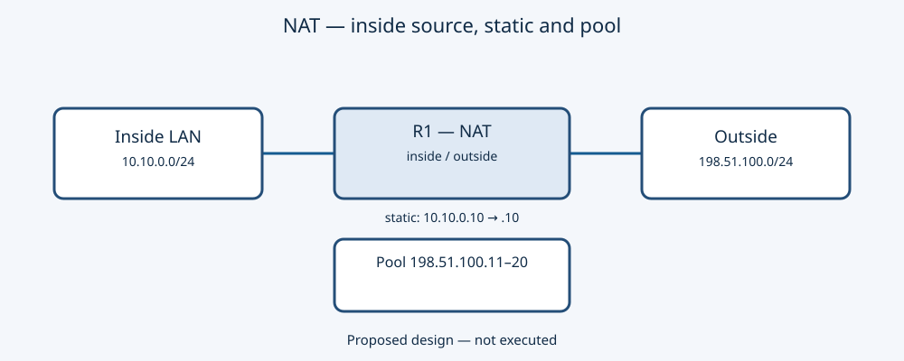

# CCNA IS-01 — NAT منبع داخلی با Static و Pool

**سطح:** CCNA. **پیش‌نیاز:** NF-09 و IC-01. **هدف رسمی:** `4.1` پیکربندی و Verification NAT برای source داخلی با Static و Pool. **وضعیت:** پیش‌نویس؛ فرمان‌ها و خروجی‌ها طراحی‌شده و اجرا‌نشده‌اند؛ مدل و نسخهٔ IOS انتخاب نشده است.

## اهداف

تفاوت Static NAT و Dynamic NAT با Pool را توضیح دهید، Inside و Outside را درست تعیین کنید و NAT را با خروجی Verification کنید.

## ۱. NAT چه می‌کند؟

NAT آدرس مبدأ یا مقصد بسته را در گذر از روتر تغییر می‌دهد. در **Inside Source NAT**، آدرس مبدأ شبکهٔ داخلی به آدرس عمومی ترجمه می‌شود تا کلاینت‌های داخلی با آدرس خصوصی بتوانند با شبکهٔ بیرونی ارتباط بگیرند. رابط متصل به شبکهٔ داخلی **Inside** و رابط متصل به شبکهٔ بیرونی **Outside** است؛ اشتباه در این دو، شایع‌ترین خطای پیکربندی است.

**Static NAT** یک آدرس داخلی را به‌طور پایدار به یک آدرس Global نگاشت می‌کند؛ برای میزبانی با آدرس ثابت و قابل‌دسترسی از بیرون مناسب است. **Dynamic NAT** یک آدرس آزاد از **Pool** را به یک Inside Local نگاشت می‌کند؛ اتصال‌های همان میزبان از همان نگاشت استفاده می‌کنند و، برخلاف PAT، چند میزبان را با یک آدرس و پورت‌های متفاوت Multiplex نمی‌کند. اگر Pool برای یک Inside Local جدید آدرس آزاد نداشته باشد، نگاشت تازه ساخته نمی‌شود؛ Timeout و بازیافت نگاشت به پیاده‌سازی وابسته است. **PAT** (یا NAT Overload) چند Inside Local را با یک آدرس Global و نگاشت شناسه‌های لایهٔ انتقال—معمولاً پورت‌های TCP/UDP—هم‌زمان پوشش می‌دهد؛ در طراحی‌های رایج کاربران کاربرد فراوان دارد.

## ۲. سناریوی مرزی

**طرح مستقل PNETLab، طراحی‌شده و اجرا‌نشده:** روتر R1، دو دامنهٔ لایهٔ ۲ جدا و چهار گرهٔ VPCS (یا میزبان آزمایشی هم‌ارز) لازم‌اند. هیچ اتصال به شبکهٔ واقعی یا اینترنت ایجاد نکنید. تصویر/مدل و نسخهٔ IOS انتخاب نشده‌اند؛ قابلیت NAT، نام رابط‌ها و رفتار ARP برای آدرس‌های Global باید پیش از اجرا در مستند همان تصویر بررسی شود.



نمودار مفهومی است و تعداد Clientها را نشان نمی‌دهد. در تمرین، دو Client (`PC-IN-A` و `PC-IN-B`) و یک Server در سمت Inside قرار می‌گیرند و یک Client (`PC-OUT`) در سمت Outside است؛ طرفین Inside و Outside دو Broadcast Domain مجزا هستند.

| گره | رابط / IP نمونه | Gateway | نقش |
|---|---|---|---|
| R1 | `Gi0/0 — 10.10.0.1/24` | — | رابط Inside |
| R1 | `Gi0/1 — 198.51.100.1/24` | — | رابط Outside |
| SERVER | `10.10.0.10/24` | `10.10.0.1` | میزبان Static NAT؛ آزمون پایه با ICMP |
| PC-IN-A | `10.10.0.25/24` | `10.10.0.1` | مبدأ Dynamic NAT |
| PC-IN-B | `10.10.0.26/24` | `10.10.0.1` | مبدأ دوم برای تمرین Pool |
| PC-OUT | `198.51.100.200/24` | `198.51.100.1` | مقصد بیرونی آزمون |
| Static Mapping | `10.10.0.10 ↔ 198.51.100.10` | — | نگاشت ثابت یک‌به‌یک |
| Dynamic Pool | `198.51.100.11–198.51.100.20/24` | — | ده آدرس برای نگاشت یک‌به‌یک؛ بدون PAT |

آدرس‌های `198.51.100.0/24` از بازهٔ مستنداتی‌اند و فقط برای لاب ایزوله استفاده می‌شوند. اگر Image انتخابی برای آدرس‌های Global روی همان Outside Subnet رفتار Proxy ARP/NAT Alias متفاوتی دارد، راهنمای همان پلتفرم را بررسی و توپولوژی را به یک بلوک مسیریابی‌شده اصلاح کنید؛ رفتار را حدس نزنید.

## ۳. پیکربندی پیشنهادی

**فرمان‌ها اجرا‌نشده‌اند.** بلوک نخست عمداً یک ACL اولیهٔ ناقص دارد تا هم‌پوشانی با نگاشت Static تحلیل شود؛ آن را به‌عنوان پیکربندی نهاییِ لاب به‌کار نبرید. ACL شمارهٔ ۱ باید طبق بلوک اصلاح‌شدهٔ پایین بازسازی شود؛ افزودن deny پس از permit موجود، ترتیب مطلوب را ایجاد نمی‌کند.

```text
configure terminal
interface GigabitEthernet0/0
 ip address 10.10.0.1 255.255.255.0
 ip nat inside
 no shutdown
exit
interface GigabitEthernet0/1
 ip address 198.51.100.1 255.255.255.0
 ip nat outside
 no shutdown
exit
ip nat inside source static 10.10.0.10 198.51.100.10
! Deliberately flawed starter ACL; replace it with the corrected ACL below.
access-list 1 permit 10.10.0.0 0.0.0.255
ip nat pool PUBLIC 198.51.100.11 198.51.100.20 netmask 255.255.255.0
ip nat inside source list 1 pool PUBLIC
end
```

ACL شمارهٔ 1 در این فرمان **انتخاب‌گر ترافیک NAT** است، نه ACL فیلتر روی Interface: `deny` یعنی «این مبدأ را با این قاعده ترجمه نکن» و به‌خودی‌خود Packet را فیلتر/Drop نمی‌کند؛ Packet می‌تواند طبق Routing و سایر Policyها Forward شود. اگر خودِ ACL فیلتر روی Interface اعمال شود، معنای `deny` متفاوت است. این دو کاربرد را با هم اشتباه نگیرید.

### سه ایراد طراحی در پیکربندی بالا — که باید بدانید

**ایراد ۱ — هم‌پوشانی Static و Dynamic.** `10.10.0.10` هم Static NAT دارد (به `198.51.100.10`) و هم ACL شمارهٔ 1 آن را برای ترجمهٔ Dynamic مجاز می‌کند. تقدم قواعد Static/Dynamic به قابلیت و نسخهٔ پلتفرم وابسته است؛ برای جلوگیری از اتکا به تقدم ضمنی، آدرس Static را صریحاً از ACL Dynamic **حذف** کنید. چون ACL ترتیبی است، افزودن `deny` بعد از `permit` فعلی کار نمی‌کند؛ ابتدا ACL موجود را در لاب ایزوله/پنجرهٔ نگهداری بازسازی کنید:

```text
no access-list 1
access-list 1 deny host 10.10.0.10
access-list 1 permit 10.10.0.0 0.0.0.255
```

**محدودیت ۲ — ظرفیت Pool از تعداد میزبان‌های ممکن کمتر است.** Pool شامل `198.51.100.11–20` است، یعنی **۱۰ آدرس**، درحالی‌که `/24` تا ۲۵۴ آدرس قابل‌استفاده دارد (بخشی از آن‌ها به Gateway/Server اختصاص می‌یابد). اگر در زمان هم‌پوشان بیش از ده Inside Local به نگاشت نیاز داشته باشند، برای میزبانِ بدون نگاشت آزاد، Translation تازه ساخته نمی‌شود؛ این‌که بسته در کجا Drop شود یا چگونه گزارش شود به پلتفرم و مسیر بستگی دارد. بدون `overload` چند میزبان آدرس Global را با Portهای متفاوت به اشتراک نمی‌گذارند.

**ایراد ۳ — نبود `overload`.** این همان ریشهٔ ایراد ۲ است. `overload` اجازه می‌دهد چند کلاینت یک آدرس عمومی را با **پورت متمایز** به اشتراک بگذارند — این همان **PAT** است:

```text
ip nat inside source list 1 interface GigabitEthernet0/1 overload
```

| روش | آدرس عمومی لازم | مقیاس |
|---|---|---|
| Static | یک آدرس Global برای هر Inside Local با نگاشت ثابت | محدود؛ مناسب میزبان‌هایی که نگاشت پایدار می‌خواهند |
| Dynamic Pool (بدون `overload`) | یک آدرس Global برای هر Inside Local که به نگاشت نیاز دارد | محدود به Pool؛ هنگام اشباع، میزبان تازه نگاشت نمی‌گیرد |
| **PAT (`overload`)** | یک آدرس Global را چند میزبان با نگاشت شناسه‌های لایهٔ انتقال به اشتراک می‌گذارند | ظرفیت تابع پروتکل/Portها، پیاده‌سازی و منابع دستگاه است |

**برای شبکهٔ `/24` کاربران، PAT (یا Pool + `overload`) انتخاب درست است**، نه Dynamic Pool خالی.

**نکتهٔ عملی:** در برخی پلتفرم‌ها و نسخه‌های Cisco، Static NAT برای قواعد هم‌پوشان بر Dynamic تقدم دارد؛ جزئیات و دامنهٔ این رفتار را از مستند همان پلتفرم بگیرید. توصیهٔ امن و روشن این است که قواعد با هم هم‌پوشانی نداشته باشند؛ حذف آدرس Static از ACL، نیت پیکربندی را صریح می‌کند.

## ۴. Verification

نمونهٔ زیر با نسخهٔ نهاییِ طراحی‌شده سازگار است: ابتدا ACL شمارهٔ ۱ مطابق اصلاح §۳ بازسازی شده، ترافیک Static/Dynamic تولید شده و تصویر بدون `overload` اجرا شده است. این وضعیت فقط **انتظار آموزشی** است و روی IOS ثبت نشده.

**فرمان و خروجی آموزشی، اجرا‌نشده:**

```text
R1# show ip nat translations
Pro  Inside global  Inside local  Outside local  Outside global
---  198.51.100.10  10.10.0.10    ---            ---
---  198.51.100.11  10.10.0.25    ---            ---
```

ردیف اول نگاشت Static و ردیف دوم یک نگاشت Dynamic یک‌به‌یک از Pool را نشان می‌دهد؛ نمایش دقیق و زمان ایجاد ردیف‌ها به پلتفرم و وضعیت ترافیک بستگی دارد. در پیکربندی این درس دستور `overload` وجود ندارد، بنابراین نمونهٔ `tcp` با تبدیل پورت متعلق به PAT است و نباید به‌عنوان خروجی همین پیکربندی نشان داده شود. برای PAT باید یک پیکربندی جدا با `overload` و Verification مستقل انجام شود.

`Inside local` آدرس داخلی پیش از ترجمه، `Inside global` نمای آدرس داخل از دید بیرون، `Outside global` آدرس بیرونی مقصد و `Outside local` نمای آن مقصد از دید داخل است. فرمان `show ip nat statistics` نیز برای بررسی شمارنده‌ها و رابط‌های NAT مفید است؛ `debug` فقط در محیط ایزوله و با مجوز.

**مرجع نمونهٔ پیاده‌سازی:** [Cisco — Configure and Verify NAT on Catalyst 9000](https://www.cisco.com/c/en/us/support/docs/switches/catalyst-9300-series-switches/217419-configure-and-verify-nat-on-catalyst-900.html). این راهنمای IOS XE/Catalyst مشخص است، نه تضمین نحو یا خروجی یکسان روی همهٔ IOSها.

## ۵. کاربرگ مستقل PNETLab و Troubleshooting

**هدف تمرین:** در توپولوژی §۲، یک نگاشت Static و یک Pool Dynamic یک‌به‌یک را پیکربندی و با ترافیک دوطرفه و جدول NAT بررسی کنید؛ خروجی PAT انتظار نرود، چون `overload` در این کاربرگ فعال نیست.

**پیش‌نیاز و تجهیزات:** پروژهٔ ایزولهٔ PNETLab، یک IOS Router با NAT پشتیبانی‌شده، دو سگمنت لایهٔ ۲ مجزا، چهار VPCS یا میزبان آزمایشی هم‌ارز، دسترسی Console و نگارش/نسخهٔ ثبت‌شدهٔ Image. هیچ گره‌ای را به اینترنت، شبکهٔ میزبان یا شبکهٔ سازمان وصل نکنید. Syntax آدرس‌دهی VPCS و نام Interface را در نسخهٔ انتخابی بررسی کنید. در توپولوژی سادهٔ این درس، پاسخ‌گویی آدرس‌های Global روی Outside subnet ممکن است به رفتار Proxy ARP/NAT Alias پلتفرم وابسته باشد؛ اگر پشتیبانی نشد، قبل از ادامه طراحی را به بلوک Global مسیریابی‌شده تغییر دهید.

### مراحل اجرا

1. دو Broadcast Domain جدا بسازید: `INSIDE` برای R1 `Gi0/0`، SERVER، PC-IN-A و PC-IN-B؛ `OUTSIDE` برای R1 `Gi0/1` و PC-OUT. رابط و کابل واقعی را ثبت کنید.
2. روی گره‌ها، آدرس‌ها و Gatewayهای جدول §۲ را تنظیم کنید. قبل از NAT، ارتباط هر میزبان با Gateway خود و عضویت صحیح در سگمنت را بررسی کنید. برای VPCS، قالب متداول `ip <address>/<prefix> <gateway>` است؛ در Image دیگری از دستور همان Image استفاده کنید.
3. روی R1، آدرس‌دهی و `ip nat inside`/`ip nat outside` را مطابق §۳ انجام دهید. با `show ip interface brief` و `show running-config interface ...` نام رابط و حالت آن را بررسی کنید؛ ابتدا اتصال پایه را بدون ترجمه بسنجید.
4. در محیط آزمایش، نگاشت Static و Pool را طبق §۳ تعریف کنید. سپس ACL 1 را با ترتیب نهاییِ زیر بازسازی کنید تا SERVER وارد Pool Dynamic نشود؛ بلوک آغازینِ ACL در §۳ فقط نمونهٔ خطای آموزشی است:

   ```text
   no access-list 1
   access-list 1 deny host 10.10.0.10
   access-list 1 permit 10.10.0.0 0.0.0.255
   ```

5. از PC-IN-A به `198.51.100.200` ترافیک ICMP بفرستید. بلافاصله روی R1 `show ip nat translations`، `show ip nat statistics` و `show access-lists 1` را ثبت کنید. باید نگاشت PC-IN-A از یکی از آدرس‌های Pool دیده شود؛ آدرس تخصیص‌یافته، شمارنده‌ها و قالب دقیق به وضعیت/نسخه بستگی دارد.
6. از PC-OUT به `198.51.100.10` Ping بزنید تا مسیر ورودیِ نگاشت Static را بررسی کنید. اگر پاسخ نرسید، پیش از نتیجه‌گیری دربارهٔ NAT، ARP/Proxy ARP، Gateway میزبان‌ها، وضعیت رابط‌ها و مسیر رفت‌وبرگشت را بررسی کنید.
7. از SERVER به PC-OUT ترافیک بفرستید و جدول NAT را بخوانید. با وجود مجازبودن Subnet در قاعدهٔ دوم، خط Deny مقدم باید SERVER را از نگاشت Dynamic کنار بگذارد؛ آدرس Static آن همچنان `198.51.100.10` است.
8. **تمرین نقص کنترل‌شده:** فقط در همین لاب، `ip nat inside` را از رابط Inside موقتاً بردارید و یک ترافیک تازه از PC-IN-B بفرستید. بررسی کنید ترجمهٔ جدید ساخته نمی‌شود؛ سپس `ip nat inside` را برگردانید و موفقیت آزمون را دوباره بررسی کنید. اگر Entry قدیمی هنوز فعال است، از جریان/مبدأ تازه استفاده کنید یا تا پایان Timeout صبر کنید؛ جدول را بی‌دلیل پاک نکنید.
9. **افزونهٔ اختیاری Pool Exhaustion:** در Snapshot یا پروژهٔ دورریختنی Pool را موقتاً به یک آدرس محدود کنید؛ از دو مبدأ داخلی جریان‌های هم‌زمان بسازید و تخصیص/عدم تخصیص را ثبت کنید. این آزمون فقط وقتی معتبر است که Image بتواند جریان‌ها را تا پایان مشاهده هم‌زمان فعال نگه دارد؛ در غیر این صورت «قابل آزمون نبود» ثبت کنید، نه «Pool تمام شد».
10. پس از ثبت شواهد، پروژه را به Snapshot پایه برگردانید یا فقط در لاب دورریختنی آن را حذف کنید. روی تجهیزات عملیاتی هیچ‌یک از فرمان‌های تغییر/پاک‌سازی این کاربرگ اجرا نشود.

### خروجی مورد انتظار (نمونهٔ طراحی‌شده، نه Capture)

| آزمون | شاهد مورد انتظار | چه چیزی هنوز اثبات نمی‌شود؟ |
|---|---|---|
| PC-IN-A → PC-OUT | نگاشت Dynamic از `10.10.0.25` به یکی از `198.51.100.11–20`؛ پاسخ Ping در صورت سلامت مسیر | سلامت برنامهٔ TCP یا دسترسی به اینترنت |
| PC-OUT → Static Global | مسیر `198.51.100.10` به `10.10.0.10` طبق نگاشت Static | دسترسی هر سرویس برنامه‌ای روی Server |
| SERVER → PC-OUT | نگاشت مبدأ Static به `198.51.100.10`؛ نه تخصیص Pool | پشتیبانی یکسانِ هر Image از Proxy ARP/NAT Alias |
| ACL 1 | شمارندهٔ Deny برای SERVER و Permit برای Subnet، پس از ترافیک مربوط | علت خطا را شمارنده به‌تنهایی تعیین نمی‌کند |
| حذف موقت `ip nat inside` | برای جریان تازه، ترجمهٔ Inside مورد انتظار دیده نمی‌شود | نتیجهٔ تراکنش‌های قدیمی تا پایان عمرشان |

### Troubleshooting

| نشانه | بررسی مرحله‌ای | احتیاط |
|---|---|---|
| هیچ Dynamic Translation نیست | نقش Inside/Outside، ACL و ترتیب آن، آدرس مبدأ، مسیر و ترافیک تازه را بررسی کنید | Entryهای قبلی ممکن است هنوز در جدول باشند |
| Static IP از Outside پاسخ نمی‌دهد | Mapping، IP/Gateway میزبان‌ها، ARP/Proxy ARP یا Route بلوک Global و مسیر برگشت را بررسی کنید | به یک Ping ناموفق علت قطعی نسبت ندهید |
| PC-IN-A Ping می‌فرستد، پاسخ نمی‌گیرد | جدول ترجمه و آمار R1، ARP میزبان بیرونی، Pool و وضعیت دو سمت را مقایسه کنید | وجود Entry به معنی موفقیت سرویس نیست |
| Pool آدرس جدید نمی‌دهد | تعداد Globalهای آزاد، Entryهای فعال و Timeout را بررسی کنید | Pool بدون `overload` ظرفیت یک‌به‌یک دارد |
| SERVER از Pool آدرس می‌گیرد | ترتیب/محتوای ACL 1 و شمارندهٔ Deny/Permit را بررسی و در لاب اصلاح کنید | `deny` بعد از `permit` اثر موردنظر را ندارد |

**معیار موفقیت و تحویل دانشجو:** (۱) نسخه و رابط‌های واقعی Image ثبت شده باشند؛ (۲) SERVER، دو Client و PC-OUT با آدرس/Gateway جدول §۲ در دو سگمنت مجزا باشند؛ (۳) Static و Dynamic Translation پس از ترافیک متناظر قابل مشاهده باشند؛ (۴) SERVER به‌علت ACL از Pool Dynamic خارج بماند؛ (۵) هر دو مسیر رفت‌وبرگشت و آزمون نقص با خروجی ثبت‌شده توضیح داده شوند؛ (۶) محدودیت ICMP، Pool و Proxy ARP/NAT Alias نوشته شود. خروجی واقعی فقط پس از اجرای مجاز ثبت شود؛ این سند فعلاً اجرا‌نشده است.

## ۶. سؤال‌ها و پاسخ

1. **NAT چه می‌کند؟** تغییر آدرس در گذر بسته.
2. **Inside Interface چیست؟** رابط سمت شبکهٔ داخلی.
3. **Static NAT چه ویژگی دارد؟** نگاشت ثابت یک‌به‌یک.
4. **Pool در Dynamic NAT چیست؟** مجموعهٔ آدرس‌های عمومی.
5. **اگر Pool تمام شود چه می‌شود؟** جلسهٔ جدید ترجمه نمی‌شود.
6. **PAT چه می‌کند؟** چند کلاینت با یک آدرس و پورت‌های متفاوت.
7. **ACL در NAT چه نقشی دارد؟** تعیین ترافیک مشمول ترجمه.
8. **Inside local چیست؟** آدرس خصوصی داخل.
9. **Inside global چیست؟** آدرس عمومی پس از ترجمه.
10. **چرا مسیر بازگشت مهم است؟** بدون آن پاسخ به مبدأ نمی‌رسد.
11. **`show ip nat translations` چه نشان می‌دهد؟** جدول ترجمه‌ها.
12. **آیا این سناریو اجرا شده است؟** خیر.

## واژه‌نامه و چک‌لیست

NAT: ترجمهٔ آدرس؛ PAT/Overload: اشتراک آدرس با پورت؛ Pool: بازهٔ آدرس عمومی؛ Inside/Outside: سمت داخلی و بیرونی.

- [ ] Inside و Outside را درست تعیین می‌کنم.
- [ ] Static و Dynamic را از هم تفکیک می‌کنم.
- [ ] Verification را با جدول ترجمه انجام می‌دهم.
