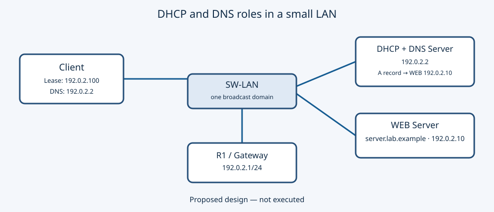

# CCNA IS-03 — نقش DHCP و DNS در شبکه

**سطح:** CCNA. **پیش‌نیاز:** NF-13. **هدف رسمی:** `4.3` توضیح نقش DHCP و DNS در شبکه. **وضعیت:** بازبینی محتوایی این نوبت؛ کفایت متن برای Objective توضیحی کافی ارزیابی شد. سناریو طراحی‌شده و اجرا‌نشده؛ مدل/نسخهٔ سرور انتخاب نشده است.

## اهداف

نقش DHCP در تخصیص پویای پارامترهای شبکه و نقش DNS در نام‌یابی/Resolve را توضیح دهید؛ DORA و رکوردهای پرکاربرد را تشخیص دهید و علت خطای «IP کار می‌کند، نام نه» را از خطای دریافت Lease جدا کنید.

## ۱. DHCP: تخصیص پارامترهای شبکه

**DHCPv4** به Client پارامترهایی مانند IPv4، Subnet Mask، Default Gateway، DNS Server و Lease Time می‌دهد. در یک Lease اولیهٔ معمول، چرخهٔ **DORA** چنین است:

| گام | فرستنده → گیرنده | کار |
|---|---|---|
| Discover | Client → سرورهای قابل‌دسترسی (ابتدا Broadcast) | یافتن سرور DHCP |
| Offer | Server → Client/Relay | پیشنهاد آدرس و Options |
| Request | Client → سرورها/Relay | درخواست یک Offer مشخص |
| Acknowledgment (ACK) | Server → Client/Relay | تأیید Lease و Options |

این خلاصه چرخهٔ آغاز Lease است؛ Renew/Rebind و رفتارهای خاص در RFC/پیاده‌سازی جزئیات بیشتری دارند. DHCP Server از **Scope**، Exclusion/Reservation و Policy برای تخصیص استفاده می‌کند. Lease موقت است و Client باید آن را تمدید کند.

Options مهم DHCPv4:

- **Option 1**: Subnet Mask؛
- **Option 3**: Router/Default Gateway؛
- **Option 6**: DNS Server؛
- **Option 15**: Domain Name، اگر در Scope تنظیم شود.

Server می‌تواند روی همان Subnet Client باشد یا روی Subnet دیگری. Router عادی Broadcast را Forward نمی‌کند؛ در حالت دوم Relay درخواست را به سرور مشخص می‌فرستد و آدرس رابط Client-facing خود را در اطلاعات Relay می‌گذارد تا Server Scope درست را انتخاب کند. Relay جای DHCP Server نیست.

## ۲. DNS: نام‌یابی و Resolve

**DNS** نام‌های دامنه را از طریق Resource Record به داده‌هایی مانند آدرس IP نگاشت می‌کند. Client معمولاً از **Stub Resolver** خود، Resolver پیکربندی‌شده را می‌پرسد؛ Resolver ممکن است پاسخ را از Cache بدهد یا در حالت Recursive از DNSهای دیگر بازیابی کند. در پایان، پاسخ هم با TTL در Cache ذخیره می‌شود. این مسیر الزاماً یک جست‌وجوی مستقیم از Client تا Authoritative Server نیست.

| رکورد | کاربرد معمول |
|---|---|
| `A` | نام به IPv4 |
| `AAAA` | نام به IPv6 |
| `CNAME` | Alias به نام Canonical دیگر؛ مقصد نهایی را به‌تنهایی مشخص نمی‌کند |
| `MX` | سرورهای دریافت ایمیل برای دامنه |
| `PTR` | Reverse Lookup از آدرس به نام |

در DNS معمولاً UDP/53 برای Query/Responseهای کوچک و TCP/53 نیز، از جمله برای پاسخ‌های بزرگ/انتقال Zone، به‌کار می‌رود؛ نیاز دقیق به نوع Query، نسخه و سیاست DNS بستگی دارد. DNS نام را Resolve می‌کند؛ DHCP پارامتر شبکه را تحویل می‌دهد و از طریق Option 6 می‌تواند آدرس Resolver را به Client اعلام کند. این دو سرویس مکمل‌اند، نه جایگزین.

**تشخیص اولیه:** اگر اتصال به یک IP مجاز کار می‌کند ولی نام Resolve نمی‌شود، Resolver/Option 6، رکورد، Suffix و Cache را بررسی کنید؛ هنوز نتیجه نگیرید که حتماً خود DNS Server خراب است. اگر Client Lease ندارد، مسیر DORA، Scope، Relay، VLAN، فیلترها و دسترس‌پذیری Server را بررسی کنید.

## ۳. سناریوی طراحی‌شده

**طرح مستقل PNETLab، طراحی‌شده و اجرا‌نشده:** یک LAN ایزوله شامل Router/Gateway، Client، Web Server و یک VM/Service Node که DHCPv4 و DNS محلی ارائه می‌کند. هیچ اتصال به اینترنت یا شبکهٔ واقعی نسازید. نوع سیستم‌عامل/سرویس DHCP-DNS و نسخهٔ آن انتخاب نشده؛ در سناریوی واقعی باید همان را ثبت کنید. اگر Image آمادهٔ PNETLab این سرویس‌ها را ندارد، نتیجه را «با این Image قابل اجرا نبود» ثبت کنید، نه این‌که Router را بدون پیکربندی به‌عنوان DNS Server فرض کنید.



| گره | رابط/آدرس نمونه | نقش/تنظیم مورد انتظار |
|---|---|---|
| R1 | `Gi0/0 — 192.0.2.1/24` | Gateway شبکه؛ DHCPv4 Server/Relay بودنش فرض نشده است |
| Client | `192.0.2.100/24` نمونهٔ Lease | Gateway `192.0.2.1`؛ DNS `192.0.2.2` از Option 6 |
| SVC-DNS-DHCP | `192.0.2.2/24` | DHCP Scope `192.0.2.0/24` و DNS Zone آزمایشگاهی `lab.example` |
| WEB | `192.0.2.10/24` | رکورد `server.lab.example` → `192.0.2.10` |

همهٔ آدرس‌های `192.0.2.0/24` برای مستندسازی‌اند و فقط در Lab ایزوله استفاده شوند. در Scope، آدرس‌های Gateway، Server و Web از تخصیص پویا مستثنا باشند؛ رنج نمونه برای Client می‌تواند `192.0.2.100–149` باشد.

## ۴. شواهد و نمونه‌های آموزشی

**نمونه‌های ساختگی، نه Capture واقعی؛** قالب فرمان‌ها به سیستم‌عامل Client و نسخهٔ ابزار وابسته است:

```text
Windows> ipconfig /all
IPv4 Address . . . . . . . . . . : 192.0.2.100
Subnet Mask . . . . . . . . . . : 255.255.255.0
Default Gateway . . . . . . . . : 192.0.2.1
DNS Servers . . . . . . . . . . : 192.0.2.2
```

```text
Client> nslookup server.lab.example 192.0.2.2
Name:    server.lab.example
Address: 192.0.2.10
```

نتیجهٔ `ping server.lab.example` تنها نشان می‌دهد نام در آن لحظه به IP تبدیل شده و آن IP به Ping پاسخ داده است؛ عملکرد وب‌اپ یا همهٔ مراحل DNS را ثابت نمی‌کند. Clientهای Linux، Windows و VPCS فرمان‌ها و جزئیات خروجی متفاوت دارند.

## ۵. کاربرگ تحلیلی/عملی و Troubleshooting

**پیوند رسمی:** Objective `4.3` از نوع Explain است؛ هدف، توصیف نقش دو سرویس و جداسازی نشانه‌هاست، نه پیکربندی IOS. این فعالیت در PNETLab طراحی‌شده و اجرا‌نشده است.

**پیش‌نیازها:** یک Client، یک Gateway، یک Service Node دارای DHCP و DNS، Web Node اختیاری، یک LAN ایزوله و دسترسی به Console/Client CLI. Image/OS/نسخهٔ نرم‌افزار و ابزار DNS را پیش از اجرا ثبت کنید؛ هیچ نسخه‌ای در این درس تأیید نشده است.

### مراحل

1. شبکهٔ ایزوله را مطابق شکل و جدول §۳ بسازید؛ Interface، کابل/Bridge، آدرس‌های Static و نسخهٔ سرویس را ثبت کنید.
2. روی Service Node، Scope را برای `192.0.2.0/24` با Exclusionهای `.1`، `.2` و `.10`، Gateway `.1` و DNS `.2` آماده کنید. رکورد `A` برای `server.lab.example` را به `.10` بگذارید. روش تنظیم Server به سیستم‌عامل/محصول وابسته است.
3. Client را روی DHCP قرار دهید. Lease تازه را با ابزار متناسب Image ببینید و IPv4/Mask/Gateway/DNS را با Scope مقایسه کنید؛ برای اثبات DORA در صورت نیاز Packet Capture/Log مجاز را هم ثبت کنید.
4. از Client با Resolver مشخص، رکورد را با `nslookup`/`dig` یا ابزار موجود Query کنید؛ آدرس برگشتی را یادداشت کنید.
5. IP مجاز WEB را مستقیم Ping و سپس نام را Resolve/Ping کنید. نتیجه‌ها را جدا ثبت کنید؛ Ping مستقیم به IP، DNS را نمی‌آزماید.
6. **نقص کنترل‌شدهٔ DNS:** فقط روی Client آزمایش، DNS Server را موقتاً به آدرس نامعتبر تغییر دهید؛ Query نام باید شکست بخورد درحالی‌که آزمون مستقیم IP ممکن است همچنان موفق باشد. DNS را به `.2` برگردانید و پاسخ درست را دوباره ثبت کنید.
7. **نقص اختیاری DHCP:** فقط در لاب دورریختنی، Scope را موقتاً غیرفعال یا مسیر Client به Server را مسدود کنید؛ Lease را Renew کنید و نتیجه را ثبت کنید، سپس تنظیمات را برگردانید. هیچ DHCP Server عملیاتی را تغییر ندهید.

### Troubleshooting

| نشانه | بررسی مرحله‌ای |
|---|---|
| Client آدرس نگرفته | VLAN/لینک، وضعیت Client، Scope آزاد، Exclusions، DORA Log/Capture، Relay در صورت Subnet جدا، ACL/Firewall |
| آدرس دارد ولی Gateway غلط است | Option 3/Scope، Reservation و Lease قبلی |
| IP مقصد پاسخ می‌دهد ولی نام نه | Option 6، IP Resolver، Zone/Record، Suffix، Cache، UDP/TCP 53 و Firewall |
| نام به IP غیرمنتظره می‌رسد | پاسخ Authoritative/Cache، TTL، رکورد CNAME/A/AAAA و Resolver پرسیده‌شده |
| نام Resolve می‌شود ولی سرویس در دسترس نیست | TCP/پورت برنامه، Route، Firewall و خود برنامه را جدا از DNS بررسی کنید |

**معیار موفقیت/تحویل:** (۱) اجزای DORA و نقش Lease/Options را توضیح می‌دهید؛ (۲) Client یک Lease هم‌خوان با Scope دریافت می‌کند؛ (۳) Option 3 و 6 را از شاهد Client تشخیص می‌دهید؛ (۴) رکورد `A` با Resolver مشخص به آدرس WEB می‌رسد؛ (۵) نقص DNS را از نقص IP/DHCP تفکیک و پس از بازگردانی موفقیت را ثبت می‌کنید؛ (۶) تفاوت نمونهٔ طراحی‌شده با Capture واقعی مشخص است. این سناریو هنوز اجرا نشده است.

## ۶. پرسش و پاسخ

1. **DHCP چه نقشی دارد؟** تخصیص خودکار آدرس و پارامترهایی مانند Mask، Gateway، DNS و Lease.
2. **DORA چیست؟** Discover، Offer، Request، Acknowledgment در Lease اولیهٔ معمول DHCPv4.
3. **Option 3 و Option 6 چه می‌دهند؟** Gateway و DNS Server.
4. **Lease چیست؟** بازهٔ زمانی تخصیص که Client باید تمدید کند.
5. **Relay چرا لازم می‌شود؟** برای رساندن پیام DHCP از Broadcast Domain کلاینت به Server در Subnet دیگر.
6. **DNS چه می‌کند؟** نام را با Resource Record به داده‌ای مثل IPv4/IPv6 Resolve می‌کند.
7. **A و AAAA چه تفاوت دارند؟** IPv4 در برابر IPv6.
8. **CNAME چیست؟** Alias به نام دیگر؛ خودِ آن لزوماً IP نیست.
9. **اگر IP کار کند ولی نام نه، کجا را بررسی می‌کنید؟** Resolver/Option 6، رکورد، Suffix و Cache.
10. **آیا Resolve شدن نام، سلامت برنامه را اثبات می‌کند؟** خیر؛ فقط پاسخ DNS را نشان می‌دهد.
11. **آیا این سناریو اجرا شده است؟** خیر.

## واژه‌نامه و چک‌لیست

DHCP: تخصیص پویای پارامتر؛ DORA: چرخهٔ Lease اولیه؛ Relay: میانجی DHCP بین Subnetها؛ DNS: نام‌یابی؛ Resolver: پرس‌وجوی DNS؛ RR: Resource Record؛ TTL: زمان Cache.

- [ ] نقش DHCP را از DNS جدا می‌کنم.
- [ ] DORA و Options 3/6 را توضیح می‌دهم.
- [ ] رکوردهای A/AAAA/CNAME/MX/PTR را از هم تفکیک می‌کنم.
- [ ] خطای Lease را از خطای DNS و خطای برنامه جدا می‌کنم.

## منابع فنی

- [RFC 2131 — Dynamic Host Configuration Protocol](https://www.rfc-editor.org/rfc/rfc2131.html)
- [RFC 2132 — DHCP Options and BOOTP Vendor Extensions](https://www.rfc-editor.org/rfc/rfc2132.html)
- [RFC 1034 — Domain Names: Concepts and Facilities](https://www.rfc-editor.org/rfc/rfc1034.html)
- [RFC 1035 — Domain Names: Implementation and Specification](https://www.rfc-editor.org/rfc/rfc1035.html)
