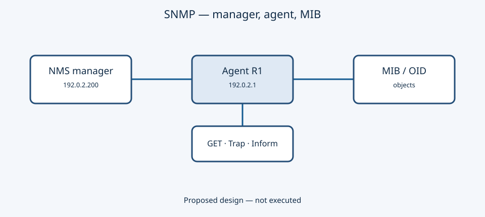

# CCNA IS-04 — نقش SNMP در عملیات شبکه

**سطح:** CCNA. **پیش‌نیاز:** NF-08. **هدف رسمی:** `4.4` توضیح کارکرد SNMP در عملیات شبکه. **وضعیت:** بازبینی محتوایی این نوبت؛ کفایت متن برای Objective توضیحی کافی ارزیابی شد. سناریو و فرمان‌ها طراحی‌شده و اجرا‌نشده‌اند؛ مدل/نسخهٔ IOS و NMS انتخاب نشده‌اند.

## اهداف

اجزای SNMP را بشناسید، تفاوت Poll و Trap/Inform را توضیح دهید و نسخه‌ها و مسئلهٔ امنیتی آن‌ها را مقایسه کنید.

## ۱. اجزای SNMP و عملیات

**SNMP** پروتکلی برای پایش/مدیریت دستگاه‌هاست: **Manager** یا NMS درخواست و پاسخ را هماهنگ می‌کند؛ **Agent** روی دستگاه مدیریت‌شده به درخواست پاسخ می‌دهد یا Notification می‌فرستد؛ **MIB** مدلِ اشیا و نوع‌های دادهٔ قابل دسترسی است؛ **OID** شناسهٔ درختیِ یک شیء. MIB را با خودِ مقادیر جاری دستگاه یکی نگیرید؛ مقدار خوانده‌شده از Agent است.

| عملیات | آغازگر → گیرنده | کاربرد و قید |
|---|---|---|
| GET | Manager → Agent | خواندن یک یا چند OID |
| GETNEXT | Manager → Agent | رفتن به OID بعدی در پیمایش درخت |
| GETBULK | Manager → Agent | دریافت کارآمدتر مجموعه‌ای از OIDها؛ از SNMPv2c به بعد |
| SET | Manager → Agent | درخواست تغییر یک شیء؛ دسترسی نوشتن پرخطر است و باید محدود شود |
| RESPONSE | Agent → Manager | پاسخ به درخواست Manager |
| TRAP | Agent → Manager | Notification بدون تأیید دریافت در لایهٔ SNMP؛ ممکن است گم شود |
| INFORM | Manager یا Agent → همتا | Notification تأییدخواه؛ گیرنده پاسخ می‌دهد و فرستنده می‌تواند آن را دوباره بفرستد |

**Poll** نام یک برنامهٔ زمان‌بندی‌شده از درخواست‌های Manager است، نه PDU جداگانه: NMS مثلاً هر چند دقیقه GET می‌فرستد تا Counter یا وضعیت را بخواند. Trap/Inform برای رویداد مناسب‌اند. Trapهای UDP تضمین تحویل ندارند؛ Inform تأیید می‌گیرد اما باز هم جای طراحی پایش و مسیر قابل‌اعتماد را نمی‌گیرد.

## ۲. Poll در برابر Notification

| روش | جهت معمول | مناسب برای | محدودیت |
|---|---|---|---|
| Poll (GET/GETBULK) | Manager → Agent | روند، Counterها و وضعیت دوره‌ای | بار و فاصلهٔ نمونه‌برداری؛ رخداد میان دو Poll ممکن است دیر دیده شود |
| Trap | Agent → Manager | اعلان رخداد | بدون تأیید دریافت SNMP؛ ممکن است در مسیر گم شود |
| Inform | Agent/Manager → گیرنده | Notification نیازمند تأیید | نیازمند پشتیبانی و تنظیم هر دو طرف؛ تأخیر/تکرار را در طراحی در نظر بگیرید |

به‌طور معمول درخواست‌ها/پاسخ‌ها از UDP **161** و Notificationها به UDP **162** در NMS می‌روند؛ ACL/Firewall باید جهت، مبدأ و مقصد درست را اجازه دهد. پورت و Transport واقعی را در تنظیمات همان محصول بررسی کنید.

## ۳. نسخه‌ها و امنیت

| نسخه | امنیت دسترسی | نکتهٔ عملیاتی |
|---|---|---|
| SNMPv1 | Community؛ بدون محرمانگی پیام | قابلیت‌های پایه و محدودیت نسخه |
| SNMPv2c | Community؛ بدون رمزنگاری و احراز هویت رمزنگارانه | GETBULK و Inform؛ Community روی مسیر امن‌نشده راز محسوب نمی‌شود |
| SNMPv3 | مدل امنیتی کاربرمحور؛ می‌تواند احراز هویت و محرمانگی فراهم کند (`authPriv`) | روش و الگوریتم‌های پشتیبانی‌شده باید با NMS/Agent هماهنگ شوند؛ `noAuthNoPriv` یا `authNoPriv` معادل رمزنگاری کامل نیست |

در v1/v2c، Community در متن آشکار حمل می‌شود؛ «RO» فقط اجازهٔ نوشتن را محدود می‌کند و محرمانگی ایجاد نمی‌کند. در محیط واقعی SNMPv3 با `authPriv` را در صورت پشتیبانی ترجیح دهید، دسترسی را به NMSهای مشخص محدود کنید و Secret را در مخزن مجاز نگه دارید. مثال v2c پایین فقط برای شبکهٔ کاملاً ایزوله است و نباید Community نمونه را روی تجهیز واقعی به‌کار برد.

## ۴. سناریوی طراحی‌شده

**طرح PNETLab مستقل، طراحی‌شده و اجرا‌نشده:** تنها یک روتر Agent و یک گرهٔ مدیریت در شبکهٔ آزمایشگاهی مجزا؛ هیچ اتصال به شبکهٔ سازمان یا اینترنت نسازید. Image روتر، NMS، نسخهٔ سیستم‌عامل و نسخهٔ Net-SNMP هنوز انتخاب/اعتبارسنجی نشده‌اند. ثبت آن‌ها شرط شروع اجراست.



```text
NMS / Linux tools 192.0.2.200/24 ── SW-LAB ── R1 Gi0/0 192.0.2.1/24 (Agent)
```

| گره | رابط/آدرس نمونه | نقش |
|---|---|---|
| R1 | `Gi0/0 — 192.0.2.1/24` | Agent؛ OIDها و Notificationها |
| NMS | `eth0 — 192.0.2.200/24` | Manager؛ Poll و دریافت Trap/Inform |
| SW-LAB | لایهٔ ۲، بدون Gateway بیرونی | اتصال ایزولهٔ دو گره |

آدرس‌های `192.0.2.0/24` مستنداتی‌اند. برای Poll از میزبان مدیریتی با ابزار سازگار با Net-SNMP استفاده می‌شود؛ در نسخهٔ واقعی، نام Image و نسخهٔ `snmpget`/`snmpwalk`/`snmptrapd` را ثبت و Firewall میزبان را برای UDP 161/162 به‌طور محدود تنظیم کنید.

### پیکربندی نمونهٔ Agent (v2c فقط برای لاب ایزوله)

```text
configure terminal
interface GigabitEthernet0/0
 ip address 192.0.2.1 255.255.255.0
 no shutdown
access-list 10 permit host 192.0.2.200
snmp-server community LAB-ONLY-CHANGE ro 10
snmp-server host 192.0.2.200 version 2c LAB-ONLY-CHANGE
snmp-server enable traps
end
```

این Syntax/پشتیبانی اجرا نشده و وابسته به IOS/Feature Set است. Community نمونه عمداً راز امنی نیست و در Config به‌صورت قابل‌خواندن ذخیره می‌شود؛ فقط در لاب دورریختنی استفاده‌اش کنید. برخی پلتفرم‌ها برای رویدادهای رابط به فعال‌سازی Notification مشخص، مثلاً link up/down، نیاز دارند؛ نام Trap و نحو آن را از راهنمای Image هدف بگیرید. در محیط واقعی SNMPv3 `authPriv` و محدودیت دسترسی را طراحی کنید، نه Community نمونه.

## ۵. کاربرگ مستقل و Troubleshooting

**هدف و پیوند رسمی:** برای هدف `4.4` مسیر Manager/Agent، Poll و Notification را توضیح دهید؛ یک OID را بخوانید و تفاوت Trap/Inform و اثر ACL/Community را با شاهدهای لاب تفسیر کنید. این کاربرگ، سناریوی طراحی‌شده است و برای اثبات رفتار IOS باید روی نسخهٔ انتخابی اجرا شود.

**تجهیزات و پیش‌نیاز:** یک Router دارای SNMP Agent، یک NMS Linux یا هم‌ارز با Net-SNMP، یک اتصال لایهٔ ۲، Console و مجوز کار روی Image مشخص. نسخه/مدل هنوز تعیین نشده؛ اگر ابزار یا Trap receiver در Image موجود نیست، ثبت کنید «این لاب با این Image قابل اجرا نبود»، ابزار دیگری را بی‌ثبت فرض نکنید.

### گام‌ها و شواهد

1. پروژهٔ PNETLab را ایزوله بسازید؛ مدل/نسخهٔ روتر، سیستم‌عامل NMS، نسخهٔ ابزار و کابل/Interface واقعی را ثبت کنید.
2. مطابق جدول §۴ آدرس‌دهی کنید؛ `show ip interface brief` و Ping دوطرفه را فقط برای عیب‌یابی IP به‌کار ببرید. Ping به‌تنهایی SNMP را ثابت نمی‌کند.
3. ACL 10 را فقط برای مبدأ NMS بسازید؛ پیکربندی v2c §۴ را در لاب وارد کنید. در دستگاه واقعی از Community نمونه استفاده نکنید.
4. روی NMS، در صورت نصب Net-SNMP، این Poll نمونه را اجرا کنید:

   ```text
   snmpget -v2c -c LAB-ONLY-CHANGE 192.0.2.1 1.3.6.1.2.1.1.1.0
   ```

   این OID به `sysDescr.0` اشاره می‌کند؛ پاسخ واقعی و نام/مقادیر آن Image‌محور است. متن دقیق واقعی را ذخیره نکنید اگر اطلاعات دارایی را افشا می‌کند.
5. روی روتر، `show snmp`، `show access-lists 10` و مشاهدهٔ بخش SNMP در Running Configuration را ثبت کنید. این فرمان‌ها فقط وضعیت/تنظیم را نشان می‌دهند؛ دریافت Poll را NMS باید ثابت کند.
6. اگر Trap receiver و روتر از رویداد Link Notification پشتیبانی کردند، در لابِ قابل‌بازگشت رابط آزمایشی را Down/Up کنید؛ NMS باید Notification مرتبط را دریافت کند. اگر تنظیم Trap subtype لازم بود، آن را مطابق راهنمای IOS ثبت کنید. نام و زمان دقیق پیام ثابت نیست.
7. **نقص کنترل‌شده:** فقط در Lab، Community در یک سمت را موقتاً متفاوت کنید یا ACL را طوری تغییر دهید که NMS مجاز نباشد؛ Poll معتبر نباید پاسخ موفق بدهد. سپس Config را به حالت پایه برگردانید و Poll موفق را دوباره ثبت کنید.
8. برای Inform، پشتیبانی Agent/NMS و تنظیم دو سمت را جداگانه بررسی کنید؛ نبودِ Inform در این تمرین پایه، نتیجهٔ شکست Trap/Poll نیست.

### خروجی آموزشی مورد انتظار — نمونه نیست مگر آن‌که Capture شود

| آزمون | شاهد مورد انتظار | محدودیت |
|---|---|---|
| Poll `sysDescr.0` | پاسخ SNMP با OID/نوع/مقدار برگشتی از Agent | مقدار/قالب به Image و MIB بستگی دارد |
| ACL 10 | شمارندهٔ مبدأ `192.0.2.200` پس از درخواست، اگر پلتفرم شمارنده ارائه دهد | شمارنده به‌تنهایی پاسخ صحیح را ثابت نمی‌کند |
| Trap link event | Notification مرتبط در NMS، در صورت پشتیبانی و فعال بودن نوع Trap | نبود پیام ممکن است از تنظیم Agent، مسیر UDP 162 یا receiver باشد |
| Community/ACL نادرست | درخواست بی‌پاسخ/خطای دسترسی و بازگشت به حالت موفق پس از اصلاح | پاسخ خطای دقیق و Log به Agent/NMS وابسته است |

### Troubleshooting

| نشانه | بررسی مرحله‌ای |
|---|---|
| Poll پاسخ نمی‌دهد | آدرس/Route و دسترسی لایهٔ ۳؛ UDP 161؛ Community/version دو طرف؛ ACL 10 و ACL/View عامل؛ OID معتبر و سرویس Agent |
| Trap دیده نمی‌شود ولی Poll کار می‌کند | `snmp-server host`، مقصد NMS، UDP 162، مسیر برگشت/Firewall، Trap subtype و Trap receiver |
| فقط بعضی OIDها پاسخ می‌دهند | OID پشتیبانی‌شده، MIB/Context، دسترسی View و نسخه را جدا بررسی کنید |
| v2c ظاهراً کار می‌کند ولی امن نیست | Community محرمانه نیست؛ دسترسی را محدود و برای محیط واقعی SNMPv3 `authPriv` را ارزیابی کنید |

**معیار موفقیت/تحویل:** (۱) نام و نسخهٔ همهٔ Imageها ثبت شده؛ (۲) NMS فقط از آدرس مجاز Poll می‌کند؛ (۳) یک OID با پاسخ واقعی و بدون افشای راز ثبت شده؛ (۴) یک آزمون Notification یا دلیل مستند عدم‌پشتیبانی آن ثبت شده؛ (۵) خطای Community/ACL کنترل‌شده و بازیابی مستند شده؛ (۶) خطر v2c و تفاوت Trap/Inform توضیح داده شده است. تا اجرای مجاز، همهٔ فرمان‌ها، خروجی‌ها و نتایج این بخش **طراحی‌شده و اجرا‌نشده** هستند.

## ۶. سؤال‌ها و پاسخ

1. **SNMP چیست؟** پروتکل پایش و مدیریت.
2. **Manager چیست؟** ایستگاه NMS.
3. **Agent چیست؟** نرم‌افزار روی دستگاه.
4. **MIB چیست؟** پایگاه دادهٔ اشیا.
5. **OID چیست؟** شناسهٔ یکتا.
6. **GET چه می‌کند؟** خواندن مقدار.
7. **Trap چیست؟** اعلان بدون تأیید.
8. **Inform چیست؟** اعلان با تأیید.
9. **Poll چگونه است؟** دوره‌ای.
10. **Community String چیست؟** راز اشتراکی در SNMPv1/v2c؛ محرمانگی ندارد.
11. **SNMPv3 `authPriv` چه می‌دهد؟** احراز هویت و محرمانگی پیام، اگر Agent/NMS همان روش را پشتیبانی و تنظیم کنند.
12. **GETBULK برای چیست؟** پیمایش کارآمدتر مجموعه‌ای از OIDها در نسخه‌های پشتیبان.
13. **UDP 161 و 162 در طراحی رایج چه نقشی دارند؟** درخواست/پاسخ Agent و دریافت Notification در NMS.
14. **آیا این سناریو اجرا شده است؟** خیر.

## واژه‌نامه و چک‌لیست

SNMP: پایش و مدیریت؛ MIB: تعریف اشیا؛ OID: شناسهٔ شیء؛ Trap: Notification بدون تأیید SNMP؛ NMS: سیستم مدیریت.

- [ ] Poll را از Trap/Inform تفکیک می‌کنم.
- [ ] GETBULK را فقط از نسخهٔ پشتیبان انتظار دارم.
- [ ] Community را در v1/v2c راز رمزنگاری‌شده نمی‌دانم.
- [ ] SNMPv3 `authPriv` را با پشتیبانی دو طرف می‌سنجم.

## منابع فنی

- [RFC 3411 — SNMP Management Framework](https://www.rfc-editor.org/rfc/rfc3411.html)
- [RFC 3416 — SNMP Protocol Operations (GET, GETNEXT, GETBULK, SET, Inform)](https://www.rfc-editor.org/rfc/rfc3416.html)
- [RFC 3414 — User-based Security Model for SNMPv3](https://www.rfc-editor.org/rfc/rfc3414.html)

نحو CLI و Trapهای قابل پشتیبانی را باید از Command Reference همان مدل/نسخهٔ IOS و NMS گرفت.
