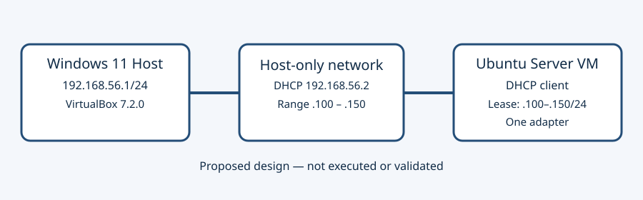

# ۰.۸ — ساخت VM و بررسی ارتباط

**سطح:** مقدماتی؛ محتوای عمومی تکمیلی. **پیش‌نیاز:** ۰.۴ و ۰.۷. **وضعیت:** طراحی‌شده و اجرا‌نشده. مبنای طراحی: Oracle VirtualBox 7.2.0 روی Windows 11 x86-64 و مهمان Ubuntu Server 24.04.3 LTS amd64. سازگاری در مستندات رسمی بررسی شده، اما این ترکیب اجرا و اعتبارسنجی نشده است. فقط میزبان آزمایشی مستقل و مجاز، نه VM یا LAB فعلی.

## اهداف

دانشجو طرح منابع و اتصال یک VM مستقل را تهیه کند، Host-only، NAT و Bridged را پیش از انتخاب محصول مقایسه کند، بررسی غیرمخرب ارتباط را طراحی کند و خروجی مورد انتظار را از مشاهدهٔ واقعی جدا نگه دارد.

## ۱. پیش از ساخت

Hypervisor، Guest، vCPU، دیسک مجازی و Virtual Switch از درس ۰.۷ می‌آیند. Host باید ظرفیت کافی، مجوز استفاده و راه بازیابی مناسب داشته باشد. به سرویس واقعی یا شبکهٔ سازمانی بدون مجوز متصل نشوید. تصویر سیستم‌عامل باید از منبع مورد اعتماد و سازگار با مجوز و معماری انتخاب شود؛ این سند هیچ تصویری را تأیید نمی‌کند.

| نوع اتصال | کاربرد متداول | ریسک و بررسی |
|---|---|---|
| Host-only | ارتباط VM و شبکهٔ میزبان‌محور، بسته به محصول | مسیرها و اشتراک‌ها ممکن است راه دیگری بسازند؛ ایزولاسیون را بررسی کنید |
| NAT | خروجی VM از طریق ترجمهٔ آدرس محیط میزبان | NAT کنترل امنیتی کامل نیست؛ قوانین ورودی و خروجی و اشتراک‌ها بررسی شوند |
| Bridged | اتصال VM به شبکهٔ خارجی متصل | VM ممکن است برای سایر دستگاه‌ها قابل مشاهده باشد؛ بدون مجوز به شبکهٔ عملیاتی وصل نکنید |

Host-only در تنظیم عادی VirtualBox یک شبکه بین Host و Guestهای متصل به همان شبکه می‌سازد و **به‌صورت پیش‌فرض مسیر اینترنت ایجاد نمی‌کند**. NAT معمولاً مسیر خروجی از طریق ترجمهٔ آدرس میزبان ایجاد می‌کند؛ Bridged، VM را به شبکهٔ رابط فیزیکی متصل می‌کند. هیچ‌کدام ایزولاسیون مطلق یا فایروال کامل را تضمین نمی‌کند: مسیریابی اضافه، اشتراک اتصال، فایروال و سایر رابط‌ها می‌توانند نتیجه را تغییر دهند.

## ۲. مبنای نسخه و سناریوی ایزوله

در مستند Oracle برای خانوادهٔ ۷.۲، Windows 11 x86-64 به‌عنوان Host و Ubuntu 24.04 LTS x86-64 به‌عنوان Guest فهرست شده‌اند. این تطبیقِ معماری، تضمین سازگاری سخت‌افزار، درایور، امنیت یا کارکرد در محیط شما نیست. VirtualBox 7.2.0 برای این کاربرگ انتخاب شده؛ تاریخ و نسخه باید هنگام اجرای واقعی ثبت شوند. سیستم‌های ARM و macOS خارج از این کاربرگ‌اند.

منابع رسمی بازبینی‌شده در ۲۰۲۶-۱۱-۲۰: [مستند VirtualBox 7.2.0](https://download.virtualbox.org/virtualbox/7.2.0/UserManual.pdf)، [سازگاری Host و Guest در راهنمای Oracle 7.2](https://docs.oracle.com/en/virtualization/virtualbox/7.2/user/Introduction.html)، [شبکهٔ Host-only در راهنمای Oracle](https://docs.oracle.com/en/virtualization/virtualbox/7.2/user/networkingdetails.html)، و [نصب پایهٔ Ubuntu Server](https://documentation.ubuntu.com/server/tutorial/basic-installation). برای دانلود از منابع رسمی و اعتبارسنجی checksum و امضای منتشرشده توسط عرضه‌کننده استفاده کنید؛ فایل ISO دانلود یا بررسی نشده است.



| مورد | مقدار طراحی‌شده، اجرا‌نشده |
|---|---|
| Host | Windows 11 x86-64، میزبان آزمایشی مستقل |
| Hypervisor | Oracle VirtualBox 7.2.0 |
| Guest | Ubuntu Server 24.04.3 LTS amd64، ISO رسمی |
| VM | `FAM-Zero-08`؛ یک کارت شبکه |
| منابع نمونه | ۲ vCPU، ۲ GiB RAM، دیسک مجازی پویا ۲۰ GiB؛ به شرط کفایت Host و مستند تصویر |
| شبکه | Host-only؛ Host `192.168.56.1/24`؛ DHCP فرضی `192.168.56.2`، محدوده `192.168.56.100–150` |

آدرس‌ها فقط نمونه‌اند. ابتدا نبود تداخل با شبکه‌ها و مسیرهای Host بررسی شود؛ اگر تداخل وجود دارد اجرای تمرین متوقف و محدودهٔ مستقل با رعایت محدودیت محصول انتخاب شود. Host-only شامل Host نیز هست و ایزولاسیون مطلق نیست. کارت اضافی NAT/Bridged، پوشهٔ اشتراکی و Clipboard مشترک برای این تمرین فعال نشوند. این کاربرگ داخل VM، LAB یا دستگاه عملیاتی موجود اجرا نمی‌شود.

## ۳. کاربرگ VirtualBox 7.2.0

**تمام مراحل و فرمان‌ها طراحی‌شده و اجرا‌نشده‌اند.** به نصب VirtualBox مجاز بر یک Host مستقل و ISO رسمی تأییدشده نیاز دارید. نصب Hypervisor یا تغییر Firmware میزبان جزو این تمرین نیست؛ فعال‌بودن مجازی‌سازی سخت‌افزاری و ظرفیت را از قبل با مسئول Host بررسی کنید.

### آماده‌سازی شبکه

0. در Windows Host آزمایشی و پیش از ساخت شبکه، در CMD بدون افزایش اختیار `ipconfig /all` و `route print -4` را مشاهده کنید. آدرس و ماسک تمام رابط‌ها و مقصد/ماسک مسیرهای IPv4 را با `192.168.56.0/24` مقایسه کنید؛ هم‌پوشانی رنج یا مسیرهای مرتبط ممکن است تداخل بسازد. به Default Route به‌تنهایی به‌عنوان هم‌پوشانی /24 نگاه نکنید: مسیرهای اختصاصی و رابط‌های فعال یا VPN را هم بررسی کنید. در صورت ابهام یا تداخل ادامه ندهید؛ یک رنج مجاز و غیرهم‌پوشان با هماهنگی مسئول انتخاب و کل جدول و DHCP را یکپارچه اصلاح کنید. این فرمان‌ها **پیشنهادی و اجرا‌نشده** هستند.
1. در VirtualBox Manager از **File → Tools → Network Manager** وارد Host-only Networks شوید. یک شبکهٔ جدید آزمایشی ایجاد کنید؛ نام اختصاص‌یافتهٔ Host-only Adapter را ثبت کنید و شبکهٔ موجود سازمانی را تغییر ندهید.
2. در Properties، IPv4 آداپتور میزبان را `192.168.56.1` با ماسک `255.255.255.0` تنظیم کنید. در برگهٔ DHCP Server، سرور را فعال و Server Address را `192.168.56.2`، ماسک را `255.255.255.0` و بازه را `192.168.56.100` تا `192.168.56.150` قرار دهید. وضعیت نمایش‌داده‌شده را ثبت کنید. این مقادیر فرضی‌اند و تا اجرا صحت تنظیم عملی تأیید نشده است.
3. در Host، با ابزار مشاهدهٔ IP بررسی کنید آداپتور جدید آدرس طراحی‌شده دارد؛ در صورت تداخل مسیر یا خطا، ادامه ندهید.

### ساخت و نصب Guest

4. در Manager، **New** را بزنید؛ نام `FAM-Zero-08`، ISO رسمی Ubuntu Server 24.04.3 amd64 و نوع Linux/Ubuntu 64-bit را انتخاب کنید. نصب دستی را انتخاب کنید؛ اگر گزینهٔ **Skip Unattended Installation** نمایش داده می‌شود آن را فعال کنید. نام منو ممکن است با تجربهٔ رابط تفاوت جزئی داشته باشد.
5. ۲ vCPU و ۲۰۴۸ MB RAM و یک دیسک مجازی پویا با ظرفیت ۲۰ GiB اختصاص دهید؛ فقط در صورت وجود منابع کافی. نام، محل دیسک و خلاصهٔ تنظیمات را بررسی و VM را ایجاد کنید.
6. پیش از شروع، در **Settings → Network → Adapter 1**، Enable Network Adapter و **Attached to: Host-only Adapter** را انتخاب و نام آداپتور ساخته‌شده را مشخص کنید. کارت‌های دیگر غیرفعال باشند؛ گزینهٔ Cable Connected بررسی شود.
7. VM را Start کنید. در نصب‌کننده Ubuntu زبان و صفحه‌کلید را انتخاب کنید. رابط شبکه باید در صورت دریافت DHCP آدرس بگیرد؛ در صورت خطا نصب می‌تواند بدون شبکه ادامه پیدا کند، اما آزمون شبکه تا رفع آن موفق نخواهد بود.
8. در بخش Storage، فقط **دیسک مجازی جدید همین VM** را انتخاب کنید. تأیید پارتیشن‌بندی داده‌های آن دیسک را پاک می‌کند؛ اگر هر ابهامی دربارهٔ مقصد دارید متوقف شوید. حساب آزمایشی بسازید؛ از رمز واقعی سازمانی استفاده نکنید. نصب OpenSSH یا بسته‌های اضافه و تغییر مخزن نرم‌افزار لازم نیست.
9. پس از پایان نصب، VM را طبق پیام نصب‌کننده راه‌اندازی مجدد و در صورت درخواست ISO را از درایو مجازی جدا کنید. با حساب آزمایشی وارد شوید.

### بررسی و تفسیر

**فرمان‌های پیشنهادی، اجرا‌نشده:**

```bash
ip -br address
ip route
ping -c 3 192.168.56.1
```

`ip -br address` رابط‌ها و آدرس‌های آن‌ها را خلاصه می‌کند؛ نامی مانند `enp0s3` تضمین‌شده نیست. انتظار طراحی این است که رابط فعال Guest آدرسی در `192.168.56.100–150/24` از DHCP دریافت کند؛ نتیجهٔ واقعی باید ثبت شود. `ip route` مسیرهای نصب‌شده را نشان می‌دهد؛ برای این Host-only وجود Default Route انتظار الزامی نیست. `ping` سه درخواست به Host می‌فرستد؛ پاسخ ممکن است تحت تأثیر فایروال Host یا سیاست ICMP باشد و عدم پاسخ به‌تنهایی قطع لینک را اثبات نمی‌کند.

**نمونهٔ آموزشی، نه خروجی مشاهده‌شده:**

```text
enp0s3   UP   192.168.56.100/24
```

`UP` وضعیت گزارش‌شدهٔ رابط و `192.168.56.100/24` آدرس فرضی آن است. برای آزمون مستقل، جدول نتیجه شامل نام Host و نسخه، نام/نسخهٔ Hypervisor و Guest، تاریخ، آدرس واقعی، خروجی‌ها و نتیجهٔ Ping بدون اطلاعات محرمانه تکمیل شود. تاکنون هیچ نتیجه‌ای ثبت نشده است.

## ۴. عیب‌یابی

| مشاهده | بررسی بعدی | احتیاط |
|---|---|---|
| Guest نصب نمی‌شود | سازگاری تصویر، منابع و پیام محصول | تغییر تنظیمات Host عملیاتی ممنوع |
| رابط در Guest نیست | اتصال کارت مجازی و پشتیبانی Guest | به‌روزرسانی یا نصب درایور با بررسی منبع و مجوز |
| IP نیست | وضعیت رابط، DHCP یا آدرس‌دهی طراحی‌شده | بدون طرح آدرس به شبکهٔ واقعی IP ندهید |
| پاسخ Ping نیست | مقصد، مسیر و فیلتر | عدم پاسخ اثبات قطعی قطع لینک نیست |
| VM به شبکهٔ ناخواسته می‌رسد | حالت اتصال، مسیر و اشتراک‌ها | تمرین را متوقف و از محیط مجاز بررسی کنید |

## ۵. آزمون و پاسخ

1. **Host-only همیشه ایزوله است؟** خیر، مسیرها و تنظیمات محصول باید بررسی شوند.
2. **NAT فایروال کامل است؟** خیر؛ قواعد و سیاست امنیتی جدا لازم است.
3. **Bridged چه ریسکی دارد؟** VM ممکن است روی شبکهٔ متصل دیده شود.
4. **چرا نسخهٔ Guest مهم است؟** نحو ابزار، نیاز منابع و قابلیت‌ها به آن وابسته‌اند.
5. **آیا VM ساخته‌شده در جدول واقعاً وجود دارد؟** خیر، فقط طراحی آموزشی است.
6. **IP وجود ندارد؛ اول چه کنیم؟** رابط، حالت شبکه و روش آدرس‌دهی را بررسی کنیم.
7. **Ping شکست می‌خورد؛ علت قطعی؟** مشخص نیست؛ مقصد، فیلتر و مسیر باید بررسی شوند.
8. **آیا vCPU ظرفیت فیزیکی تضمین‌شده است؟** نه الزاماً؛ سیاست و منابع میزبان مؤثرند.
9. **چرا خروجی را بدون دادهٔ حساس ثبت می‌کنیم؟** برای کاهش ریسک افشا و حفظ شواهد ضروری.
10. **آیا می‌توان بدون مجوز شبکهٔ سازمان را Bridged کرد؟** خیر.
11. **چه زمانی تمرین عملی تأییدشده است؟** پس از اجرا با محصول، نسخه، محیط و شواهد ثبت‌شده و بررسی نتیجه.

## واژه‌نامه و چک‌لیست

Guest: سیستم داخل VM؛ Host-only: اتصال میزبان‌محور؛ NAT: ترجمهٔ آدرس؛ Bridged: اتصال به شبکهٔ مرتبط؛ vCPU: منبع پردازشی ارائه‌شده به Guest.

- [ ] نوع اتصال و خطر آن را پیش از نصب توضیح می‌دهم.
- [ ] پیش از اجرا نسخهٔ انتخاب‌شده و سازگاری واقعی Host را بررسی می‌کنم.
- [ ] نتیجهٔ فرضی را اجراشده نمی‌نامم.
